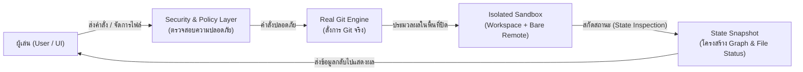

# Git-Diwaa

แนวคิดระบบเกมจำลองการเรียนรู้ Git ด้วยคำสั่ง Git จริง ภายใต้สภาพแวดล้อมที่ปลอดภัยและแยกขาดจากระบบปฏิบัติการ

---

## 💡 แนวคิดหลักของระบบ (Core Concept)

การเรียนรู้ Git ที่มีประสิทธิภาพจำเป็นต้องให้ผู้เรียนได้สัมผัสและฝึกใช้ **Git CLI จริง** แต่การเปิดให้รันคำสั่งโดยตรงมีความเสี่ยงต่อระบบและความซับซ้อนในการตรวจสอบสถานะ 

Git-Diwaa จึงถูกออกแบบขึ้นภายใต้ 3 แนวคิดหลัก:

1. **Real Git Engine:** ใช้ Git จริงประมวลผล เพื่อให้ได้พฤติกรรมและข้อความที่ตรงตามมาตรฐานจริง 100%
2. **Safe & Isolated Sandbox:** กักบริเวณการทำงานทั้งหมดไว้ในพื้นที่ทดลองแยกเฉพาะ ตัดขาดจากระบบไฟล์ของเครื่องและเครือข่ายภายนอก
3. **Decoupled Architecture:** แยก Domain Logic (ระบบความปลอดภัยและสั่งการ Git) ออกจาก Presentation (ส่วนแสดงผลและเกม) อย่างเด็ดขาด

---

## 🧭 แผนภาพภาพรวมแนวคิด (Conceptual Overview)

---

## 📖 รายละเอียดสถาปัตยกรรมเชิงลึก

อ่านรายละเอียดของแนวคิด สถาปัตยกรรมระบบ วงจรข้อมูล และโมเดลความปลอดภัยฉบับเต็มได้ที่:
👉 **[docs/architecture.md](docs/architecture.md)**

แนวคิดการออกแบบเกม (LM-GM, อุปมาโลกเวท, การออกแบบด่าน):
👉 **[docs/game-design.md](docs/game-design.md)**
