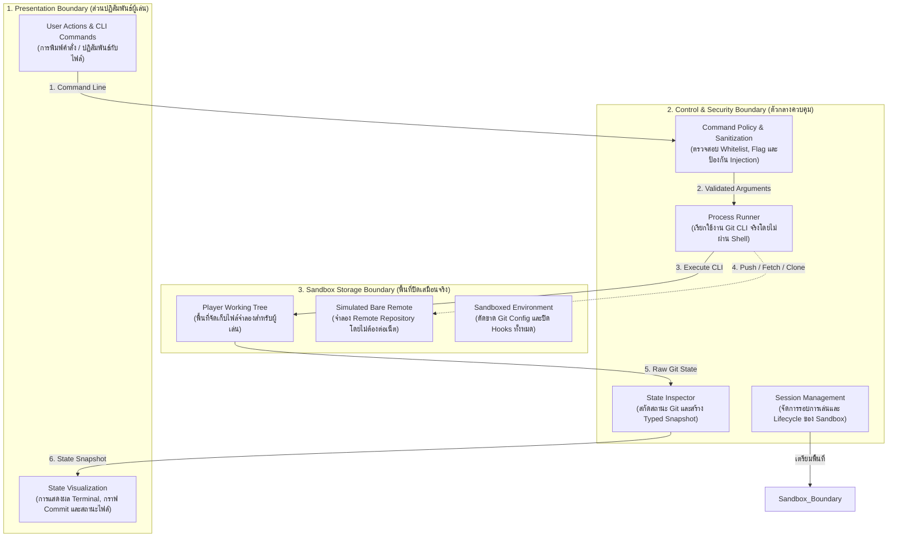
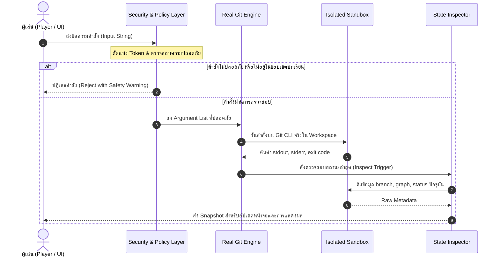
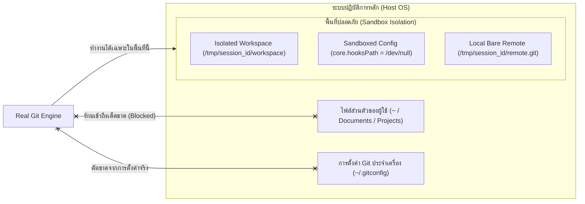

# สถาปัตยกรรมเชิงแนวคิดระบบ Git (System Conceptual Architecture)

เอกสารฉบับนี้อธิบายแนวคิดการออกแบบสถาปัตยกรรม (Conceptual Architecture) ของระบบจำลองการทำงาน Git ในเกม Git-Diwaa โดยเน้นหลักการออกแบบ ความปลอดภัย และการไหลของข้อมูลระหว่างระบบ

---

## 1. ที่มาและปรัชญาของแนวคิด (Design Philosophy)

### ปัญหาของการเรียนรู้ Git ทั่วไป
* **การจำลองด้วย Hardcode / Mockup:** ผู้เรียนไม่ได้สัมผัสข้อความ Error, Warning หรือพฤติกรรม Corner Case ที่เกิดขึ้นจริงบน Git
* **ความเสี่ยงหากใช้ Git ของระบบโดยตรง:** อาจเผลอลบไฟล์ระบบ, กระทบ `.git` ของโปรเจกต์จริง หรือเปิดช่องโหว่ความปลอดภัย (เช่น Command Injection)

### แนวคิดการแก้ไขปัญหาของ Git-Diwaa
ออกแบบระบบสถาปัตยกรรมแบบ **"Real Git in a Controlled Sandbox"** โดยให้มีตัวกลางทำหน้าที่ควบคุม ตรวจสอบ และตัดขาดสภาพแวดล้อมออกจากระบบปฏิบัติการภายนอก

---

## 2. โครงสร้างสถาปัตยกรรมเชิงแนวคิด (Conceptual Architecture)

ระบบแบ่งออกเป็น 4 ขอบเขตแนวคิด (Conceptual Boundaries) ดังแผนภาพ:

---

## 3. แนวคิดการไหลของข้อมูล (Conceptual Data Flow)

การประมวลผลคำสั่งในระบบจะเดินทางผ่านวงจรชีวิตที่เป็นลำดับขั้นเพื่อรับรองความปลอดภัย:

---

## 4. แนวคิดโมเดลความปลอดภัยของ Sandbox (Sandbox Security Concept)

### เสาหลักความปลอดภัย (Core Security Pillars):
1. **Non-Shell Invocation:** สั่งการ process ตรงไปยัง executable `git` โดยไม่ใช้ command shell (`sh`, `bash`, `cmd`) ทำให้ไม่สามารถฝังคำสั่งพ่วง (Command Chaining เช่น `;`, `&&`, `|`) ได้
2. **Directory Jail:** ตรวจสอบ Argument ทุกตัว ห้ามใช้ parameter ที่อ้างอิงเส้นทางออกนอก workspace (เช่น `../` หรือ absolute path)
3. **Zero Configuration Leak:** บังคับให้ Git มองเห็นเฉพาะ config ชั่วคราวที่สร้างขึ้นใหม่ และปิดระบบ Git Hook ทั้งหมดเพื่อป้องกันการรัน Script ที่ไม่พึงประสงค์
4. **Networkless Remote Simulation:** จำลอง Remote ด้วย Local Bare Repository ภายในเครื่อง ทำให้ไม่ต้องเปิดพอร์ตหรือเชื่อมต่ออินเทอร์เน็ต

---

## 5. แนวคิดการแปลงสถานะ (State Snapshot Concept)

การแสดงผลในเกมจะไม่พึ่งพาการอ่าน stdout ของคำสั่ง Git โดยตรง เพราะข้อความ CLI ออกแบบมาให้อ่านด้วยตามนุษย์ ไม่เหมาะกับการนำไปประมวลผลต่อ

ระบบจึงใช้แนวคิด **State Extraction**:
* หลังจากการรันคำสั่งสำเร็จ ระบบจะสั่งคำสั่งตรวจสอบแบบเจาะจง (เช่น `git status --porcelain`, `git log --format=...`)
* นำข้อมูลดิบมาประกอบเป็น **Snapshot Data Structure**:
  * โครงสร้างกิ่ง (Branches) และจุดที่ HEAD ชี้อยู่
  * สถานะไฟล์ (Untracked, Modified, Staged)
  * โหนดของ Commit Tree สำหรับนำไปสร้างภาพกราฟิก

แนวคิดนี้ทำให้ส่วนติดต่อผู้ใช้ (UI) สามารถเปลี่ยนแปลงหรือพัฒนาใหม่ได้อิสระ โดยไม่ต้องแก้ไขตรรกะของระบบ Git ด้านหลัง
