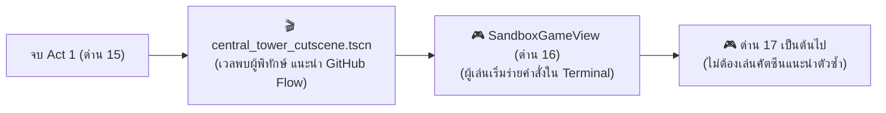

# หอคอยเวทกลาง (Central Tower Intro Cutscene)

เป้าหมาย: ฉากคัตซีนเปิดตัวบทที่ 2 (Act 2: การทำงานเป็นทีม / Teamwork) ก่อนเริ่มด่านที่ 16 (GitHub Flow) โดยเล่าเรื่องราวการก้าวเข้าสู่คลังเวทกลางของเวล และการพบกับผู้พิทักษ์คลังเวทกลางเป็นครั้งแรก พร้อมเกริ่นนำธรรมเนียมการจารึกเวทมนตร์ร่วมกันแบบ **GitHub Flow**

---

## 1. ภาพรวมและโฟลว์การทำงาน (Flow)

ฉากนี้ทำหน้าที่เป็น **Act Transition Cutscene** ที่เล่นเพียงครั้งเดียวในช่วงรอยต่อระหว่าง Act 1 และ Act 2:



* **เมื่อเข้าสู่ฉาก:** จอค่อยๆ สว่างขึ้น เวลเดินเข้ามาจากทางซ้ายหยุดยืนประจันหน้ากับผู้พิทักษ์ที่ยืนรออยู่ทางขวา
* **การพูดคุย:** กล่องข้อความสไตล์ Retro Fantasy ปรากฏขึ้น ตัวอักษรค่อยๆ พิมพ์ทีละตัว (Typewriter Effect)
* **การควบคุม:** ผู้เล่นคลิกหน้าจอ หรือกด Space / Enter เพื่ออ่านบทสนทนาประโยคถัดไป
* **การข้ามฉาก:** สามารถกดปุ่ม **"ข้าม ⏵⏵ (Esc)"** หรือกดปุ่ม `Esc` บนคีย์บอร์ดได้ตลอดเวลา เพื่อตัดเข้าสู่เกมเพลย์ทันที
* **เมื่อจบคัตซีน:** หน้าจอจะค่อยๆ เฟดมืดลง พร้อมปรับระดับเสียง BGM ลงอย่างนุ่มนวล แล้วเปลี่ยน Scene ไปยังด่านเกมเพลย์ที่ระบุใน `@export var next_scene_path`

---

## 2. ทรัพยากรและ Assets ที่ใช้งาน

| หมวดหมู่ | ไฟล์ Asset | รายละเอียด |
|---|---|---|
| **ฉากหลัง** | `res://assets/cutscene/backgrounds/central-tower-Sheet.png` | ห้องโถงหอคอยเวทกลาง (ขนาดเฟรมละ 480×270 พิกเซล, ขยาย Scale 4 เท่าเต็มจอ 1920×1080) |
| **ตัวละครฝั่งซ้าย (เวล)** | `res://assets/cutscene/characters/vel/` | • `vel_Hblue_Sredyellow_idle.png` (ท่ายืน)<br>• `vel_walk_right-Sheet.png` (ท่าเดินเข้าห้อง)<br>• `vel_breathe_blink-Sheet.png` (ท่าหายใจและกระพริบตา)<br>• `vel_shockpng.png` (ท่าตกใจ) |
| **ตัวละครฝั่งขวา (ผู้พิทักษ์)** | `res://assets/cutscene/characters/guardian/` | • `guardian-idle.png` (ท่ายืนนิ่ง)<br>• `guardian-talk-Sheet.png` (ท่าพูด)<br>• `guardian-talk-blink-Sheet.png` (ท่าพูดพร้อมกระพริบตา)<br>• `guardian-breathe-Sheet.png` (ท่าหายใจ) |
| **เอฟเฟกต์ประกอบ** | `res://assets/cutscene/exclamation_mark.png` | ไอคอนตกใจ (!) สีแดงเด้งขึ้นเหนือศีรษะเวล |
| **ฟอนต์ข้อความ** | `res://assets/fonts/TA-8-bit.ttf` | ฟอนต์พิกเซล 8-bit มาตรฐานเดียวกับ Ending Cutscene |

---

## 3. โครงสร้าง Scene และ Node Hierarchy

ไฟล์ Scene อยู่ที่: [`Scenes/cutscene/central_tower_cutscene.tscn`](file:///c:/Users/67030311/Documents/Game-Git-Diwaa/src/GitDiwaa.Godot/Scenes/cutscene/central_tower_cutscene.tscn)

```text
CentralTowerCutscene (Node2D) [Script: central_tower_cutscene.gd]
├── Camera2D (จัดกึ่งกลาง 960, 540)
├── Background (Sprite2D) (central-tower-Sheet, region 480x270, Scale 4x4)
├── Atmosphere (ColorRect) (ฟิลเตอร์เงาบรรยากาศความมืดม่วงโปร่งแสง)
├── Stage (Node2D)
│   ├── Vel (AnimatedSprite2D) [Position: (760, 780), Scale 4x4]
│   │   └── ExclamationMark (Sprite2D) [Position: (0, -60)]
│   └── Guardian (AnimatedSprite2D) [Position: (1320, 780), Scale 4x4, Flip H: true]
└── MagicStoryUI (CanvasLayer: Layer 10)
    ├── SkipButton (Button) [มุมขวาบน สำหรับกดข้ามคัตซีน สไตล์เดียวกับ Ending Cutscene]
    ├── DialogueBox (PanelContainer) [กล่องข้อความกึ่งกลางล่างจอ สไตล์เดียวกับ Ending Cutscene]
    │   └── Margin (MarginContainer)
    │       └── VBox (VBoxContainer)
    │           ├── SpeakerLabel (Label) [ชื่อผู้พูด สีทอง #FFE673, ฟอนต์ TA-8-bit ขนาด 28]
    │           ├── DialogueLabel (Label) [ข้อความคำพูด สีขาวครีม #FAF9F6, ฟอนต์ TA-8-bit ขนาด 26]
    │           └── ContinuePrompt (Label) [คำแนะนำ 'คลิกหน้าจอเพื่อไปต่อ', ฟอนต์ TA-8-bit ขนาด 20]
    └── FadeOverlay (ColorRect) [ม่านจอดำสำหรับเฟดเข้า-ออก]
```

---

## 4. บทสนทนาในฉาก (Dialogue Script)

บทสนทนาถูกจัดเก็บเป็น Array ของ Dictionary ในตัวแปร `DIALOGUES` ภายในสคริปต์ [`central_tower_cutscene.gd`](file:///c:/Users/67030311/Documents/Game-Git-Diwaa/src/GitDiwaa.Godot/Scripts/cutscene/central_tower_cutscene.gd):

| ลำดับ | ผู้พูด | ข้อความบทสนทนา | ท่าทางเวล | ท่าทางผู้พิทักษ์ |
|:---:|:---:|---|:---:|:---:|
| 1 | **ผู้พิทักษ์** | "มาถึงแล้วสินะ ศิษย์ฝึกหัด" | `idle` | `talk_blink` |
| 2 | **เวล** | "ท่านคือ..." | `shock` (!) | `idle` |
| 3 | **ผู้พิทักษ์** | "ข้าคือผู้พิทักษ์คลังเวทกลาง ดูแลบันทึกและความรู้ของจอมเวททุกคนในอาณาจักร นายมาที่นี่เพื่อตามหาเศษคัมภีร์ที่เหลือ ใช่ไหม" | `breathe_blink` | `talk_blink` |
| 4 | **เวล** | "ใช่ครับ" | `idle` | `breathe` |
| 5 | **ผู้พิทักษ์** | "ดี แต่ก่อนจะไปมากกว่านี้ ข้าอยากให้เจ้าได้เรียนรู้การใช้พลัง Git ของเราในการจารึกร่วมกับผู้อื่น" | `breathe_blink` | `talk_blink` |
| 6 | **เวล** | "กฎเหรอครับ?" | `breathe_blink` | `idle` |
| 7 | **ผู้พิทักษ์** | "ไม่ใช่หรอก มันเรียกว่าธรรมเนียมมากกว่า โดยส่วนมากธรรมเนียมเป็นไปตามกำหนดจากเจ้าของคัมภีร์" | `idle` | `talk_blink` |
| 8 | **ผู้พิทักษ์** | "เพราะงั้นนี่คือ..." | `idle` | `breathe` |
| 9 | **ผู้พิทักษ์** | "'GitHub Flow' ธรรมเนียมที่คลังเวทกลางแห่งนี้ใช้กันมาตลอด" | `shock` | `talk_blink` |
| 10 | **เวล** | "GitHub Flow?" | `shock` | `breathe` |
| 11 | **ผู้พิทักษ์** | "ใช่ ความจริงแล้วในหมู่จอมเวททั่วอาณาจักร มีธรรมเนียมการทำงานร่วมกันอยู่หลายแบบ บ้างก็ใช้ 'Git Flow' ที่ซับซ้อนกว่า มีเส้นทางแยกย่อยหลายสาย บางคลังก็ใช้แบบอื่นไปเลยก็มี" | `breathe_blink` | `talk_blink` |
| 12 | **ผู้พิทักษ์** | "แต่ที่นี่ เราเลือกใช้ GitHub Flow เพราะเรียบง่าย เหมาะกับจอมเวทที่หมุนเวียนงานกันเร็ว ๆ" | `idle` | `talk_blink` |
| 13 | **เวล** | "แล้วมันทำงานยังไงครับ" | `breathe_blink` | `idle` |
| 14 | **ผู้พิทักษ์** | "หลักการง่ายมาก มีเส้นทางหลักอยู่เส้นเดียวคือ main ห้ามใครแก้ไขมันตรง ๆ เด็ดขาด" | `shock` | `talk_blink` |
| 15 | **ผู้พิทักษ์** | "ทุกครั้งที่จะเริ่มงานใหม่ ไม่ว่าเล็กหรือใหญ่ ต้องแยกเส้นทางจารึกใหม่ออกมาก่อนเสมอ" | `breathe_blink` | `talk_blink` |
| 16 | **ผู้พิทักษ์** | "ทำงานเสร็จ ทดสอบจนมั่นใจ ก็ยื่นคำขอบันทึกคัมภีร์กลับเข้า main แล้วให้จอมเวทคนอื่นตรวจสอบก่อนรวม" | `idle` | `talk_blink` |

---

## 5. การนำไปใช้งาน (Integration Guide)

### การเชื่อมต่อจากด่านจบของ Act 1 (ด่าน 15):
เมื่อผู้เล่นทำภารกิจด่านสุดท้ายของ Act 1 สำเร็จ ให้สั่งเปลี่ยน Scene มายังคัตซีนนี้:
```gdscript
get_tree().change_scene_to_file("res://Scenes/cutscene/central_tower_cutscene.tscn")
```

### การตั้งค่าด่านถัดไปใน Godot Inspector:
ที่ Root Node `CentralTowerCutscene` จะมีตัวแปร Export:
* **`Next Scene Path`**: กำหนด Path ของด่านถัดไป (ค่าเริ่มต้นคือ `"res://Scenes/SandboxGameView.tscn"`)
* เมื่อจบคัตซีนหรือกดปุ่มข้าม ระบบจะพาผู้เล่นเข้าสู่ Scene นี้โดยอัตโนมัติ

### วิธีเพิ่มหรือแก้ไขบทสนทนา:
เปิดไฟล์ [`Scripts/cutscene/central_tower_cutscene.gd`](file:///c:/Users/67030311/Documents/Game-Git-Diwaa/src/GitDiwaa.Godot/Scripts/cutscene/central_tower_cutscene.gd) และแก้ไขในอาร์เรย์ `DIALOGUES`:
```gdscript
{
    "speaker": "ชื่อตัวละคร",
    "text": "ข้อความที่ต้องการให้พูด",
    "vel_anim": "idle",          # ท่าของเวล (idle, walk, shock, breathe_blink)
    "guardian_anim": "talk_blink",# ท่าของผู้พิทักษ์ (idle, talk, talk_blink, breathe)
    "exclamation": false         # ใส่ true หากต้องการให้มีไอคอน (!) เด้งบนหัวเวล
}
```
