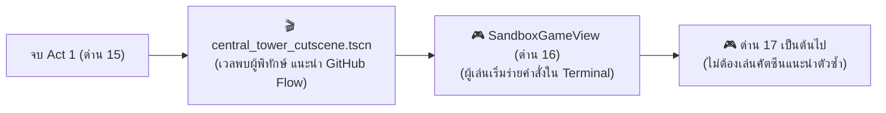

# หอคอยเวทกลาง (Central Tower Intro Cutscene)

เป้าหมาย: ฉากคัตซีนเปิดตัวบทที่ 2 (Act 2: การทำงานเป็นทีม / Teamwork) ก่อนเริ่มด่านที่ 16 (GitHub Flow) โดยเล่าเรื่องราวการก้าวเข้าสู่คลังเวทกลางของเวล และการพบกับผู้พิทักษ์คลังเวทกลางเป็นครั้งแรก พร้อมเกริ่นนำธรรมเนียมการจารึกเวทมนตร์ร่วมกันแบบ **GitHub Flow**

---

## 1. ภาพรวมและโฟลว์การทำงาน (Flow)

ฉากนี้ทำหน้าที่เป็น **Act Transition Cutscene** ที่เล่นเพียงครั้งเดียวในช่วงรอยต่อระหว่าง Act 1 และ Act 2:



* **เมื่อเข้าสู่ฉาก:** จอค่อยๆ สว่างขึ้น เวลเดินเข้ามาจากทางซ้ายหยุดยืนประจันหน้ากับผู้พิทักษ์ที่ยืนรออยู่ทางขวา
* **การพูดคุย:** กล่องข้อความสไตล์ Retro Fantasy ปรากฏขึ้น ตัวอักษรค่อยๆ พิมพ์ทีละตัว (Typewriter Effect)
* **การควบคุม:** ผู้เล่นคลิกหน้าจอ หรือกด Space / Enter เพื่ออ่านบทสนทนาประโยคถัดไป
* **การข้ามฉาก:** สามารถกดปุ่ม **"ข้าม ⏵⏵ (Esc)"** หรือกดปุ่ม `Esc` บนคีย์บอร์ดได้ตลอดเวลา เพื่อตัดเข้าสู่เกมเพลย์ทันที
* **เมื่อจบคัตซีน:** หน้าจอจะค่อยๆ เฟดมืดลง พร้อมปรับระดับเสียง BGM ลงอย่างนุ่มนวล แล้วเปลี่ยน Scene ไปยังด่านเกมเพลย์ที่ระบุใน `@export var next_scene_path`

---

## 2. ทรัพยากรและ Assets ที่ใช้งาน

| หมวดหมู่ | ไฟล์ Asset | รายละเอียด |
|---|---|---|
| **ฉากหลัง** | `res://assets/cutscene/backgrounds/central-tower-Sheet.png` | ห้องโถงหอคอยเวทกลาง (ขนาดเฟรมละ 480×270 พิกเซล, ขยาย Scale 4 เท่าเต็มจอ 1920×1080) |
| **ตัวละครฝั่งซ้าย (เวล)** | `res://assets/cutscene/characters/vel/` | • `vel_Hblue_Sredyellow_idle.png` (ท่ายืน)<br>• `vel_walk_right-Sheet.png` (ท่าเดินเข้าห้อง)<br>• `vel_breathe_blink-Sheet.png` (ท่าหายใจและกระพริบตา)<br>• `vel_shockpng.png` (ท่าตกใจ) |
| **ตัวละครฝั่งขวา (ผู้พิทักษ์)** | `res://assets/cutscene/characters/guardian/` | • `guardian-idle.png` (ท่ายืนนิ่ง)<br>• `guardian-talk-Sheet.png` (ท่าพูด)<br>• `guardian-talk-blink-Sheet.png` (ท่าพูดพร้อมกระพริบตา)<br>• `guardian-breathe-Sheet.png` (ท่าหายใจ) |
| **เอฟเฟกต์ประกอบ** | `res://assets/cutscene/exclamation_mark.png` | ไอคอนตกใจ (!) สีแดงเด้งขึ้นเหนือศีรษะเวล |
| **กรอบข้อความ** | `res://assets/cutscene/frame dialog text/text dialog.png` | กรอบข้อความดีไซน์พิเศษ ขอบมนโทนม่วงเข้มตัดลาเวนเดอร์ (9-slice StyleBoxTexture) |
| **ลูกศรไปต่อ** | `res://assets/cutscene/frame dialog text/arrow.png` | ไอคอนลูกศรพิกเซลชี้ลงโทนลาเวนเดอร์ ลอยเด้งดึ๋งบอกให้คลิกไปต่อ |
| **ฟอนต์ข้อความ** | `res://assets/fonts/TA-8-bit.ttf` | ฟอนต์พิกเซล 8-bit มาตรฐานดั้งเดิมของโปรเจกต์ (ปรับขยายขนาดเป็น 26 px สีขาวจั๊ว สระคมชัดพอดีกล่อง ดูรายละเอียดใน [คู่มือฟอนต์](fonts.md)) |

---

## 3. โครงสร้าง Scene และ Node Hierarchy

ไฟล์ Scene อยู่ที่: [`game/features/cutscene/central_tower_cutscene.tscn`](../game/features/cutscene/central_tower_cutscene.tscn)

```text
CentralTowerCutscene (Node2D) [Script: central_tower_cutscene.gd]
├── AnimationPlayer [Autoplay: background_loop วนลูป 132 เฟรมตลอดทั้งฉาก]
├── Camera2D (จัดกึ่งกลาง 960, 540)
├── Background (Sprite2D) (central-tower-Sheet, hframes: 11, vframes: 12, Scale 4x4)
├── Atmosphere (ColorRect) (ฟิลเตอร์เงาบรรยากาศความมืดม่วงโปร่งแสง)
├── Stage (Node2D)
│   ├── Vel (AnimatedSprite2D) [Spawn: (-120, 750), Target: (700, 750), Scale 4x4]
│   │   ├── DropShadow (Sprite2D) [drop_shadow.png, Scale (0.65, 0.45), Position: (0, 38.5)]
│   │   ├── ExclamationMark (Sprite2D) [Position: (0, -60)]
│   │   └── QuestionMark (Node2D) [Position: (0, -36)]
│   │       └── Label [Font: TA-8-bit.ttf 20px, Color: #FFFFFF, Outline: 4px #000000]
│   └── Guardian (AnimatedSprite2D) [Position: (1220, 750), Scale 4x4, Flip H: true]
│       └── DropShadow (Sprite2D) [drop_shadow.png, Scale (0.65, 0.45), Position: (0, 38.5)]
└── MagicStoryUI (CanvasLayer: Layer 10)
    ├── SkipButton (Button) [มุมขวาบน สำหรับกดข้ามคัตซีน]
    ├── DialogueBox (PanelContainer) [StyleBoxTexture: text dialog.png (Hand-drawn pixel frame 9-slice, Margin 24px, Region: Rect2(43, 191, 2086, 332), Filter: Linear, Modulate: Color(0.78, 0.74, 0.82) ลดความสว่างเส้นม่วงลงไม่ให้แย่งสายตา), Offset: L:-580, R:580, T:-216, B:-36]
    │   ├── Margin (MarginContainer) [Margin: L:36, T:24, R:48, B:16]
    │   │   └── VBox (VBoxContainer) [Separation: 12]
    │   │       ├── SpeakerLabel (Label) [ชื่อผู้พูด ตัวหนา TA-8-bit ขนาด 30 px (FontVariation: variation_embolden = 0.6) สีทองหม่น #F0D273 / สีฟ้าอ่อน #7AC7FF, Outline 3px]
    │   │       └── DialogueLabel (Label) [ข้อความคำพูด ฟอนต์ TA-8-bit ขนาด 26 px (ขยายเพิ่ม 15% จากเดิม) สีขาวจั๊ว #FFFFFF คมชัด, Outline 2px, Line Spacing 8px]
    │   └── ArrowOverlay (Control) [Overlay ป้องกันกระทบข้อความ]
    │       └── ArrowWrapper (Control) [Anchors: Bottom-Right (offset: -48, -34, -22, -16)]
    │           └── ContinueArrow (TextureRect) [arrow.png ลอยเด้งดึ๋ง แสดงเฉพาะเมื่อพิมพ์ข้อความเสร็จสิ้น]
    └── FadeOverlay (ColorRect) [ม่านจอดำสำหรับเฟดเข้า-ออก]
```

---

## 3.1 มาตรฐานตำแหน่งการยืน สัดส่วน และการเดินเข้าฉากของตัวละคร (Positioning & Proportion Standard)

เพื่อแก้ปัญหาตัวละครยืนเอียง ไม่สมส่วน หรือถูกกล่องข้อความบดบังเหลือเพียงศีรษะ (Puppet/Drowning Effect) มาตรฐานการจัดวางองค์ประกอบสำหรับฉากสนทนาหน้าจอ 1920×1080 (จุดกึ่งกลาง x = 960) ถูกกำหนดขึ้นดังนี้:

1. **การสมมาตรซ้าย-ขวาบนแกน X (Symmetrical Alignment):**
   - ระยะห่างจากกึ่งกลางจอ: กำหนด `d = 260px` จาก `x = 960`
   - **เวล (ฝั่งซ้าย):** ยืนที่ `x = 700` (`960 - 260`) อยู่ในแนวทางเดินพื้นโล่งระหว่างเสาโคมไฟซ้ายและบันไดกลาง
   - **ผู้พิทักษ์ (ฝั่งขวา):** ยืนที่ `x = 1220` (`960 + 260`) อยู่ในแนวทางเดินพื้นโล่งระหว่างบันไดกลางและเสาโคมไฟขวา
   - ผลลัพธ์: ตัวละครทั้งสองยืนประจันหน้ากันอย่างสมมาตร กรอบประตูและอักขระเวทกลางฉากมองเห็นได้ชัดเจน ไม่เบี้ยวเอียง

2. **ระดับความสูงและการยึดพื้นบนแกน Y (Grounded Height & Drop Shadow):**
   - ตัวละคร Sprite ขนาด 48×83 ขยาย Scale 4 เท่า มีความสูง 332px จุดกำเนิด (Origin Center) อยู่ตรงกลางตัว ปลายเท้าอยู่ที่ `+154px` จาก Origin
   - กำหนดระดับแกน Y: `position.y = 750` ส่งผลให้ปลายเท้าอยู่ที่ `y = 904` สอดคล้องกับระนาบพื้นกระเบื้องลายข้าวหลามตัดด้านหน้าบันไดอย่างเป็นธรรมชาติ (ไม่ลอยหรือยืนสูงติดผนังด้านบนเกินไป)
   - เพิ่มโหนดเงาใต้เท้า `DropShadow` (`res://assets/cutscene/props/khampri/drop_shadow.png`) วางไว้ที่ `Vector2(0, 38.5)` สเกล `Vector2(0.65, 0.45)` พร้อม `show_behind_parent = true` ช่วยให้ตัวละครดูมีน้ำหนักและติดพื้นอย่างเป็นธรรมชาติ ไม่รู้สึกลอยในอากาศ

3. **สัดส่วนและการเว้นระยะของกล่องข้อความ (Dialogue Box Clearance & Proportion):**
   - ปรับกล่องข้อความ `DialogueBox` ให้มีสัดส่วนกะทัดรัดใกล้เคียงฉากหอสมุด: ขนาด `1160 × 180 px`, จัดวางกึ่งกลางแนวนอน (`offset_left = -580`, `offset_right = 580`), ห่างขอบล่าง 36 px (`offset_top = -216`, `offset_bottom = -36`)
   - ใช้ภาพกรอบที่ผู้ใช้วาดเองแท้จริง (`text dialog.png`) ผ่าน `StyleBoxTexture` (Region: `Rect2(43, 191, 2086, 332)`) โดยกำหนด 9-slice Margins แบบสมมาตร `24 px` ทุกด้าน เปิด `texture_filter = Linear` และปรับ `modulate_color = Color(0.78, 0.74, 0.82)` เพื่อลดความสว่างของเส้นม่วงลงเล็กน้อย ไม่ให้เด่นแย่งสายตาจากบทสนทนา
   - การจัดแนว: ชื่อผู้พูดและบทสนทนาชิดซ้ายแนวเดียวกัน ห่างขอบซ้าย 36 px, เว้นชื่อจากขอบบน 24 px, เว้นระหว่างชื่อกับบทพูด 12 px
   - Typography Hierarchy: ชื่อผู้พูดใช้แบบ**ตัวหนา (Bold)** ขนาด **30 px** (สร้างผ่าน `FontVariation: variation_embolden = 0.6` และขอบดำ 3 px) โดยแยกสีตามบทบาท: ผู้พิทักษ์ใช้สีทองหม่น `#F0D273` (`Color(0.941, 0.824, 0.451, 1.0)`) และเวล/ผู้เล่นใช้สีฟ้าอ่อน `#7AC7FF` (`Color(0.48, 0.78, 1.0, 1.0)`) เด่นชัดกว่าบทพูด, บทพูดใช้ฟอนต์ **TA-8-bit.ttf** ขยายขนาดเป็น **26 px** (เพิ่มขึ้น 15% จากเดิม 22 px เพื่อให้อ่านง่าย สระไม่จม) สีขาวจั๊ว `#FFFFFF` ขอบดำ 2 px เว้นระยะบรรทัด 8 px คงบทสนทนาแบบเดิม 16 บท พร้อมใช้ Non-breaking Space สำหรับคำเฉพาะอย่าง "Git Flow" / "GitHub Flow" เพื่อไม่ให้ถูกตัดแยกคนละบรรทัด
   - ลูกศรไปต่อ (Continue Arrow): จัดวางที่มุมขวาล่าง (`ArrowOverlay`) ซ่อนระหว่างข้อความกำลังพิมพ์ และจะแสดงขึ้นพร้อมอนิเมชันลอยเบาๆ ทันทีที่ข้อความขึ้นครบ 100%
   - ผลลัพธ์: ระดับขอบบนของกล่องข้อความอยู่ที่ `y = 864` วางทับเฉพาะส่วนรองเท้า (ประมาณ 40 px) โดยมองเห็นลำตัว เสื้อผ้า และใบหน้าของตัวละครครบถ้วนชัดเจนในระดับสายตา

4. **การเดินเข้าฉากจากนอกจอ (Walk-in Entrance):**
   - เวลจะเกิดที่พิกัดนอกจอซ้ายสุด: `Vector2(-120, 750)` พร้อมเปิดเล่นแอนิเมชัน `"walk"`
   - เล่น Tween เคลื่อนที่ตามแกน X จาก `-120.0` ไปยัง `700.0` เป็นระยะทาง 820px ในเวลา **3.6 วินาที** (`Tween.TRANS_LINEAR`, ความเร็ว ~228 px/s) ครบ 2 รอบลูปการเดินสมบูรณ์พอดี (1.8s × 2) ทำให้ก้าวเท้าสุดท้ายแตะพื้นสนิทอย่างนุ่มนวล
   - เมื่อเดินถึงจุด `700` ตัวละครจะเปลี่ยนเป็นท่า `"breathe"` หน่วงเวลาหยุดยืนนิ่ง **1.0 วินาที** เพื่อให้เวลยืนหายใจปกติและตั้งสติก่อน แล้วกล่องข้อความจึงเริ่มแสดงบทสนทนาแรก

5. **การซิงค์จังหวะหายใจของตัวละคร (Breathing Synchronization):**
   - ทั้งสองตัวละครใช้ลูปหายใจที่มีคาบเวลาเท่ากันเป๊ะ: 6 เฟรม @ 5 FPS (Frame durations `[2, 1, 2, 1, 2, 1]` = รวม 9 ticks = 1.8 วินาทีต่อลูป)
   - เมื่อเวลเดินเข้าฉากเสร็จสิ้น (t = 3.6s) ระบบจะสั่งรีเซ็ตทั้งเวลและผู้พิทักษ์ให้เริ่มที่เฟรม 0 (`frame = 0, progress = 0.0`) พร้อมกันทันที
   - ระหว่างการเปลี่ยนสถานะ (พูด vs ฟัง) ตัวละครจะส่งต่อ `frame` และ `frame_progress` เข้าหากัน ทำให้จังหวะการยกอกหายใจและการกระพริบตาเป็นไปอย่างพร้อมเพรียง ไม่คลาดเคลื่อนหลุดเฟส

> [!NOTE]
> **การแยกส่วนมาตรฐาน (Documentation Scope):**
> มาตรฐานตำแหน่งการยืนและการจัดสัดส่วนนี้ได้รับการบันทึกไว้ในเอกสารเพื่อเป็นเกณฑ์กลางสำหรับการสร้างฉากสนทนาทั่วไป โดย**ไม่มีการนำไปดัดแปลงหรือกระทบกับฉาก `intro_cutscene` หรือ `ending_cutscene` เดิมของโปรเจกต์** ตามข้อกำหนดที่ตกลงไว้

---

## 4. บทสนทนาในฉาก (Dialogue Script)

บทสนทนาถูกจัดเก็บเป็น Array ของ Dictionary ในตัวแปร `DIALOGUES` ภายในสคริปต์ [`game/features/cutscene/central_tower_cutscene.gd`](../game/features/cutscene/central_tower_cutscene.gd):

* ตัวละครใช้ระบบ **Sequence Loops** อัตโนมัติ (ผู้พิทักษ์: ลูปพูดเมื่อถึงบท / ลูปหายใจเมื่อฟัง, เวล: ลูปหายใจต่อเนื่อง)
* ไม่มีการตัดรีสตาร์ทเฟรม 0 เมื่อผู้เล่นคลิกเปลี่ยนประโยค

| ลำดับ | ผู้พูด | ข้อความบทสนทนา | ท่าทางเวล | ไอคอน Emote | ท่าทางผู้พิทักษ์ |
|:---:|:---:|---|:---:|:---:|:---:|
| 1 | **ผู้พิทักษ์** | "มาถึงแล้วสินะ ศิษย์ฝึกหัด" | `breathe (loop)` | - | `talk (loop)` |
| 2 | **เวล** | "ท่านคือ..." | `breathe (loop)` | - | `breathe (loop)` |
| 3 | **ผู้พิทักษ์** | "ข้าคือผู้พิทักษ์คลังเวทกลาง ดูแลบันทึกและความรู้ของจอมเวททุกคนในอาณาจักร\nนายมาที่นี่เพื่อตามหาเศษคัมภีร์ที่เหลือ ใช่ไหม" | `breathe (loop)` | - | `talk (loop)` |
| 4 | **เวล** | "ใช่ครับ" | `breathe (loop)` | - | `breathe (loop)` |
| 5 | **ผู้พิทักษ์** | "ดี แต่ก่อนจะไปมากกว่านี้ ข้าอยากให้เจ้าได้เรียนรู้การใช้พลัง Git ของเราในการจารึกร่วมกับผู้อื่น" | `breathe (loop)` | - | `talk (loop)` |
| 6 | **เวล** | "กฎเหรอครับ?" | `breathe (loop)` | `?` | `breathe (loop)` |
| 7 | **ผู้พิทักษ์** | "ไม่ใช่หรอก มันเรียกว่าธรรมเนียมมากกว่า โดยส่วนมากธรรมเนียมเป็นไปตามกำหนดจากเจ้าของคัมภีร์" | `breathe (loop)` | - | `talk (loop)` |
| 8 | **ผู้พิทักษ์** | "เพราะงั้นนี่คือ..." | `breathe (loop)` | - | `talk (loop)` |
| 9 | **ผู้พิทักษ์** | "'GitHub Flow' ธรรมเนียมที่คลังเวทกลางแห่งนี้ใช้กันมาตลอด" | `breathe (loop)` | - | `talk (loop)` |
| 10 | **เวล** | "GitHub Flow?" | `breathe (loop)` | `?` | `breathe (loop)` |
| 11 | **ผู้พิทักษ์** | "ใช่ ความจริงแล้วในหมู่จอมเวททั่วอาณาจักร มีธรรมเนียมการทำงานร่วมกันอยู่หลายแบบ\nบ้างก็ใช้ 'Git Flow' ที่ซับซ้อนกว่า มีเส้นทางแยกย่อยหลายสาย บางคลังก็ใช้แบบอื่นไปเลยก็มี" | `breathe (loop)` | - | `talk (loop)` |
| 12 | **ผู้พิทักษ์** | "แต่ที่นี่ เราเลือกใช้ 'GitHub Flow' เพราะเรียบง่าย เหมาะกับจอมเวทที่หมุนเวียนงานกันเร็ว ๆ" | `breathe (loop)` | - | `talk (loop)` |
| 13 | **เวล** | "แล้วมันทำงานยังไงครับ" | `breathe (loop)` | `?` | `breathe (loop)` |
| 14 | **ผู้พิทักษ์** | "หลักการง่ายมาก มีเส้นทางหลักอยู่เส้นเดียวคือ main ห้ามใครแก้ไขมันตรง ๆ เด็ดขาด" | `breathe (loop)` | - | `talk (loop)` |
| 15 | **ผู้พิทักษ์** | "ทุกครั้งที่จะเริ่มงานใหม่ ไม่ว่าเล็กหรือใหญ่ ต้องแยกเส้นทางจารึกใหม่ออกมาก่อนเสมอ" | `breathe (loop)` | - | `talk (loop)` |
| 16 | **ผู้พิทักษ์** | "ทำงานเสร็จ ทดสอบจนมั่นใจ ก็ยื่นคำขอบันทึกคัมภีร์กลับเข้า main แล้วให้จอมเวทคนอื่นตรวจสอบก่อนรวม" | `breathe (loop)` | - | `talk (loop)` |

---

## 5. การนำไปใช้งาน (Integration Guide)

### การเชื่อมต่อจากด่านจบของ Act 1 (ด่าน 15):
เมื่อผู้เล่นทำภารกิจด่านสุดท้ายของ Act 1 สำเร็จ ให้สั่งเปลี่ยน Scene มายังคัตซีนนี้:
```gdscript
get_tree().change_scene_to_file("res://features/cutscene/central_tower_cutscene.tscn")
```

### การตั้งค่าด่านถัดไปใน Godot Inspector:
ที่ Root Node `CentralTowerCutscene` จะมีตัวแปร Export:
* **`Next Scene Path`**: กำหนด Path ของด่านถัดไป (ค่าเริ่มต้นคือ `"res://features/sandbox/sandbox_game_view.tscn"`)
* เมื่อจบคัตซีนหรือกดปุ่มข้าม ระบบจะพาผู้เล่นเข้าสู่ Scene นี้โดยอัตโนมัติ

### วิธีเพิ่มหรือแก้ไขบทสนทนา:
เปิดไฟล์ [`game/features/cutscene/central_tower_cutscene.gd`](../game/features/cutscene/central_tower_cutscene.gd) และแก้ไขในอาร์เรย์ `DIALOGUES`:
```gdscript
{
    "speaker": "ชื่อตัวละคร",
    "text": "ข้อความที่ต้องการให้พูด",
    "vel_anim": "idle",          # ท่าของเวล (idle, walk, shock, breathe_blink)
    "guardian_anim": "talk_blink",# ท่าของผู้พิทักษ์ (idle, talk, talk_blink, breathe)
    "exclamation": false         # ใส่ true หากต้องการให้มีไอคอน (!) เด้งบนหัวเวล
}
```
