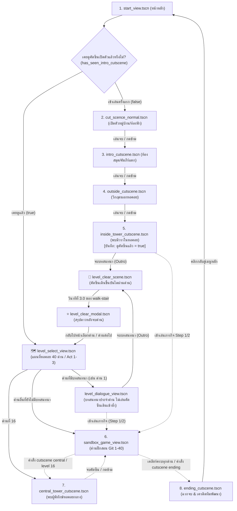
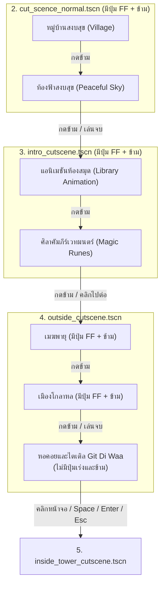

# คู่มือระบบควบคุมคัตซีน (Cutscene Controls Specification & Manual)

เอกสารนี้ระบุรายละเอียดการทำงานของ **ระบบเร่งความเร็ว (Fast-Forward)**, **ระบบข้ามคัตซีน (Skip)**, และ **ระบบเลื่อนบทสนทนา (Advance)** ของเกม Git Di Waa รวมถึงรูปแบบหน้าตา UI, วิธีการควบคุม, การทำงานเบื้องหลัง, และเส้นทางการเปลี่ยนผ่านฉาก (Scene Flow)

---

## 1. ระบบเร่งความเร็ว (Fast-Forward System)

ผู้เล่นสามารถสั่งเร่งความเร็วเกมเป็น 2.5 เท่า (2.5x) ได้อย่างอิสระผ่าน **2 ช่องทางเท่านั้น**:

### 1.1 วิธีใช้งาน (2 รูปแบบ)
1. **คลิกปุ่มสลับบนหน้าจอ (On-Screen Toggle Button):**
   * คลิกที่ปุ่ม `⏵ 1.0x` ที่มุมขวาบนของหน้าจอ
   * ปุ่มจะสลับเป็นโหมดเร่งสปีดค้างไว้ทันที โดยแสดงลูกศรคู่พร้อมแอนิเมชันลูกศรเด้งไปทางขวา (`⏵ ⏵ 2.5x`) คงดีไซน์กรอบเรโทร 8-bit สีดำขอบขาวนวลเดิม
   * เมื่อคลิกซ้ำอีกครั้ง จะสลับกลับมาเป็นความเร็วปกติ `⏵ 1.0x`
2. **กดค้างบนคีย์บอร์ด (Hold-Key Real-Time):**
   * กดปุ่ม **Shift** (ซ้าย หรือ ขวา) ค้างไว้
   * ความเร็วจะเร่งเป็น 2.5x ทันทีในขณะที่กดค้าง และปุ่มบนหน้าจอจะแสดงลูกศรคู่เด้งดึ๋งไปข้างหน้าตามจังหวะการกด
   * เมื่อปล่อยมือ ความเร็วจะคืนกลับมาเป็น 1.0x ปกติทันที (หากไม่ได้กด Toggle ปุ่มบนหน้าจอค้างไว้)

> [!IMPORTANT]
> **การสงวนหน้าที่ของปุ่ม Spacebar และการคลิกบนหน้าจอ:**
> * ปุ่ม **Spacebar**, **Enter**, และ **การคลิกที่ตำแหน่งใดก็ได้บนหน้าจอ** (ที่ไม่ใช่ปุ่ม UI) ถูกกำหนดหน้าที่ไว้เฉพาะสำหรับ **"การไปต่อ (Advance)"** หรือ **"เร่งให้ข้อความ Typewriter แสดงผลขึ้นจนครบประโยคทันที"** เท่านั้น
> * **ไม่มีผลต่อการเร่งสปีดเกม (Time Scale)** เพื่อป้องกันความสับสนและไม่ให้ความเร็วของเกมเด้งไปมาในขณะที่ผู้เล่นเพียงต้องการอ่านบทสนทนาต่อไป

### 1.2 ผลลัพธ์หลังสั่งเร่งสปีด (Engine Behavior)
* **ความเร็วเกม:** ตัวเกมจะปรับอัตราความเร็วของระบบ:
  $$\text{Engine.time_scale} = 2.5$$
  ทำให้อนิเมชันตัวละคร, การเคลื่อนที่, ข้อความ, และเอฟเฟกต์ภาพทั้งหมดวิ่งเร็วขึ้นเป็น **2.5 เท่า** ของความเร็วปกติ
* **การซิงค์กันระหว่างปุ่มและคีย์ลัด:**
  * หากเปิดปุ่ม Toggle ทิ้งไว้ เกมจะวิ่ง 2.5x ต่อเนื่อง แม้จะปล่อยมือจากปุ่ม Shift แล้ว
  * หากปิดปุ่ม Toggle ไว้ ผู้เล่นยังคงสามารถกด Shift ค้างเพื่อเร่งสปีดชั่วคราวได้ตลอดเวลา
* **การแสดงผลต่อเนื่องและการซ่อนในหน้าไตเติล (Visibility Lifecycle):**
  * ปุ่มเร่งความเร็วจะแสดงผลต่อเนื่องในคัตซีนเล่าเรื่องทั้งหมด (หมู่บ้าน, ท้องฟ้า, ห้องสมุด, มนตรา, เมฆพายุ, เมืองโกลาหล)
  * **ยกเว้นหน้าไตเติลเกม Git Di Waa (`outside_cutscene` Stage 3):** เมื่อหอคอยทมิฬและข้อความชื่อเกมปรากฏขึ้น ระบบจะค่อย ๆ จาง (Fade-out) และ **ซ่อนทั้งปุ่มเร่งและปุ่มข้ามออกทั้งหมด** เพื่อให้หน้าไตเติลสะอาดตาตามอัตลักษณ์ของเกม และรีเซ็ตความเร็วกลับเป็น `1.0x`

---

## 2. ระบบปุ่มข้ามคัตซีน (Skip Button System)

### 2.1 วิธีใช้งาน (Controls)
ผู้เล่นสามารถสั่งข้ามคัตซีนได้ 2 ช่องทาง:
1. **คลิกปุ่มบนหน้าจอ:** คลิกปุ่ม `ข้าม` ที่มุมขวาบนของหน้าจอ
2. **กดคีย์ลัดบนคีย์บอร์ด:** กดปุ่ม **Esc (Escape)** ได้ตลอดเวลา

### 2.2 ดีไซน์และรูปแบบปุ่ม (UI Design & Styling)
ปุ่มควบคุมถูกวางไว้ที่ **มุมขวาบนของหน้าจอ** สไตล์เรโทร 8-bit ตามอัตลักษณ์ของเกม:

| คุณสมบัติ (Property) | ค่าที่กำหนด (Value) | รายละเอียด |
| :--- | :--- | :--- |
| **ตำแหน่ง (Position)** | มุมขวาบน (`PRESET_TOP_RIGHT`) | ห่างจากขอบขวา 20px, ขอบบน 20px (`y: 20px - 60px`) |
| **ขนาดปุ่ม (Size)** | ปุ่มเร่ง: กว้าง 100px / ปุ่มข้าม: กว้าง 90px (สูง 40px) | ขนาดสมดุล จัดกึ่งกลางพอดีทั้งโหมด 1.0x และ 2.5x |
| **ฟอนต์ (Font)** | `res://assets/fonts/ChakraPetch-Bold.ttf` (สำรอง: `TA-8-bit.ttf`) | ฟอนต์มาตรฐานเดียวกับระบบบทสนทนา อ่านง่าย คมชัด (ดู [คู่มือฟอนต์](fonts.md)) |
| **ขนาดฟอนต์ (Font Size)** | `20px` | คมชัด อ่านง่ายบนหน้าจอความละเอียดสูง |
| **ข้อความบนปุ่ม (Text)** | `ข้าม` | ปรับข้อความเรียบง่าย สไตล์มินิมอลเรโทรตามคำขอ |
| **สีกรอบปุ่ม (Border Color)** | สีขาวนวล `Color(0.98, 0.976, 0.965, 0.85)` (`#FAF9F6`) | ขอบเส้นเด่นชัดสไตล์เกมเรโทร ตัดกับฉากหลังมืด |
| **ความหนากรอบ (Border Width)** | `2px` ทั้ง 4 ด้าน | เส้นกรอบ 8-bit หนาพอเหมาะ |
| **ความโค้งมน (Corner Radius)** | มนมุม `8px` ทั้ง 4 ด้าน | ให้ความรู้สึกนุ่มนวลแบบ Modern Retro |
| **สีพื้นหลังปกติ (Normal BG)** | สีน้ำเงินเข้มเกือบดำ `Color(0.00392, 0, 0.07451, 0.95)` (`#010013`) | พื้นหลังทึบ 95% ตัดกับฉากด้านหลัง อ่านง่าย |
| **สีพื้นหลังเมื่อชี้ (Hover BG)** | สีม่วงเข้ม `Color(0.06, 0.04, 0.16, 0.95)` + กรอบสว่าง 100% | มี Feedback ชัดเจนเมื่อผู้เล่นเลื่อนเมาส์ไปชี้ |

### 2.3 การข้ามแบบรายฉากย่อย (Granular Stage-by-Stage Skipping)
เพื่อไม่ให้การกด "ข้าม" กระโดดข้ามเนื้อเรื่องทั้งหมดไปถึงตอนจบ ระบบนำเทคนิค `custom_skip_action: Callable` มาใช้ เพื่อให้แต่ละฉากสามารถข้ามฉากย่อยทีละขั้นอย่างต่อเนื่อง:
1. **`cut_scence_normal`:**
   * **Stage 1 (หมู่บ้านสงบสุข):** กดข้าม -> ข้ามไปเปิดฉากท้องฟ้าสงบสุข (Stage 2) ทันที
   * **Stage 2 (ท้องฟ้าสงบสุข):** กดข้าม -> ตัดเข้าสู่ฉากห้องสมุด (`intro_cutscene.tscn`)
2. **`intro_cutscene`:**
   * **Stage 1 (แอนิเมชันห้องสมุด/คัมภีร์แตก):** กดข้าม -> ข้ามไปหน้าแสดงแผ่นกระดาษมนตราโบราณ (`_skip_to_magic_text()`) โดยไม่ข้ามฉากทิ้ง
   * **Stage 2 (หน้ามนตราโบราณ):** กดข้าม -> ตัดเข้าสู่ฉากภายนอก (`outside_cutscene.tscn`)
3. **`outside_cutscene`:**
   * **Stage 1 (เมฆพายุ):** กดข้าม -> ข้ามไปฉากบ้านเมืองโกลาหล (Stage 2)
   * **Stage 2 (บ้านเมืองโกลาหล):** กดข้าม -> ข้ามไปฉากหอคอยทมิฬและไตเติลเกม (Stage 3)
   * **Stage 3 (หอคอยทมิฬ/ไตเติลเกม Git Di Waa):** **ไม่มีปุ่มเร่งและปุ่มข้าม** ผู้เล่นคลิกหน้าจอ หรือกด Space/Enter/Esc เพื่อเข้าสู่เกมเพลย์ด่านแรก (`_trigger_start_level()`)

### 2.4 การป้องกันการดักจับคลิกชนปุ่มควบคุม (Click Passthrough Fix)
* **ปัญหาเดิม:** ในฉากที่มีการกดหน้าจอเพื่อไปต่อ (`_input(event)`) มีคำสั่ง `get_viewport().set_input_as_handled()` ดักจับเมาส์คลิกซ้ายก่อนที่ระบบ GUI ของ Godot จะส่ง event ไปถึงปุ่ม ส่งผลให้เมื่อผู้เล่นคลิกปุ่ม "ข้าม" หรือปุ่ม "เร่งความเร็ว" ระบบเข้าใจผิดคิดว่าผู้เล่นคลิกเพื่ออ่านต่อ และปุ่มกดไม่ติด
* **การแก้ไข:** เพิ่มการตรวจสอบ `var hovered := get_viewport().gui_get_hovered_control(); if hovered is BaseButton: return` เพื่อปล่อยให้สัญญาณการคลิกส่งตรงไปยังปุ่มกดได้อย่างสมบูรณ์

---

## 3. ตารางสรุปหน้าที่ของปุ่มควบคุมทั้งหมด (Complete Controls Reference)

| การทำงาน (Action) | ปุ่มหรือการควบคุม (Input Controls) | พฤติกรรมของระบบ (Game Behavior) |
| :--- | :--- | :--- |
| **เร่งความเร็ว (Fast-Forward 2.5x)** | • **ปุ่ม Shift** (ซ้าย/ขวา กดค้าง) • **คลิกปุ่ม FF บนหน้าจอ** (`⏵ 1.0x` / `⏵ ⏵ 2.5x`) | ปรับ `Engine.time_scale = 2.5` ทำให้ภาพเคลื่อนไหวและบทสนทนาวิ่งเร็วขึ้น |
| **ข้ามคัตซีน (Skip Stage)** | • **ปุ่ม Esc (Escape)** • **คลิกปุ่ม `ข้าม`** บนหน้าจอ | ข้ามลำดับเหตุการณ์ปัจจุบันไปยังฉากย่อยถัดไปทันที (Stage-by-Stage Skip) |
| **ไปต่อ / เร่งข้อความขึ้นครบ (Advance & Finish Text)** | • **ปุ่ม Spacebar** • **ปุ่ม Enter** • **คลิกซ้ายที่ไหนก็ได้บนหน้าจอ** (นอกปุ่ม UI) | 1. หากข้อความ Typewriter กำลังพิมพ์: เร่งแสดงข้อความเต็มประโยคทันที 2. หากข้อความขึ้นครบแล้ว: เลื่อนไปประโยคถัดไปหรือเริ่มฉากใหม่ |

---

## 4. เส้นทางการเชื่อมโยงและการข้ามฉากทั้งระบบ (Complete Scene Flow & Transition)

แผนภาพลำดับการไหลของฉากทั้งหมดในเกม Git Di Waa (พร้อมระบบจดจำความคืบหน้าผู้เล่น):

### 4.0 การทดสอบการเปลี่ยนฉากจาก Sandbox (Sandbox Testing Commands)
ภายใน `sandbox_game_view.tscn` สามารถพิมพ์คำสั่งใน Terminal หรือเรียกผ่าน GDScript Method เพื่อทดสอบโฟลว์การเปลี่ยนฉากได้ทันที:
* **คำสั่ง `cutscene central` หรือ `level 16`:** ตัดเข้าสู่ `central_tower_cutscene.tscn` (และเมื่อจบคัตซีนหรือกดข้ามจะส่งกลับมายัง Sandbox) หรือเรียกผ่านเมธอด `play_central_tower_cutscene()`
* **คำสั่ง `cutscene ending`:** ตัดเข้าสู่ `ending_cutscene.tscn` (และเมื่อจบคัตซีนหรือกดข้ามจะส่งกลับสู่ `start_view.tscn`) หรือเรียกผ่านเมธอด `play_ending_cutscene()`
* **คำสั่ง `cutscene`:** แสดงคำแนะนำวิธีใช้คำสั่งเปลี่ยนฉากทั้งหมดใน Terminal

### 4.1 รายละเอียดย่อยการข้ามฉากภายในคัตซีนต้นเกม (Granular Stage Skipping)

### 4.2 สถานะการใช้งานในปัจจุบัน (Current Development Mode)
> [!NOTE]
> **เพื่อความสะดวกในการพัฒนาและทดสอบระบบ (Dev / Sandbox Testing):**
> โค้ดปัจจุบันได้**เปิดใช้งานทั้งปุ่มเร่งความเร็ว (Fast-Forward 2.5x / Shift) และปุ่มข้าม (Skip / Esc) ไว้ทุกฉากคัตซีน (ฉากที่ 1–6)** เพื่อให้ทีมพัฒนาและผู้ทดสอบสามารถข้ามฉากและเร่งความเร็วเพื่อตรวจงานได้อย่างสะดวกรวดเร็ว

| ลำดับฉาก | ไฟล์ฉาก (`.tscn`) | ปุ่มเร่งสปีด (2.5x / Shift) | ปุ่มข้าม (Skip / Esc) | ปลายทางเมื่อกดข้าม (Skip Target) |
| :---: | :--- | :---: | :---: | :--- |
| **1** | `cut_scence_normal.tscn` | ✅ มี | ✅ มี | ข้ามหมู่บ้าน -> ท้องฟ้า -> `intro_cutscene.tscn` |
| **2** | `intro_cutscene.tscn` | ✅ มี | ✅ มี | ข้ามแอนิเมชัน -> หน้ามนตรา -> `outside_cutscene.tscn` |
| **3** | `outside_cutscene.tscn` | ✅ มี | ✅ มี | ข้ามพายุ -> เมือง -> ไตเติล -> `inside_tower_cutscene.tscn` |
| **4** | `inside_tower_cutscene.tscn` | ✅ มี | ✅ มี | ช่วงเดินเข้าห้องโถง -> เริ่มบทเรียนด่าน 1 ทันที, ช่วงบทเรียน -> `sandbox_game_view.tscn` (ขั้นที่ 1/2), ช่วงสรุปผล -> หน้าสรุปดาว |
| **5** | `central_tower_cutscene.tscn` | ✅ มี | ✅ มี | ข้ามบทสนทนาผู้พิทักษ์ -> `sandbox_game_view.tscn` |
| **6** | `ending_cutscene.tscn` | ✅ มี | ✅ มี | ข้ามฉากจบ -> กลับสู่เมนูหลัก `start_view.tscn` |

---

### 4.3 ข้อกำหนดแผนงานในอนาคตสำหรับเวอร์ชันปล่อยจริง (Production / Release Roadmap)
> [!IMPORTANT]
> **แผนการปรับปรุงในอนาคต (Production Release):**
> เมื่อตัวเกมพัฒนาเสร็จสมบูรณ์และพร้อมปล่อยให้ผู้เล่นทั่วไปเล่น ให้ปรับเปลี่ยนสเปกการแสดงผลปุ่มควบคุมตามตารางด้านล่างนี้ โดยเปิดปุ่มข้ามไว้เฉพาะฉากเปิดตัวแรกสุด และให้ผู้เล่นรับชมบทสนทนาในหอคอยรวมถึงฉากจบโดยไม่ให้กดข้าม:

| ลำดับ | ฉาก (Scene) | ปุ่มเร่งสปีด (2.5x / Shift) | ปุ่มข้าม (Skip / Esc) | หมายเหตุ / เหตุผลการออกแบบ |
| :---: | :--- | :---: | :---: | :--- |
| **1** | `cut_scence_normal.tscn` | ✅ **มี** | ✅ **มี** | เปิดให้ข้ามได้สำหรับผู้เล่นที่เริ่มเล่นรอบใหม่ |
| **2** | `intro_cutscene.tscn` | ✅ **มี** | ❌ **ไม่มี** | ให้ดูเรื่องราวห้องสมุดและคัมภีร์แตก เร่งสปีดได้ |
| **3** | `outside_cutscene.tscn` | ✅ **มี** | ❌ **ไม่มี** | ให้ดูเมืองโกลาหลและไตเติลเกม เร่งสปีดได้ |
| **4** | `inside_tower_cutscene.tscn` | ✅ **มี** | ❌ **ไม่มี** | บังคับอ่านบทสนทนาสอนเล่นของมิวรา เร่งสปีดได้ |
| **5** | `central_tower_cutscene.tscn` | ✅ **มี** | ❌ **ไม่มี** | บังคับอ่านบทสนทนาผู้พิทักษ์หอคอยกลาง เร่งสปีดได้ |
| **6** | `ending_cutscene.tscn` | ❌ **ไม่มี** | ❌ **ไม่มี** | ฉากจบและเครดิต ปิดทั้งเร่งและข้ามเพื่อให้รับชมจนจบ |

---

## 5. ระบบการเล่นอนิเมชันในฉากห้องสมุด (Dual Playback Modes)

ในไฟล์ [`game/features/cutscene/intro_cutscene.gd`](../game/features/cutscene/intro_cutscene.gd) มีตัวแปร `@export_enum("AnimationPlayer", "ScriptTween") var playback_mode` ให้ผู้พัฒนาสามารถเลือกวิธีเล่นฉากได้ 2 รูปแบบผ่าน Inspector:

1. **โหมด `AnimationPlayer` (โหมดมาตรฐานเริ่มต้น - แนะนำ):**
   * เล่นแอนิเมชันชื่อ `"walk_in"` ที่กำหนด Keyframe ไว้บน Timeline ของ Node `AnimationPlayer` ใน Godot Editor
   * ควบคุมจังหวะตัวละครเดิน หลุมดำดูดอาจารย์ คัมภีร์ตก และเศษกระจายได้อย่างราบรื่น
2. **โหมด `ScriptTween` (`play_with_tween()`):**
   * ควบคุมการเคลื่อนไหวผ่านโค้ด GDScript เพียวๆ ด้วย `create_tween()`
   * เหมาะสำหรับใช้ทดสอบการทำงานของ Tween หรือใช้เป็นโค้ดสำรองทางเทคนิค

---

## 6. แอนิเมชันตัวละครเวลและตัวอักษร ! ตกใจบนหัว (Vel Shock Jump & Emote !)

* **จังหวะปรมาจารย์ตกหลุมดำ (ที่วินาที 9.38):**
  * **สลับ Sprite:** เวลเปลี่ยนเฟรมเป็นท่าตกใจ (`vel_shock`)
  * **กระโดดถอยหลัง:** มี Tween กระโดดยกตัวลอยขึ้นระดับ $y - 30\text{px}$ พร้อมเด้งถอยไปทางซ้าย $x - 12\text{px}$ แบบ Parabolic Arc
  * **ไอคอนเครื่องหมาย !:** เด้งขยายตัวจากจุดศูนย์กลาง (Scale 0.0 -> 1.0) เหนือศีรษะเวลด้วย `TRANS_BACK`
* **จังหวะคัมภีร์ตกกระแทกพื้น (ที่วินาที 10.60):**
  * เมื่อคัมภีร์ตกถึงพื้น เวลจะแสดงอาการตกใจซ้ำรอบที่สอง (กระโดดตัวโยนเบาๆ พร้อมไอคอน ! ปรากฏอีกครั้ง)
  * จากนั้นสลายตัวหายไปพร้อมกับหลุมดำอย่างกลมกลืน

---

## 7. ประวัติการแก้ไขและรายการคอมมิต (Changelog & Commit Specifications)

### รายละเอียดการเปลี่ยนแปลงล่าสุด: สลับฉากกด Start เป็นหน้าเลือกด่านหากเคยดูคัตซีนแล้ว พร้อมระบบจดจำสถานะผู้เล่น
* **ชื่อคอมมิต (Commit Title):**
  * **ไทย:** `feat(start): นำทางผู้เล่นที่เคยดูคัตซีนไปยังหน้าเลือกด่าน และบังคับคัตซีนสำหรับผู้เล่นใหม่`
  * **Conventional Commits:** `feat(start): route returning players to level select, enforce cutscene for new players`
* **รายละเอียดสิ่งที่ทำไป (Commit Details):**
  1. **ระบบจดจำสถานะผู้เล่น (`GameProgressManager`):**
     - สร้าง `res://common/game_progress_manager.gd` จัดเก็บลงไฟล์ `user://game_progress.cfg`
     - จัดเก็บค่าสถานะ `has_seen_intro_cutscene` ตรวจสอบว่าผู้เล่นเคยเข้าชมฉากคัตซีนเปิดตัวแล้วหรือไม่
  2. **ปรับปรุงเงื่อนไขกดปุ่ม Start ใน `start_view_controller.gd`:**
     - ผู้เล่นใหม่ (ยังไม่เคยดู): บังคับให้รับชมฉากคัตซีนเปิดตัว (`cut_scence_normal.tscn`)
     - ผู้เล่นเดิม (เคยดูแล้ว): ข้ามคัตซีนเปิดตัวทั้งหมด และนำทางตรงสู่หน้าต่างเลือกรวมด่าน (`level_select_view.tscn`) ทันที
  3. **บันทึกสถานะอัตโนมัติ:**
     - เมื่อผู้เล่นเดินทางถึงห้องโถงหอคอยเวทใน `inside_tower_cutscene.gd` จะบันทึกสถานะ `has_seen_intro_cutscene = true` ทันที
  4. **คำสั่งทดสอบใน Terminal:**
     - คำสั่ง `reset` / `reset progress`: ล้างสถานะเพื่อทดสอบโฟลว์ดูคัตซีนซ้ำ
     - คำสั่ง `level`: เปิดหน้าเลือกด่านโดยตรง

---

### รายละเอียดการเปลี่ยนแปลงก่อนหน้า: กำหนดการเร่งสปีดเฉพาะปุ่ม Shift และปุ่ม FF พร้อมสงวน Spacebar/คลิก สำหรับไปต่อและแสดงข้อความครบ
* **ชื่อคอมมิต (Commit Title):**
  * **ไทย:** `fix(cutscene): กำหนดให้เร่งสปีดด้วย Shift และปุ่ม FF เท่านั้น พร้อมสงวน Spacebar/คลิก สำหรับไปต่อและแสดงข้อความครบ`
  * **Conventional Commits:** `fix(cutscene): restrict fast-forward to shift key and ff button, dedicate spacebar and click to text advance`
* **รายละเอียดสิ่งที่ทำไป (Commit Details):**
  1. **จำกัดปุ่มเร่งความเร็ว (Fast-Forward Controls):**
     - ใน `cut_scence_normal.gd`, `intro_cutscene.gd`, และ `outside_cutscene.gd` ปรับปรุงตัวแปร `wants_hold` ให้ตรวจสอบเฉพาะ `Input.is_key_pressed(KEY_SHIFT)`
     - ตัด `KEY_SPACE` และ `KEY_ENTER` ออกจากระบบเร่งความเร็ว เพื่อไม่ให้ปนกับการเลื่อนบทสนทนา
     - การเร่งความเร็วทำได้ 2 ช่องทางเท่านั้น คือ คลิกปุ่ม Toggle `FF 2.5x` บนหน้าจอ หรือกดปุ่ม `Shift` ค้าง
  2. **สงวนหน้าที่ Spacebar และการคลิกหน้าจอ (Advance & Finish Text):**
     - ปุ่ม `Spacebar`, `Enter`, และการคลิกซ้ายบนหน้าจอ (ที่ไม่ใช่ปุ่ม UI) ทำหน้าที่เฉพาะ:
       * หากข้อความกำลังพิมพ์ (Typewriter effect) -> เร่งแสดงผลข้อความเต็มประโยคทันที
       * หากข้อความแสดงผลครบแล้ว -> เลื่อนไปยังประโยคถัดไป หรือเริ่มฉากถัดไป
  3. **อัปเดตเอกสารคู่มือ (Documentation):**
     - อัปเดต `docs/cutscene-controls.md` ให้ระบุบทบาทของแต่ละปุ่มอย่างชัดเจน พร้อมเพิ่มตารางสรุปหน้าที่ของปุ่มควบคุมทั้งหมด

---

### รายละเอียดการเปลี่ยนแปลงก่อนหน้า: ยกเลิกการคลิกเมาส์ค้างเพื่อเร่งสปีด คงเหลือเฉพาะกดคีย์บอร์ดและปุ่มสลับบนจอ
* **ชื่อคอมมิต (Commit Title):**
  * **ไทย:** `fix(cutscene): ยกเลิกการคลิกเมาส์ค้างเพื่อเร่งสปีด คงเหลือเฉพาะกดคีย์บอร์ดและปุ่มสลับบนจอ`
  * **Conventional Commits:** `fix(cutscene): remove mouse hold to fast-forward, keep keyboard hold and on-screen toggle`
* **รายละเอียดสิ่งที่ทำไป (Commit Details):**
  - นำ `Input.is_mouse_button_pressed(MOUSE_BUTTON_LEFT)` ออกจาก `cut_scence_normal.gd`, `intro_cutscene.gd`, และ `outside_cutscene.gd`
  - ป้องกันปัญหาการคลิกเมาส์เพื่ออ่านต่อหรือคลิกปุ่มถูกเข้าใจผิดว่าเป็นการกดเร่งความเร็ว

---

### รายละเอียดการเปลี่ยนแปลงก่อนหน้า: ซ่อนปุ่มเร่งและปุ่มข้ามในหน้าไตเติลเกม Git Di Waa และแก้ปุ่มข้ามฉากย่อยตามลำดับ
* **ชื่อคอมมิต (Commit Title):**
  * **ไทย:** `fix(cutscene): ซ่อนปุ่มเร่งและปุ่มข้ามในหน้าไตเติลเกม Git Di Waa และแก้ปุ่มข้ามฉากย่อยตามลำดับ`
  * **Conventional Commits:** `fix(cutscene): hide fast-forward and skip buttons on Git Di Waa title card and fix stage-by-stage skip flow`
* **รายละเอียดสิ่งที่ทำไป (Commit Details):**
  1. ซ่อนปุ่มเร่งความเร็วและปุ่มข้ามในหน้าไตเติลเกม (`outside_cutscene.gd` Stage 3)
  2. ระบบข้ามคัตซีนแบบรายฉากย่อย (`custom_skip_action: Callable`)
  3. ป้องกันการคลิกชนปุ่มควบคุม (`hovered is BaseButton`)
