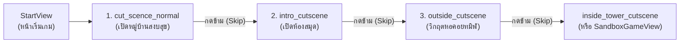

# คู่มือระบบควบคุมคัตซีน (Cutscene Controls Specification & Manual)

เอกสารนี้ระบุรายละเอียดการทำงานของ **ระบบเร่งความเร็ว (Fast-Forward)** และ **ระบบข้ามคัตซีน (Skip)** ของเกม Git Di Waa รวมถึงรูปแบบหน้าตา UI, วิธีการควบคุม, การทำงานเบื้องหลัง, และเส้นทางการเปลี่ยนผ่านฉาก (Scene Flow)

---

## 1. ระบบเร่งความเร็ว (Fast-Forward System)

ในระบบใหม่นี้ ผู้เล่นสามารถเลือกใช้งานการเร่งความเร็ว (2.5x) ได้อย่างอิสระถึง **2 รูปแบบพร้อมกัน** โดยไม่ขัดแย้งกัน:

### 1.1 วิธีใช้งาน (2 รูปแบบ)
1. **คลิกปุ่มสลับบนหน้าจอ (On-Screen Toggle Button):**
   * คลิกที่ปุ่ม `⏵ 1.0x` ที่มุมขวาบนของหน้าจอ
   * ปุ่มจะสลับเป็นโหมดเร่งสปีดค้างไว้ทันที (`⏵⏵ 2.5x`) พร้อมแสงนีออนสีม่วงเรืองแสงและอนิเมชันลูกศรเด้งไปทางขวา
   * เมื่อคลิกซ้ำอีกครั้ง จะสลับกลับมาเป็นความเร็วปกติ `1.0x`
2. **กดค้างบนคีย์บอร์ดหรือเมาส์ (Hold-Key Real-Time):**
   * กดปุ่ม **Spacebar**, **Shift** (ซ้าย/ขวา), **Enter**, หรือ **คลิกเมาส์ซ้ายค้างไว้** บนหน้าจอ
   * ความเร็วจะเร่งเป็น 2.5x ทันทีในขณะที่กดค้าง และปุ่มบนหน้าจอจะติดไฟนีออนพร้อมลูกศรเด้งตามจังหวะการกด
   * เมื่อปล่อยมือ ความเร็วจะคืนกลับมาเป็น 1.0x ปกติทันที (หากไม่ได้กด Toggle ปุ่มบนหน้าจอค้างไว้)

### 1.2 ผลลัพธ์หลังสั่งเร่งสปีด (Engine Behavior)
* **ความเร็วเกม:** ตัวเกมจะปรับอัตราความเร็วของระบบ:
  $$\text{Engine.time_scale} = 2.5$$
  ทำให้อนิเมชันตัวละคร, การเคลื่อนที่, ข้อความ, และเอฟเฟกต์ภาพทั้งหมดวิ่งเร็วขึ้นเป็น **2.5 เท่า** ของความเร็วปกติ
* **การซิงค์กันระหว่างปุ่มและคีย์ลัด:**
  * หากเปิดปุ่ม Toggle ทิ้งไว้ เกมจะวิ่ง 2.5x ต่อเนื่อง แม้จะปล่อยมือจาก Spacebar แล้ว
  * หากปิดปุ่ม Toggle ไว้ ผู้เล่นยังคงสามารถกด Spacebar/Shift ค้างเพื่อเร่งสปีดชั่วคราวได้ตลอดเวลา
* **เงื่อนไขการปิดเร่งสปีดอัตโนมัติ:**
  * **ช่วงจบฉาก/เปลี่ยนผ่าน (Transition):** ระบบจะล็อกความเร็วกลับเป็น `1.0x` เพื่อให้การตัดฉากสมูท
  * **ช่วงอ่านมนตราโบราณ (`intro_cutscene`):** ขณะที่แผ่นกระดาษมนตราลอยขึ้นมาให้อ่าน ระบบจะซ่อนปุ่มเร่งและปิดการเร่งชั่วคราว เพื่อไม่ให้ข้ามเนื้อหาสำคัญโดยไม่ตั้งใจ

---

## 2. ระบบปุ่มข้ามคัตซีน (Skip Button System)

### 2.1 วิธีใช้งาน (Controls)
ผู้เล่นสามารถสั่งข้ามคัตซีนได้ 2 ช่องทาง:
1. **คลิกปุ่มบนหน้าจอ:** คลิกปุ่ม `ข้าม ⏵⏵ (Esc)` ที่มุมขวาบนของหน้าจอ
2. **กดคีย์ลัดบนคีย์บอร์ด:** กดปุ่ม **Esc (Escape)** ได้ตลอดเวลา

### 2.2 ดีไซน์และรูปแบบปุ่ม (UI Design & Styling)
ปุ่มควบคุมถูกวางไว้ที่ **มุมขวาบนของหน้าจอ** สไตล์เรโทร 8-bit ตามอัตลักษณ์ของเกม:

| คุณสมบัติ (Property) | ค่าที่กำหนด (Value) | รายละเอียด |
| :--- | :--- | :--- |
| **ตำแหน่ง (Position)** | มุมขวาบน (`PRESET_TOP_RIGHT`) | ห่างจากขอบขวา 20px, ขอบบน 20px (`y: 20px - 60px`) |
| **ขนาดปุ่ม (Size)** | ปุ่มเร่ง: กว้าง 105px / ปุ่มข้าม: กว้าง 175px (สูง 40px) | ขนาดพอดีกับข้อความภาษาไทยและสัญลักษณ์ |
| **ฟอนต์ (Font)** | `res://assets/fonts/TA-8-bit.ttf` | ฟอนต์พิกเซล 8-bit คมชัด รองรับภาษาไทยสมบูรณ์ |
| **ขนาดฟอนต์ (Font Size)** | `20px` | คมชัด อ่านง่ายบนหน้าจอความละเอียดสูง |
| **สีกรอบปุ่ม (Border Color)** | สีขาวนวล `Color(0.98, 0.976, 0.965, 0.85)` (`#FAF9F6`) | ขอบเส้นเด่นชัดสไตล์เกมเรโทร ตัดกับฉากหลังมืด |
| **ความหนากรอบ (Border Width)** | `2px` ทั้ง 4 ด้าน | เส้นกรอบ 8-bit หนาพอเหมาะ |
| **ความโค้งมน (Corner Radius)** | มนมุม `8px` ทั้ง 4 ด้าน | ให้ความรู้สึกนุ่มนวลแบบ Modern Retro |
| **สีพื้นหลังปกติ (Normal BG)** | สีน้ำเงินเข้มเกือบดำ `Color(0.00392, 0, 0.07451, 0.95)` (`#010013`) | พื้นหลังทึบ 95% ตัดกับฉากด้านหลัง อ่านง่าย |
| **สีพื้นหลังเมื่อชี้ (Hover BG)** | สีม่วงเข้ม `Color(0.06, 0.04, 0.16, 0.95)` + กรอบสว่าง 100% | มี Feedback ชัดเจนเมื่อผู้เล่นเลื่อนเมาส์ไปชี้ |

### 2.3 สิ่งที่เกิดขึ้นหลังกดปุ่มข้าม (After Skip Triggered)
1. **รีเซ็ตความเร็วเกมทันที:** เรียก `Engine.time_scale = 1.0` เสมอ เพื่อรับประกันว่าฉากถัดไปจะไม่วิ่งเร็วผิดปกติ
2. **ตัดเข้าสู่ฉากถัดไปทันที:** สั่ง `get_tree().change_scene_to_file(next_scene_path)` ไปยังฉากเป้าหมายทันทีโดยไม่ต้องรอให้อนิเมชันเดิมเล่นจบ
3. **ป้องกันการกดซ้ำ:** มี Flag `_skipping = true` ป้องกันการเปลี่ยนฉากซ้อนกันหลายรอบ

### 2.4 การแก้ไขปัญหาการดักจับปุ่ม Escape (Escape Key Interception Fix)
* **ปัญหาเดิม:** ในฉาก `intro_cutscene.gd` เมื่ออ่านมนตราโบราณตอนท้ายฉาก ฟังก์ชัน `_input(event)` เดิมดักจับเงื่อนไข `event is InputEventKey` โดยไม่ยกเว้นปุ่ม Esc ทำให้เมื่อผู้เล่นกด Esc โค้ดเข้าใจผิดคิดว่าต้องการ "อ่านต่อ" แล้วค่อยๆ เฟดจอดำ 1.5 วินาที แทนที่จะสั่งข้ามทันที
* **การแก้ไข:** เพิ่มเงื่อนไข `if event is InputEventKey and event.keycode == KEY_ESCAPE: return` เพื่อปล่อยให้สัญญาณปุ่ม Esc ส่งผ่านไปยังปุ่มข้าม (`skip_cutscene_button.gd`) ทำให้ผู้เล่นสามารถกด Esc ข้ามฉากได้ทันทีในทุกสถานการณ์

---

## 3. เส้นทางการข้ามฉาก (Scene Flow & Transition Matrix)

เกม Git Di Waa มีลำดับคัตซีนเปิดเรื่อง 3 ฉากต่อเนื่องกัน ก่อนเข้าสู่เกมเพลย์ หากผู้เล่นกดปุ่ม **"ข้าม"** ในแต่ละหน้า ระบบจะนำทางไปดังนี้:

| ลำดับ | ฉากปัจจุบัน (Current Scene) | ไฟล์ฉาก (`.tscn`) | ปลายทางเมื่อกดข้าม (Next Scene) | พฤติกรรมเมื่อกดเร่งสปีด |
| :---: | :--- | :--- | :--- | :--- |
| **1** | **ฉากเปิดหมู่บ้านสงบสุข** | `cut_scence_normal.tscn` | `intro_cutscene.tscn` (ฉากห้องสมุด) | คลิกปุ่มหรือกด Space/Shift ค้างเพื่อเร่งภาพหมู่บ้านและท้องฟ้าเป็น 2.5x |
| **2** | **ฉากเปิดในห้องสมุด** | `intro_cutscene.tscn` | `outside_cutscene.tscn` (ฉากวิกฤตภายนอก) | คลิกปุ่มหรือกด Space/Shift ค้างเพื่อเร่งฉากคัมภีร์แตกเป็น 2.5x *(ซ่อนปุ่มและปิดเร่งตอนอ่านมนตรา)* |
| **3** | **ฉากวิกฤตและหอคอยทมิฬ** | `outside_cutscene.tscn` | `inside_tower_cutscene.tscn` *(fallback: Sandbox)* | คลิกปุ่มหรือกด Space/Shift ค้างเพื่อเร่งเมฆพายุและหอคอยเป็น 2.5x |

> [!TIP]
> ในฉากที่ 3 (`outside_cutscene`) มีระบบความปลอดภัย **Scene Fallback (`_get_resolved_next_scene()`)**: หากไฟล์ฉาก `inside_tower_cutscene.tscn` ยังไม่ถูกสร้างหรือยังไม่ได้รวมเข้ามาในโปรเจกต์ ระบบจะส่งผู้เล่นไปยังหน้าทดลองเล่น `res://Scenes/SandboxGameView.tscn` แทนโดยอัตโนมัติ เพื่อป้องกันปัญหาเกมค้างหรือติดหน้าจอดำ

---

## 4. ระบบการเล่นอนิเมชันในฉากห้องสมุด (Dual Playback Modes)

ในไฟล์ [`src/GitDiwaa.Godot/scripts/cutscene/intro_cutscene.gd`](file:///c:/Users/67030311/Documents/Game-Git-Diwaa/src/GitDiwaa.Godot/scripts/cutscene/intro_cutscene.gd) มีตัวแปร `@export_enum("AnimationPlayer", "ScriptTween") var playback_mode` ให้ผู้พัฒนาสามารถเลือกวิธีเล่นฉากได้ 2 รูปแบบผ่าน Inspector:

1. **โหมด `AnimationPlayer` (โหมดมาตรฐานเริ่มต้น - แนะนำ):**
   * เล่นแอนิเมชันชื่อ `"walk_in"` ที่กำหนด Keyframe ไว้บน Timeline ของ Node `AnimationPlayer` ใน Godot Editor
   * ควบคุมจังหวะตัวละครเดิน หลุมดำดูดอาจารย์ คัมภีร์ตก และเศษกระจายได้อย่างราบรื่น
2. **โหมด `ScriptTween` (`play_with_tween()`):**
   * ควบคุมการเคลื่อนไหวผ่านโค้ด GDScript เพียวๆ ด้วย `create_tween()` ความยาว ~250 บรรทัด
   * เหมาะสำหรับใช้ทดสอบการทำงานของ Tween หรือใช้เป็นโค้ดสำรองทางเทคนิค
