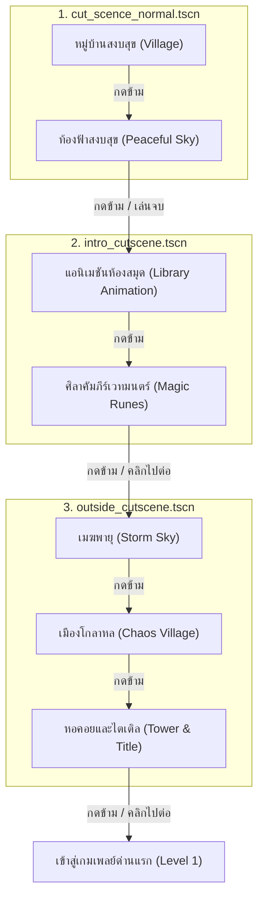

# คู่มือระบบควบคุมคัตซีน (Cutscene Controls Specification & Manual)

เอกสารนี้ระบุรายละเอียดการทำงานของ **ระบบเร่งความเร็ว (Fast-Forward)** และ **ระบบข้ามคัตซีน (Skip)** ของเกม Git Di Waa รวมถึงรูปแบบหน้าตา UI, วิธีการควบคุม, การทำงานเบื้องหลัง, และเส้นทางการเปลี่ยนผ่านฉาก (Scene Flow)

---

## 1. ระบบเร่งความเร็ว (Fast-Forward System)

ในระบบใหม่นี้ ผู้เล่นสามารถเลือกใช้งานการเร่งความเร็ว (2.5x) ได้อย่างอิสระถึง **2 รูปแบบพร้อมกัน** โดยไม่ขัดแย้งกัน:

### 1.1 วิธีใช้งาน (2 รูปแบบ)
1. **คลิกปุ่มสลับบนหน้าจอ (On-Screen Toggle Button):**
   * คลิกที่ปุ่ม `⏵ 1.0x` ที่มุมขวาบนของหน้าจอ
   * ปุ่มจะสลับเป็นโหมดเร่งสปีดค้างไว้ทันที โดยแสดงลูกศรคู่พร้อมแอนิเมชันลูกศรเด้งไปทางขวา (`⏵ ⏵ 2.5x`) คงดีไซน์กรอบเรโทร 8-bit สีดำขอบขาวนวลเดิม
   * เมื่อคลิกซ้ำอีกครั้ง จะสลับกลับมาเป็นความเร็วปกติ `⏵ 1.0x`
2. **กดค้างบนคีย์บอร์ดหรือเมาส์ (Hold-Key Real-Time):**
   * กดปุ่ม **Spacebar**, **Shift** (ซ้าย/ขวา), **Enter**, หรือ **คลิกเมาส์ซ้ายค้างไว้** บนหน้าจอ
   * ความเร็วจะเร่งเป็น 2.5x ทันทีในขณะที่กดค้าง และปุ่มบนหน้าจอจะแสดงลูกศรคู่เด้งดึ๋งไปข้างหน้าตามจังหวะการกด
   * เมื่อปล่อยมือ ความเร็วจะคืนกลับมาเป็น 1.0x ปกติทันที (หากไม่ได้กด Toggle ปุ่มบนหน้าจอค้างไว้)

### 1.2 ผลลัพธ์หลังสั่งเร่งสปีด (Engine Behavior)
* **ความเร็วเกม:** ตัวเกมจะปรับอัตราความเร็วของระบบ:
  $$\text{Engine.time_scale} = 2.5$$
  ทำให้อนิเมชันตัวละคร, การเคลื่อนที่, ข้อความ, และเอฟเฟกต์ภาพทั้งหมดวิ่งเร็วขึ้นเป็น **2.5 เท่า** ของความเร็วปกติ
* **การซิงค์กันระหว่างปุ่มและคีย์ลัด:**
  * หากเปิดปุ่ม Toggle ทิ้งไว้ เกมจะวิ่ง 2.5x ต่อเนื่อง แม้จะปล่อยมือจาก Spacebar แล้ว
  * หากปิดปุ่ม Toggle ไว้ ผู้เล่นยังคงสามารถกด Spacebar/Shift ค้างเพื่อเร่งสปีดชั่วคราวได้ตลอดเวลา
* **การแสดงผลต่อเนื่อง (Continuous Button Visibility):**
  * ปุ่มเร่งความเร็วจะ **คงอยู่บนหน้าจอตลอดเวลา** ในทุกคัตซีน รวมถึงช่วงอ่านมนตราโบราณและช่วงหน้าไตเติลเกม เพื่อให้ผู้เล่นเร่งดูเนื้อหาได้ตามใจชอบ
  * เมื่อเกิดการตัดเปลี่ยนฉาก (Transition) ระบบจะคืนค่าความเร็วกลับเป็น `1.0x` ชั่วคราวเพื่อความราบรื่นในการโหลดฉาก

---

## 2. ระบบปุ่มข้ามคัตซีน (Skip Button System)

### 2.1 วิธีใช้งาน (Controls)
ผู้เล่นสามารถสั่งข้ามคัตซีนได้ 2 ช่องทาง:
1. **คลิกปุ่มบนหน้าจอ:** คลิกปุ่ม `ข้าม` ที่มุมขวาบนของหน้าจอ
2. **กดคีย์ลัดบนคีย์บอร์ด:** กดปุ่ม **Esc (Escape)** ได้ตลอดเวลา

### 2.2 ดีไซน์และรูปแบบปุ่ม (UI Design & Styling)
ปุ่มควบคุมถูกวางไว้ที่ **มุมขวาบนของหน้าจอ** สไตล์เรโทร 8-bit ตามอัตลักษณ์ของเกม:

| คุณสมบัติ (Property) | ค่าที่กำหนด (Value) | รายละเอียด |
| :--- | :--- | :--- |
| **ตำแหน่ง (Position)** | มุมขวาบน (`PRESET_TOP_RIGHT`) | ห่างจากขอบขวา 20px, ขอบบน 20px (`y: 20px - 60px`) |
| **ขนาดปุ่ม (Size)** | ปุ่มเร่ง: กว้าง 100px / ปุ่มข้าม: กว้าง 90px (สูง 40px) | ขนาดสมดุล จัดกึ่งกลางพอดีทั้งโหมด 1.0x และ 2.5x |
| **ฟอนต์ (Font)** | `res://assets/fonts/TA-8-bit.ttf` | ฟอนต์พิกเซล 8-bit คมชัด รองรับภาษาไทยสมบูรณ์ |
| **ขนาดฟอนต์ (Font Size)** | `20px` | คมชัด อ่านง่ายบนหน้าจอความละเอียดสูง |
| **ข้อความบนปุ่ม (Text)** | `ข้าม` | ปรับข้อความเรียบง่าย สไตล์มินิมอลเรโทรตามคำขอ |
| **สีกรอบปุ่ม (Border Color)** | สีขาวนวล `Color(0.98, 0.976, 0.965, 0.85)` (`#FAF9F6`) | ขอบเส้นเด่นชัดสไตล์เกมเรโทร ตัดกับฉากหลังมืด |
| **ความหนากรอบ (Border Width)** | `2px` ทั้ง 4 ด้าน | เส้นกรอบ 8-bit หนาพอเหมาะ |
| **ความโค้งมน (Corner Radius)** | มนมุม `8px` ทั้ง 4 ด้าน | ให้ความรู้สึกนุ่มนวลแบบ Modern Retro |
| **สีพื้นหลังปกติ (Normal BG)** | สีน้ำเงินเข้มเกือบดำ `Color(0.00392, 0, 0.07451, 0.95)` (`#010013`) | พื้นหลังทึบ 95% ตัดกับฉากด้านหลัง อ่านง่าย |
| **สีพื้นหลังเมื่อชี้ (Hover BG)** | สีม่วงเข้ม `Color(0.06, 0.04, 0.16, 0.95)` + กรอบสว่าง 100% | มี Feedback ชัดเจนเมื่อผู้เล่นเลื่อนเมาส์ไปชี้ |

### 2.3 การข้ามแบบรายฉากย่อย (Granular Stage-by-Stage Skipping)
เพื่อไม่ให้การกด "ข้าม" กระโดดข้ามเนื้อเรื่องทั้งหมดไปถึงตอนจบ ระบบนำเทคนิค `custom_skip_action: Callable` มาใช้ เพื่อให้แต่ละฉากสามารถข้ามฉากย่อยทีละขั้นอย่างต่อเนื่อง:
1. **`cut_scence_normal`:**
   * **Stage 1 (หมู่บ้านสงบสุข):** กดข้าม -> ข้ามไปเปิดฉากท้องฟ้าสงบสุข (Stage 2) ทันที
   * **Stage 2 (ท้องฟ้าสงบสุข):** กดข้าม -> ตัดเข้าสู่ฉากห้องสมุด (`intro_cutscene.tscn`)
2. **`intro_cutscene`:**
   * **Stage 1 (แอนิเมชันห้องสมุด/คัมภีร์แตก):** กดข้าม -> ข้ามไปหน้าแสดงแผ่นกระดาษมนตราโบราณ (`_skip_to_magic_text()`) โดยไม่ข้ามฉากทิ้ง
   * **Stage 2 (หน้ามนตราโบราณ):** กดข้าม -> ตัดเข้าสู่ฉากภายนอก (`outside_cutscene.tscn`)
3. **`outside_cutscene`:**
   * **Stage 1 (เมฆพายุ):** กดข้าม -> ข้ามไปฉากบ้านเมืองโกลาหล (Stage 2)
   * **Stage 2 (บ้านเมืองโกลาหล):** กดข้าม -> ข้ามไปฉากหอคอยทมิฬและไตเติลเกม (Stage 3)
   * **Stage 3 (หอคอยทมิฬ/ไตเติล):** กดข้าม -> เข้าสู่เกมเพลย์ด่านแรก (`_trigger_start_level()`)

### 2.4 การป้องกันการดักจับคลิกชนปุ่มควบคุม (Click Passthrough Fix)
* **ปัญหาเดิม:** ในฉากที่มีการกดหน้าจอเพื่อไปต่อ (`_input(event)`) มีคำสั่ง `get_viewport().set_input_as_handled()` ดักจับเมาส์คลิกซ้ายก่อนที่ระบบ GUI ของ Godot จะส่ง event ไปถึงปุ่ม ส่งผลให้เมื่อผู้เล่นคลิกปุ่ม "ข้าม" หรือปุ่ม "เร่งความเร็ว" ระบบเข้าใจผิดคิดว่าผู้เล่นคลิกเพื่ออ่านต่อ และปุ่มกดไม่ติด
* **การแก้ไข:** เพิ่มการตรวจสอบ `var hovered := get_viewport().gui_get_hovered_control(); if hovered is BaseButton: return` เพื่อปล่อยให้สัญญาณการคลิกส่งตรงไปยังปุ่มกดได้อย่างสมบูรณ์

---

## 3. เส้นทางการข้ามฉาก (Scene Flow & Transition Matrix)

| ลำดับฉาก | ไฟล์ฉาก (`.tscn`) | พฤติกรรมเมื่อกดปุ่ม "ข้าม" (Skip Behavior) | ปลายทางเมื่อจบคัตซีน |
| :---: | :--- | :--- | :--- |
| **1** | `cut_scence_normal.tscn` | ข้ามจากหมู่บ้าน -> ท้องฟ้า -> ห้องสมุด ทีละสเต็ป | `intro_cutscene.tscn` |
| **2** | `intro_cutscene.tscn` | ข้ามแอนิเมชัน -> หน้ามนตรา -> ฉากภายนอก ทีละสเต็ป | `outside_cutscene.tscn` |
| **3** | `outside_cutscene.tscn` | ข้ามจากพายุ -> บ้านเมือง -> หอคอยไตเติล -> เริ่มด่าน ทีละสเต็ป | `inside_tower_cutscene.tscn` *(fallback: Sandbox)* |

---

## 4. ระบบการเล่นอนิเมชันในฉากห้องสมุด (Dual Playback Modes)

ในไฟล์ [`src/GitDiwaa.Godot/scripts/cutscene/intro_cutscene.gd`](file:///c:/Users/67030311/Documents/Game-Git-Diwaa/src/GitDiwaa.Godot/scripts/cutscene/intro_cutscene.gd) มีตัวแปร `@export_enum("AnimationPlayer", "ScriptTween") var playback_mode` ให้ผู้พัฒนาสามารถเลือกวิธีเล่นฉากได้ 2 รูปแบบผ่าน Inspector:

1. **โหมด `AnimationPlayer` (โหมดมาตรฐานเริ่มต้น - แนะนำ):**
   * เล่นแอนิเมชันชื่อ `"walk_in"` ที่กำหนด Keyframe ไว้บน Timeline ของ Node `AnimationPlayer` ใน Godot Editor
   * ควบคุมจังหวะตัวละครเดิน หลุมดำดูดอาจารย์ คัมภีร์ตก และเศษกระจายได้อย่างราบรื่น
2. **โหมด `ScriptTween` (`play_with_tween()`):**
   * ควบคุมการเคลื่อนไหวผ่านโค้ด GDScript เพียวๆ ด้วย `create_tween()`
   * เหมาะสำหรับใช้ทดสอบการทำงานของ Tween หรือใช้เป็นโค้ดสำรองทางเทคนิค

---

## 5. แอนิเมชันตัวละครเวลและตัวอักษร ! ตกใจบนหัว (Vel Shock Jump & Emote !)

* **จังหวะปรมาจารย์ตกหลุมดำ (ที่วินาที 9.38):**
  * **สลับสไปรต์:** เปลี่ยนเป็นหน้าตกใจสุดขีดทันที `vel.play("shock")`
  * **เวลกระโดดสะดุ้งตัวลอย (Jump Arc):** เลียนแบบตามแบบฉาก `ending-cutscene` (Stage 5)
    * **พุ่งตัวลอยขึ้นสู่อากาศ (0.22s):** ดีดตัวจากพื้น `y: 59px` ขึ้นสู่จุดสูงสุด `y: 35px` (ความสูง 24px) ด้วยเส้นโค้ง `TRANS_QUAD` และ `EASE_OUT`
    * **แลนดิ้งทิ้งตัวกลับสู่พื้น (0.25s):** ตกลงมาแตะพื้นไม้ที่ `y: 59px` ด้วยเส้นโค้ง `TRANS_QUAD` และ `EASE_IN`
  * **ตัวอักษร ! ตกใจบนหัว (Font Text Label !):**
    * **รูปแบบตัวอักษร:** ใช้ Label ฟอนต์พิกเซล `TA-8-bit.ttf` ขนาด `28px` สีแดงนวล `#EB5C5C` (`Color(0.92, 0.36, 0.36, 1.0)`) พร้อมเส้นขอบสีดำหนา `5px` คมชัดสไตล์เรโทร
    * **กระโดดขึ้นพร้อมกับเวล:** ปรากฏตัวขึ้นเหนือศีรษะเวล (`position: Vector2(0, -52)`) ขยายตัว Pop Bounce (`scale: 1.15 -> 1.0`) และพุ่งลอยขึ้นสู่อากาศพร้อมกับเวลไปสู่จุดสูงสุด (`y: -58px`)
    * **ลงสู่พื้นพร้อมกัน:** ตกลงมาสู่ระดับปกติ (`y: -52px`) พร้อมจังหวะแลนดิ้งแตะพื้นของเวล
    * **แลนดิ้งปุ๊บยุบตัวหายทันที (0.15s):** เมื่อแตะพื้น ตัวอักษร `!` จะยุบตัวหายวับไปทันที (`scale -> 0`, `modulate:a -> 0`) ไม่ลอยค้างบนจอ

---

## 6. ประวัติการแก้ไขและรายการคอมมิต (Changelog & Commit Specifications)

### รายละเอียดการเปลี่ยนแปลงล่าสุด: แก้ปุ่มข้ามให้ข้ามฉากย่อยตามลำดับ ไม่ตัดจบ และคงปุ่มเร่งความเร็วไว้ตลอดเวลา
* **ชื่อคอมมิต (Commit Title):**
  * **ไทย:** `fix(cutscene): แก้ปุ่มข้ามให้ข้ามเฉพาะฉากย่อยตามลำดับ ป้องกันการตัดจบ และคงปุ่มเร่งสปีดไว้ตลอดเวลา`
  * **Conventional Commits:** `fix(cutscene): implement granular stage-by-stage skip, prevent early scene skip to end, and persist fast-forward button across all cutscenes`
* **รายละเอียดสิ่งที่ทำไป (Commit Details):**
  1. **ระบบข้ามคัตซีนแบบรายฉากย่อย (Granular Stage-by-Stage Skip):**
     - เพิ่ม `custom_skip_action: Callable` ใน `skip_cutscene_button.gd` ให้ฉากแม่ดักจับการกดข้ามได้โดยตรง
     - ใน `cut_scence_normal.gd`: เมื่อกด "ข้าม" ช่วงหมู่บ้าน (Stage 1) จะข้ามไปฉากท้องฟ้า (Stage 2) และเมื่อกดข้ามอีกครั้งจึงตัดเข้าสู่ห้องสมุด
     - ใน `intro_cutscene.gd`: เมื่อกด "ข้าม" ช่วงแอนิเมชันห้องสมุด (Stage 1) จะข้ามไปยังหน้าแสดงแผ่นกระดาษมนตราโบราณทันที (`_skip_to_magic_text()`) โดยไม่ข้ามฉากทิ้ง และเมื่อกดข้ามอีกครั้งในหน้ามนตรา จึงจะตัดเข้าสู่ฉากภายนอก
     - ใน `outside_cutscene.gd`: เมื่อกด "ข้าม" ช่วงพายุ (Stage 1) จะข้ามไปช่วงบ้านเมืองโกลาหล (Stage 2) -> กดข้ามอีกครั้งไปช่วงหอคอยทมิฬและไตเติล (Stage 3) -> กดข้ามอีกครั้งจึงจะเข้าสู่เกมเพลย์ด่านแรก
  2. **คงปุ่มเร่งความเร็วไว้ตลอดเวลา ไม่ซ่อนออก (Continuous Fast-Forward Availability):**
     - นำคำสั่ง `set_fast_forward_visible(false)` ออกจากทุกจุดใน `cut_scence_normal.gd`, `intro_cutscene.gd`, และ `outside_cutscene.gd`
     - ปรับให้ผู้เล่นสามารถกดเร่งสปีด 2.5x ได้ตลอดเวลาทั้งในระหว่างฉากแอนิเมชัน, ช่วงอ่านมนตรา, และช่วงหน้าไตเติลเกม
  3. **แก้ไขปัญหาปุ่มข้ามและปุ่มเร่งกดไม่ติด (Fix Button Click Passthrough):**
     - ใน `intro_cutscene.gd` และ `outside_cutscene.gd` ฟังก์ชัน `_input(event)` ดักจับการคลิกเมาส์ซ้ายเพื่ออ่านต่อ/เริ่มเกม แล้วเรียก `set_input_as_handled()` ทำให้ปุ่มไม่ได้รับคลิก
     - เพิ่มการตรวจสอบ `var hovered := get_viewport().gui_get_hovered_control(); if hovered is BaseButton: return`
     - ทำให้เมื่อผู้เล่นคลิกบนปุ่ม "ข้าม" หรือปุ่มเร่งความเร็ว สัญญาณคลิกจะไม่ถูกกลืน และทำงานได้อย่างแม่นยำ 100%
  4. **ระบบ Scene Fallback ป้องกันการข้ามแล้วค้าง (Robust Scene Fallback):**
     - ใน `outside_cutscene.gd` เพิ่มการตรวจเช็คเส้นทางฉากถัดไปทั้ง `inside_tower_cutscene.tscn`, `SandboxGameView.tscn`, และ fallback สู่ `cut_scence_normal.tscn` เพื่อให้สามารถทดสอบคัตซีนได้อย่างราบรื่น

---

### รายละเอียดการเปลี่ยนแปลงก่อนหน้า (Previous Commits)
* **ชื่อคอมมิต:** `fix(cutscene): จัดกึ่งกลางปุ่มเร่งสปีด ลูกศรเด้งคู่พร้อมกัน ระนาบเลขพอดีกับลูกศร และปรับปุ่มข้ามเหลือ 'ข้าม'`
* **รายละเอียด:** จัดตำแหน่งกึ่งกลางปุ่มเร่งสปีด, ซิงค์ลูกศรคู่เด้งพร้อมกัน, ชดเชยระนาบ -4px ให้พอดีกับตัวเลข 1.0x/2.5x, ปรับปุ่มข้ามเหลือคำว่า 'ข้าม' และคงสไตล์เรโทร 8-bit ดั้งเดิม
