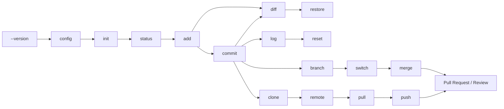
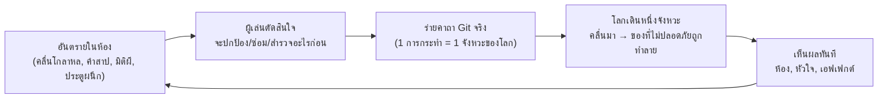

# Git-Diwaa — Game Design v2 (ฉบับปรับปรุงตามข้อเสนอแนะ)

> ยึดเนื้อเรื่องเดิม "บททดสอบแห่งหอคอยเวทมนตร์" (เวล, มิวรา, ผู้พิทักษ์คลังเวทกลาง, ปรมาจารย์, เศษคัมภีร์ 16 ชิ้น)
> แต่เปลี่ยนวิธีเล่นจาก **"อ่านชีท → ดูรูปคุยกัน → พิมพ์ตาม"** เป็น **"เจอปัญหาในโลกเวท → ร่ายคาถา (Git จริง) → เห็นโลกเปลี่ยน"**

---

## 0. ปัญหาของเวอร์ชันเดิม (จากข้อเสนอแนะ)

| อาการที่ผู้ทดสอบเจอ | สาเหตุเชิงออกแบบ | แนวทางแก้ในเวอร์ชันนี้ |
|---|---|---|
| "เหมือนเอาชีทมาแปะ" | แต่ละด่านแยก 3 ขั้น *สอน → เล่น → สรุป* ชัดเจน ผู้เล่นรู้ตัวว่ากำลังถูกสอน | รวมเป็นวงจรเดียว **ปัญหา → ลงมือ → ผลลัพธ์ในโลก** ความรู้แทรกอยู่ในปัญหา (stealth learning) |
| "รูปมาพูด ๆ" | บทสนทนายาว + ปุ่มคำถาม (Choice) ที่ไม่มีผลต่อการเล่น | บทพูดต่อจังหวะไม่เกิน 3 บรรทัด, คำถามย้ายไปเป็นคำสั่ง `ask` (เลือกอ่านเมื่ออยากรู้) |
| คำสั่งไม่สัมพันธ์กับสิ่งที่เกิดในฉาก | คำสั่งเป็นแค่ "กุญแจเปิดประตู" | ทุกคาถาเปลี่ยนโลก **ตรงตามหน้าที่จริงของคำสั่ง** (เช่น `reset` = ย้อนเวลา, `branch` = แยกมิติ) |
| หน้าจอรก | แสดง Terminal + File + Graph ทุกด่าน | **Contextual UI** แผงข้อมูลปลดล็อกตามความรู้ที่ผู้เล่นมี |
| การวัดผลเป็นการเลือกตอบ | ตัวเลือก / เฟรมภาพนิ่ง | ตรวจจาก **สถานะ Repository จริง** และการกระทำของผู้เล่น |

---

## 1. กรอบแนวคิด LM-GM (Learning Mechanics – Game Mechanics)

อ้างอิง Arnab et al. (2015) *Mapping learning and game mechanics for serious games analysis*, British Journal of Educational Technology 46(2).
หลักคือ **ทุกกลไกเกมต้องจับคู่กับกลไกการเรียนรู้** ถ้ากลไกใดไม่มีคู่ ให้ตัดหรือลดบทบาท

### 1.1 ตารางจับคู่หลัก (Core LM-GM Map)

| Learning Mechanic | Game Mechanic ใน Git-Diwaa | ตัวอย่างในเกม | คำสั่ง Git |
|---|---|---|---|
| Discover / Explore | **ร่ายคาถาสำรวจ** แล้วโลกเผยข้อมูลที่ซ่อนอยู่ | ร่าย `status` แล้วเศษคัมภีร์ที่ยังไม่ถูกติดตามเรืองแสง | status, log, diff |
| Instructional (just-in-time) | **คำแนะนำของมิวราเมื่อจำเป็น** (Hint 3 ระดับ, ค่อย ๆ จางหายใน Act หลัง) | `hint` ครั้งที่ 1 บอกเป้าหมาย / ครั้งที่ 3 บอกคาถา | ทุกคำสั่ง |
| Action / Task | **วงร่ายเวท** — พิมพ์คาถา Git จริง | ผู้เล่นพิมพ์ `git add scroll.txt` | ทุกคำสั่ง |
| Demonstration → Imitation | ด่านต้นมีตัวอย่างคาถาในเป้าหมาย, ด่านหลังไม่มี | Floor 1–5 เป้าหมายบอกคาถา, Floor 6+ บอกแค่สิ่งที่ต้องการ | — |
| Feedback | **เอฟเฟกต์เวทในฉาก** สร้างจากการเปรียบเทียบสถานะก่อน/หลัง | เศษคัมภีร์ลอยขึ้นแท่นเตรียม, หนังสือเรืองแสงเมื่อจารึก | add, commit |
| Experimentation | **มิติคู่ขนาน** ลองผิดได้โดยไม่กระทบเส้นทางหลัก | สลับไปมิติ `experiment` แล้วเห็นเศษคัมภีร์หายเมื่อกลับ `main` | branch, switch |
| Analyse / Identify | **ปริศนารหัสผ่าน** ต้องอ่านผลลัพธ์จริงเพื่อหาคำตอบ | หารหัสผนึกจากประวัติจารึกแล้ว `say <รหัส>` | log, diff |
| Repetition | **โกลาหลแทรกแซง** (World Event) ทำให้ต้องใช้คาถาเดิมในบริบทใหม่ | พลังโกลาหลแก้ข้อความคัมภีร์ → ต้อง diff/restore | diff, restore |
| Plan / Strategize | **เลือกระดับการย้อนเวลา** ที่มีผลจริง | `reset --hard` ทำเศษคัมภีร์ชิ้นที่ 6 หาย, `--soft` รักษาไว้ | reset |
| Collaboration | **คลังเวทกลางและจอมเวทคนอื่น (NPC)** ส่งงานเข้าคลังพร้อมกัน | จอมเวทอื่นอัปเดตคลัง → ต้อง `pull` ก่อน `push` | clone, pull, push, fetch |
| Assessment | **สถานะ Repository สุดท้าย** ไม่ใช่ข้อความคำสั่ง | ผ่านด่านเมื่อ HEAD, Stage, Branch ตรงเป้าหมาย | — |
| Reflect | **บันทึกสั้นท้ายด่าน** ("สิ่งที่นายเพิ่งทำคือ…") 1–2 บรรทัด | สรุปผลพร้อมชื่อคาถาจริง | — |
| Motivation (รอง) | ดาว / Coin / Leaderboard | แสดงตอนจบด่านเท่านั้น | — |

### 1.2 กลไกที่ถูกตัดหรือลดบทบาท (ไม่มีคู่ LM)

* **ปุ่มคำถาม 3–4 ตัวเลือกก่อนเล่น** → ย้ายเป็นคำสั่ง `ask` (ผู้เล่นเลือกเปิดเอง ไม่ขวางการเล่น)
* **ตัวเลือก "ใช่/ไม่" ที่จบเกมทันที** → ตัด (ไม่มีผลต่อการเรียนรู้)
* **ฉากสรุปผลที่เป็นบทสนทนายาว** → เหลือ 1–2 บรรทัด + ชื่อคาถาที่ใช้
* **คำสั่งที่ใช้เพียงเพื่อ "ขยับสิ่งกีดขวาง"** → ไม่มีอีกต่อไป ทุกคำสั่งต้องเปลี่ยนสถานะ Git จริง

---

## 2. ขอบเขตเนื้อหาและทฤษฎีรองรับการคัดเลือกคำสั่ง

### 2.1 เกณฑ์คัดเลือก "คำสั่ง Git ขั้นพื้นฐาน"

คำสั่งที่อยู่ในเกมต้องผ่านเกณฑ์อย่างน้อย 2 ใน 3 ข้อ:

1. **ความถี่ในการใช้งานจริง (Frequency of Use)** — อยู่ในกลุ่มคำสั่งที่นักพัฒนาใช้บ่อยที่สุด ตามผลศึกษาการใช้ Git CLI ของนักพัฒนา และหัวข้อพื้นฐานใน *Pro Git* (Chacon & Straub, 2014) บทที่ 2–3 (Git Basics, Branching)
2. **ความจำเป็นต่อเวิร์กโฟลว์มาตรฐาน (Workflow Necessity)** — จำเป็นต่อ *GitHub Flow* (branch → commit → push → Pull Request → review → merge) ซึ่งเป็นเวิร์กโฟลว์ที่ใช้สอนในหลักสูตรวิศวกรรมซอฟต์แวร์
3. **การกู้คืนจากความผิดพลาด (Recovery Value)** — ช่วยแก้ปัญหาที่ผู้เริ่มต้นพบบ่อย (แก้ไฟล์ผิด, stage ผิด, commit ผิด branch, conflict)

**มาตรฐานคำสั่ง:** ใช้รูปแบบปัจจุบันของ Git ≥ 2.23 เป็นหลัก — `git switch` / `git restore` แทน `git checkout`
เกมจะปฏิเสธ `git checkout` อย่างสุภาพ พร้อมบอกคาถาสมัยใหม่ที่ใช้แทน (ไม่รองรับรูปแบบเก่าทุกเวอร์ชัน)

### 2.2 การจัดหมวดหมู่: 5 สำนักเวท (Schools of Magic)

| สำนักเวท | แนวคิด Git | คำสั่ง | Act |
|---|---|---|---|
| 🔮 **เวทปลุกพลัง** (Awakening) | ตั้งค่าและสร้าง Repository | `--version`, `config`, `init` | 1 |
| 👁 **เวทหยั่งรู้** (Divination) | สังเกตสถานะ / ประวัติ / ความต่าง | `status`, `log`, `diff`, `show` | 1, 3 |
| ✒️ **เวทจารึก** (Inscription) | Working Tree → Stage → Commit | `add`, `commit`, `commit --amend` | 1, 3 |
| ⏳ **เวทกาลเวลา** (Chronomancy) | ย้อน / กู้คืน | `restore`, `restore --staged`, `reset --soft/--mixed/--hard` | 1, 3 |
| 🌌 **เวทมิติ** (Dimension) | Branch และการรวม | `branch`, `switch`, `switch -c`, `merge`, `merge --abort` | 1, 3 |
| 🏛 **เวทเชื่อมคลัง** (Conjuration) | Remote และการทำงานเป็นทีม | `clone`, `remote`, `fetch`, `pull`, `push`, `push -u` | 1, 2, 3 |

### 2.3 ลำดับการเรียนรู้ (Prerequisite Graph)

อ้างอิง **Gagné's Learning Hierarchy** (ทักษะระดับสูงต้องสร้างบนทักษะย่อยที่เป็นพื้นฐาน)
และ **Revised Bloom's Taxonomy** (Anderson & Krathwohl, 2001) สำหรับระดับความลึกของแต่ละ Act



| Act | ระดับ Bloom | ลักษณะการเล่น | ระดับการช่วยเหลือ (Scaffolding) |
|---|---|---|---|
| Act 1 หอคอย 15 ชั้น | Remember → Understand → Apply | ปริศนาเดี่ยว 1 แนวคิดต่อชั้น | สูง: เป้าหมายบอกคาถา (ชั้น 1–5) → บอกแค่ผลที่ต้องการ (ชั้น 6+) |
| Act 2 คลังเวทกลาง | Apply → Analyse | ทำงานร่วมกับจอมเวท NPC ใน GitHub Flow | กลาง: Hint ระดับ 1–3 |
| Act 3 วิกฤตหอคอย | Analyse → Evaluate | สถานการณ์ปัญหาผสม เลือกคาถาเอง | ต่ำ: Hint แค่ระดับ 1–2 (Fading ตาม Vygotsky ZPD) |

### 2.4 การผสานความสนุกกับการเรียนรู้ (Stealth Learning)

* **ไม่มีขั้น "สอน" แยก** — ทุกชั้นเริ่มจาก *ปัญหาในโลก* (คัมภีร์ถูกสาป, ประตูผนึก, มิติแตก) แล้วผู้เล่นค้นพบว่าคาถาไหนแก้ได้
* **ล้มเหลวได้อย่างปลอดภัย** — Sandbox ทำให้ลองคำสั่งผิดได้ เกมตอบด้วยข้อความ Git จริง + การแปลความของมิวราสั้น ๆ
* **ผลลัพธ์เห็นเป็นรูปธรรม** — สถานะ Git ถูกแปลงเป็นภาพ (โต๊ะเขียน / แท่นเตรียม / คัมภีร์ / มิติ / คลังเวท)
* **ความอยากรู้นำทาง** — รหัสผนึก, เศษคัมภีร์ที่หายไป, เบาะแสของปรมาจารย์ ซ่อนอยู่ในประวัติ Git จริง

---

## 3. การเปรียบเปรยและคำศัพท์ในโลกเวท (Metaphor & In-Game Terminology)

หลักการ: **อุปมาต้องทำงานเหมือนของจริง** — ถ้าผู้เล่นเข้าใจอุปมา ก็ต้องทำนายพฤติกรรมของ Git ได้ถูก

### 3.1 แผนที่อุปมา (Metaphor Map)

| แนวคิด Git | ในโลกเวท | ทำไมอุปมานี้ "ถูกต้อง" |
|---|---|---|
| Repository | **คัมภีร์เวทส่วนตัว** | เก็บทุกการจารึกและประวัติทั้งหมด |
| Working Tree | **โต๊ะเขียน (Desk)** | ที่วางเศษคัมภีร์ที่กำลังแก้ ยังไม่ถาวร |
| Untracked file | **เศษคัมภีร์ไร้ตรา** | คัมภีร์ยังไม่รู้จักมัน |
| Staging Area | **แท่นเตรียม (Altar)** | คัดเลือกว่าจะจารึกชิ้นไหน ก่อนจารึกจริง |
| Commit | **การจารึก (Inscription)** | ถาวร มีชื่อผู้จารึก ข้อความ และเวลา |
| Commit message | **คำจารึก** | บอกว่าจารึกครั้งนี้คืออะไร |
| HEAD | **ที่คั่นหน้า (Bookmark)** | บอกว่าตอนนี้เรายืนอยู่ ณ หน้าไหนของประวัติ |
| `log` | **ม้วนประวัติ** | อ่านย้อนการจารึกทั้งหมด |
| `diff` | **คาถาเทียบรอย** | เทียบรอยอักขระสองช่วงเวลา |
| `restore` | **คาถาฟื้นคืน** | คืนเศษคัมภีร์บนโต๊ะ/แท่น ให้เหมือนที่จารึกไว้ล่าสุด |
| `reset` | **เวทย้อนกาล** | เลื่อนที่คั่นหน้ากลับไปในอดีต — ระดับ soft/mixed/hard = เก็บไว้บนแท่น / เก็บไว้บนโต๊ะ / ลบทิ้งหมด |
| Branch | **มิติคู่ขนาน** | เส้นเวลาแยกที่ทดลองได้โดยไม่กระทบมิติหลัก |
| `switch` | **ประตูมิติ** | ย้ายตัวเองไปยืนในมิติอื่น โลกรอบตัว (ไฟล์) เปลี่ยนตาม |
| `merge` | **พิธีหลอมมิติ** | รวมสองเส้นเวลา |
| Merge conflict | **การปะทะของมิติ** | สองมิติเขียนอักขระต่างกัน ณ จุดเดียวกัน ต้องตัดสินใจเอง |
| Remote | **คลังเวทกลาง** | ที่เก็บความรู้ร่วมของจอมเวททุกคน |
| `clone` | **คาถาคัดลอกคัมภีร์** | ได้ทั้งเนื้อหาและประวัติ |
| `pull` / `fetch` | **คาถาเรียกความรู้** / **คาถาส่องคลัง** | fetch = ดูว่าคลังมีอะไรใหม่, pull = ดึงลงมารวมกับคัมภีร์เรา |
| `push` | **คาถาส่งผ่านประตูเวท** | ส่งการจารึกของเราเข้าคลัง |
| Pull Request | **คำร้องต่อสภาจอมเวท** | ขอให้ผู้อาวุโสตรวจก่อนหลอมเข้ามิติหลัก |

### 3.2 วิธีใช้คำศัพท์ในบทสนทนา

* ตัวละครพูดด้วย **คำในโลกเวทเสมอ** เช่น "วางเศษคัมภีร์ขึ้นแท่นเตรียม" ไม่ใช่ "add ไฟล์เข้า Staging Area"
* **ชื่อคาถาจริงปรากฏเฉพาะใน** (1) วงร่ายเวท (Terminal) (2) สมุดคาถา (`spells`) (3) บันทึกท้ายด่าน — เพื่อให้ผู้เล่นเชื่อมโยงอุปมา ↔ คำสั่งจริงได้เอง
* ข้อความ error ของ Git แสดงตามจริง (เรียนรู้ข้อความจริง) แล้วมิวราแปลเป็นภาษาโลกเวท 1 บรรทัด

---

## 4. UI/UX และปฏิสัมพันธ์

### 4.1 Visual Feedback — เอฟเฟกต์สร้างจาก "สถานะก่อน/หลัง"

เกมไม่เดาจากข้อความคำสั่ง แต่เปรียบเทียบ Snapshot ของ Repository ก่อนและหลังร่ายคาถา แล้วเลือกเอฟเฟกต์:

| การเปลี่ยนแปลงของสถานะ | เอฟเฟกต์ในฉาก |
|---|---|
| Repository ถูกสร้าง | คัมภีร์เล่มใหม่ปรากฏกลางวงเวท |
| ไฟล์เข้า Stage เพิ่ม | เศษคัมภีร์ลอยจากโต๊ะขึ้นแท่นเตรียม |
| Commit ใหม่ | แสงจารึกลงหน้าคัมภีร์ + เสียงระฆัง |
| HEAD ถอยหลัง | นาฬิกาทรายหมุนกลับ (ย้อนกาล) |
| ไฟล์ถูกคืนค่า | รอยสาปบนเศษคัมภีร์สลายไป |
| Branch ใหม่ | รอยแยกมิติ |
| เปลี่ยน Branch | ก้าวผ่านประตูมิติ |
| Merge commit | สองแสงหลอมรวม |
| มีไฟล์ Unmerged | สายฟ้าปะทะระหว่างมิติ |
| Remote ref เปลี่ยน (push) | เศษคัมภีร์บินเข้าประตูคลังเวท |
| Commit ใหม่จาก Remote (pull/fetch) | ความรู้ไหลออกจากประตูคลังเวท |
| คำสั่งผิด / ถูกปฏิเสธ | วงเวทกระพริบแดง |

### 4.2 Contextual UI — แผงข้อมูลปลดล็อกตามความรู้

| แผง | ปลดล็อกเมื่อ | แสดงอะไร |
|---|---|---|
| วงร่ายเวท (Terminal) | ชั้น 1 | ผลลัพธ์ Git จริง |
| โต๊ะเขียน (Desk) | ชั้น 3 (`status`) | ไฟล์ใน Working Tree + สถานะ |
| แท่นเตรียม (Altar) | ชั้น 4 (`add`) | ไฟล์ใน Stage |
| คัมภีร์/ม้วนประวัติ (Tome) | ชั้น 5 (`commit`) | Commit ล่าสุด |
| แผนที่มิติ (Dimensions) | ชั้น 10 (`branch`) | กราฟ Branch |
| ประตูคลังเวท (Archive) | ชั้น 13 (`clone`) | Remote และ tracking |

ด่านที่ยังไม่ถึงเนื้อหาจะ **ไม่เห็นแผงนั้นเลย** และสมุดคาถา (`spells`) แสดงเฉพาะคาถาที่ปลดล็อกแล้ว

### 4.3 Interactive Assessment — วัดผลด้วยการลงมือ

* **ตัดคำถามปรนัย** ทั้งหมดที่ไม่กระทบการตัดสินใจ
* **ปริศนาที่ต้องอ่านผลลัพธ์จริง**: รหัสผนึกจาก `log`, อักขระที่ถูกแก้จาก `diff` → ตอบด้วย `say <คำตอบ>`
* **ทางเลือกที่มีผลจริง**: ระดับของ `reset`, วิธีแก้ conflict (`resolve`) — เลือกผิดเห็นผลทันทีและลองใหม่ได้ (`retry`)
* **ตรวจผ่านจากสถานะ Repository** (HEAD, Branch, Stage, Tracked files, Remote) ไม่ตรวจข้อความคำสั่ง ยกเว้นคาถาสำรวจ (`status`/`log`/`diff`) ที่ไม่เปลี่ยนสถานะ

### 4.4 เครื่องมือของโลกเกม (ไม่ใช่ Git)

ใช้ของที่มีอยู่แล้วใน Sandbox ของเกม Godot และเพิ่มเท่าที่จำเป็นต่อปริศนา:

| เครื่องมือ | หน้าที่ | สถานะ |
|---|---|---|
| `cat <file>` / แผง Files | อ่านเศษคัมภีร์บนโต๊ะ | มีแล้ว |
| `write <file> <ข้อความ>` / Editor ในแผง Files | เขียนทับเศษคัมภีร์ | มีแล้ว |
| `files` | ดูรายการไฟล์ | มีแล้ว |
| `say <คำ>` | เอ่ยรหัสผนึก (ปริศนาด่าน 6–7) | แผนถัดไป |
| แผงภารกิจ (Mission Panel) | เป้าหมายแบบ "ผลลัพธ์ในโลก" + คำใบ้ | ปรับในรอบนี้ |

---

## 5. การออกแบบด่านใหม่ (ยึดเนื้อเรื่องเดิม)

รูปแบบทุกชั้น: **ปัญหาในโลก → เป้าหมาย 1–3 ข้อ (ตรวจจากสถานะ) → เอฟเฟกต์ → บันทึกสั้น + เศษคัมภีร์**

### Act 1 — หอคอยเวทมนตร์ (ชั้น 1–15, เศษคัมภีร์ 1–12)

> สถานะ: Act 1 ครบ 15 ด่าน เล่นได้ในเกม Godot (`game/features/dialogue/levels/level_NN.gd`) ด่าน 2–15 เป็นมินิเกมห้อง (ดู §8)
> ตารางนี้คือแบบร่างแรก ฉบับที่ใช้จริงสรุปไว้ใน §8.3

| ชั้น | ชื่อตอน | ปัญหาในโลก (Hook) | สิ่งที่ผู้เล่นต้องทำให้เกิด | คาถา |
|---|---|---|---|---|
| 1 | ปลุกพลังเวท | ประตูหอคอยไม่รู้จักผู้เล่น | วงเวทตอบระดับพลัง, ประตูจำชื่อและตราประทับ | `--version`, `config` |
| 2 | คัมภีร์เล่มแรก | ไม่มีที่จารึกเศษคัมภีร์ | คัมภีร์ส่วนตัวถือกำเนิด | `init` |
| 3 | เศษคัมภีร์ไร้ตรา | เศษคัมภีร์ร่วงลงบนโต๊ะ ชิ้นไหนใหม่? | สำรวจสถานะ แล้วหยิบอ่านชิ้นที่ไร้ตรา | `status` |
| 4 | แท่นเตรียม | เศษคัมภีร์ชิ้นที่ 1 แตกเป็น 3 ส่วน | วางส่วนแรกขึ้นแท่น แล้ววางที่เหลือทั้งหมด → หลอมรวม | `add <file>`, `add .` |
| 5 | การจารึกครั้งแรก | เศษบนแท่นจะสลายถ้าไม่จารึก | จารึกพร้อมคำจารึก, แล้วจารึกการแก้ไขโดยไม่ผ่านแท่น | `commit -m`, `commit -am` |
| 6 | ม้วนประวัติของอาจารย์ | ประตูผนึกต้องใช้รหัสที่อาจารย์เคยจารึก | อ่านประวัติ หารหัส แล้ว `say` | `log`, `log --oneline` |
| 7 | รอยอักขระที่ถูกแก้ | พลังโกลาหลแก้อักขระในเศษคัมภีร์ | เทียบรอยหาอักขระเดิม แล้วตรวจสิ่งที่อยู่บนแท่น | `diff`, `diff --staged` |
| 8 | คาถาฟื้นคืน | เศษคัมภีร์ถูกสาป และคำสาปแอบขึ้นแท่น | ฟื้นคืนเศษคัมภีร์ และนำคำสาปลงจากแท่น | `restore`, `restore --staged` |
| 9 | เวทย้อนกาล | จารึกล่าสุดมีคำสาปปนกับเศษคัมภีร์ชิ้นที่ 6 | ย้อนกาลโดยไม่ทำลายเศษคัมภีร์ แล้วจารึกเฉพาะของดี (`--hard` = เศษหาย) | `reset --soft/--mixed` |
| 10 | รอยแยกมิติ | มีมิติผีค้างอยู่ และต้องการมิติทดลอง | สำรวจมิติ สร้าง `experiment` ลบมิติผี | `branch`, `branch -d` |
| 11 | ประตูมิติ | เศษคัมภีร์ชิ้นที่ 8 ปรากฏเฉพาะในมิติทดลอง | ข้ามมิติ จารึก แล้วกลับ main เห็นมันหายไป | `switch`, `switch -c` |
| 12 | พิธีหลอมมิติ | สองมิติเขียนอักขระชิ้นที่ 5 ต่างกัน | หลอมมิติ เจอการปะทะ ตัดสิน แล้วจารึกผล | `merge`, (`merge --abort`) |
| 13 | คัมภีร์แสงสว่าง | คัมภีร์อยู่ในคลังเวทกลาง | คัดลอกคัมภีร์ เดินเข้าห้อง ตรวจสายเชื่อม เพิ่มสายสำรอง | `clone`, `remote -v`, `remote add` |
| 14 | ความรู้ใหม่จากคลัง | จอมเวทอีกคนเพิ่งส่งความรู้เข้าคลัง | เรียกความรู้ล่าสุดลงมา | `pull` |
| 15 | ประตูสู่คลังเวทกลาง | ต้องส่งคัมภีร์ของตนเพื่อพิสูจน์ตัวตน | สร้างสายเชื่อม origin แล้วส่งพร้อมผูกเส้นทาง | `remote add`, `push -u` |

### Act 2 — คลังเวทกลาง (ชั้น 16–20, เศษคัมภีร์ 13–16) — แผนถัดไป

| ชั้น | ปัญหาในโลก | กลไกหลัก |
|---|---|---|
| 16 | ผู้พิทักษ์ให้ตั้งห้องเก็บความรู้ใหม่ในคลัง | `init` → `remote add` → `push -u`, เห็น "คำร้องต่อสภา" ตัวอย่าง |
| 17 | ต้องเสนอเศษคัมภีร์โดยไม่แตะมิติหลัก | `clone` → `switch -c` → `push -u` → เปิดคำร้อง (PR) |
| 18 | สภาส่งความเห็นกลับ | อ่าน Review แล้วระบุจุดที่ต้องแก้ด้วยการแก้จริง |
| 19 | ต้องแก้ตาม Review และดูว่าคลังขยับไปไหน | `add`/`commit`/`push` + `fetch` |
| 20 | สภาอนุมัติ — ฉากจบ ปรมาจารย์ปรากฏ | Merge PR → คัมภีร์ต้นกำเนิดครบ 16 ชิ้น |

### Act 3 — วิกฤตหอคอย (ชั้น 21–40) — แผนถัดไป

ใช้สถานการณ์เดิมจาก Storyboard (ชั้น 21–40) แต่เปลี่ยนเป็น **"เหตุร้ายในหอคอย"** ที่ผู้เล่นต้องวินิจฉัยเอง
ไม่มีเป้าหมายบอกคาถา, Hint สูงสุด 2 ระดับ, ตรวจจากสถานะปลายทางเท่านั้น
ตัวอย่าง: ชั้น 31 "จารึกหลงมิติ" — การจารึก 2 ครั้งลงผิดมิติ → ต้อง `branch` + `reset --hard` + `switch` ให้มิติถูกต้อง

---

## 6. ระบบเสริมแรงจูงใจ (Secondary Elements)

ระบบเหล่านี้ **ไม่อยู่ในวงจรหลักของการเล่น** แสดงเฉพาะหน้าสรุปท้ายชั้น:

* **ดาว / คะแนน / Coin** — ใช้สูตรเดิมจาก Storyboard (คะแนนเต็ม 90+10n, ขั้นตอน 80% + ประสิทธิภาพ 20%, หัก 3%/ข้อผิด)
* **เวลา** เริ่มนับเมื่อจบบทนำของชั้น (ไม่กดดันระหว่างอ่าน)
* **Leaderboard / ร้านไอเทม** — กระตุ้นให้เล่นซ้ำเพื่อเก็บ 3 ดาว (แผนถัดไป)
* แก่นความสนุกมาจาก **ปริศนา + ผลลัพธ์ที่เห็นในโลก + เรื่องราว** ไม่ใช่ตัวเลข

---

## 7. แผนที่การนำไปใช้ในเกม Godot (Implementation Map)

| หลักการออกแบบ | ที่อยู่ในโค้ด | งานในรอบนี้ |
|---|---|---|
| ตรวจผ่านจาก **สถานะ Repository** | `game/features/level_mission/level_mission.gd` | เพิ่ม objective ชนิด `state` (เช่น `repo_initialized`, `staged`, `commits_at_least`, `tracked_clean`) ตรวจจาก `GitRepositorySnapshot` |
| **Visual Feedback** จาก snapshot ก่อน/หลัง | `game/features/sandbox/spell_effects/` (ใหม่) | ตรวจชนิดเอฟเฟกต์ แล้วแสดงแบนเนอร์เวท + แสงที่แผงที่เกี่ยวข้อง |
| **Contextual UI** | คีย์ `panels` ในขั้น gameplay ของไฟล์ด่าน | ซ่อน Files / Git Graph ในด่านที่ยังไม่ถึงเนื้อหา |
| **โลกตอบสนองเมื่อสำเร็จ** | คีย์ `world` ใน objective | ข้อความเหตุการณ์สั้น ๆ ในแผงภารกิจ แทนบทสนทนายาว |
| **ปัญหาในโลกตั้งต้น** | คีย์ `setup` ในขั้น gameplay | สร้างไฟล์/commit ตั้งต้นก่อนผู้เล่นเริ่ม (เศษคัมภีร์บนโต๊ะ ฯลฯ) |
| **ลดบทพูด / ตัด Choice ที่ไม่จำเป็น** | `game/features/dialogue/levels/level_0N.gd` | บทนำ ≤ 4 บรรทัด, เข้าสู่การเล่นทันที, ไม่มีฉากจบร้าย |

---

## 8. มินิเกมห้องในหอคอย — Git คือเครื่องมือเอาตัวรอด

ข้อเสนอแนะรอบสอง: *"ยังเน้น Git ไม่ได้ทำให้ Git เป็นสิ่งจำเป็นในการผ่านด่าน"*
แนวทางแก้: แต่ละชั้นเป็น **ห้องที่มีอันตราย** ของในห้องคือไฟล์จริงใน repo และกฎของโลกทำร้ายผู้เล่น
ผู้เล่นไม่ได้ถูกสั่งให้พิมพ์คำสั่ง แต่ต้องใช้ Git เพราะเป็นทางเดียวที่รอดหรือไปต่อได้

### 8.1 วงจรการเล่น (Core Loop)



### 8.2 กฎของโลก ↔ แนวคิด Git (LM-GM)

| กฎของโลก (Game Mechanic) | ผลถ้าไม่ใช้ Git | สิ่งที่ผู้เล่นเรียนรู้ (Learning Mechanic) |
|---|---|---|
| คลื่นโกลาหลทุก N การกระทำ | ของที่ยังไม่จารึกสลาย (−♥) | `commit` คือจุดปลอดภัย; stage ยังไม่ใช่ |
| ของที่จารึกแล้วแต่ถูกแก้ | ถูกสาป (เนื้อหาเพี้ยน) | `restore` ดึงฉบับที่ commit ไว้กลับมา |
| ม้วนคำสาปบนแท่นตอนคลื่นมา | ระเบิด (−♥) | `add` ต้องเลือก ไม่โกย `add .` |
| คำสาปที่ถูกจารึกลงคัมภีร์ | กัดกินทุกคลื่น | `reset` ย้อน commit ที่ผิด |
| ของสำคัญ (essential) หายไป | แพ้ทันที | ระดับของ `reset` (`--hard` ทิ้งงานจริง) |
| มิติผี | ดูดพลังทุกคลื่น | `branch` / `branch -d` |
| คัมภีร์ไม่ตรงกับคลังเวท (sync_required) | ล้าหลัง/ยังไม่ส่ง → ถูกกัดกินทุกคลื่น | `pull` / `push -u` (fetch อย่างเดียวไม่พอ) |
| ของที่มีเฉพาะในอีกมิติ | หายเมื่อข้ามมิติกลับ | `switch` เปลี่ยนโลกของ working tree |
| ประตูผนึก / อักขระปลอม | เอ่ยผิด −♥ | ข้อมูลจริงอยู่ใน `log` / `diff` เท่านั้น |
| ห้องมองไม่เห็น (blind) | เดาสุ่มเสียเวลา | `status` คือการมองเห็นสถานะ |

หัวใจหมด = แพ้ แล้วกด "ลองชั้นนี้ใหม่" ได้ทันที (ความล้มเหลวปลอดภัย เป็นส่วนหนึ่งของการเรียนรู้)

### 8.3 ด่านที่เล่นได้ (เฉลยสำหรับทีม / playtest)

| ด่าน | มินิเกม | เฉลยที่ตั้งใจ | กับดัก |
|---|---|---|---|
| 1 | ปลุกวงเวท / ประตูไม่รู้จักนาม | `git --version` · `git config --global user.name/email` | — |
| 2 | แข่งกับคลื่นแรก | `git init` | พิมพ์ผิดจนคลื่นมา |
| 3 | โต๊ะที่มองไม่เห็น | `git status` · `cat scroll-d.txt` · `cat scroll-b.txt` | เดาอ่านทีละแผ่น |
| 4 | แท่นที่ต้องเลือก | `git add fragment-1a.txt` · `git add fragment-1b.txt fragment-1c.txt` | `git add .` |
| 5 | พายุโกลาหล / เศษที่ซ่อนอยู่ | `git commit -m "..."` · `git commit -am "..."` | ลังเล, `add .` + commit |
| 6 | ประตูผนึก | `git log --oneline` · `say aurora` · add + commit | เดารหัส |
| 7 | อักขระกุญแจ | `git diff` · `say lumina` · `git diff --staged` · `say ignis` | เชื่อ `cat` แล้วเอ่ย umbra |
| 8 | คำสาปสองทาง | `git restore fragment-5.txt` · `git restore --staged curse.txt` | commit ทับคำสาป |
| 9 | หน้ากระดาษต้องสาป | `git reset --mixed HEAD~1` + add + commit (หรือ `--soft` + `restore --staged curse.txt` + commit) | `--hard` |
| 10 | มิติผี | `git branch` · `git branch -d phantom` · `git branch experiment` | ชักช้า |
| 11 | ครึ่งกุญแจจันทรา | `git switch experiment` · add + commit · `git switch main` · `git switch -c trial` | ไม่จารึกกุญแจ |
| 12 | กุญแจสุริยันจันทรา | `git merge experiment` · แก้ altar-core.txt · add · commit | ไม่จารึกผลการหลอม |
| 13 | คัมภีร์จากคลังเวท (ไม่มีคัมภีร์ = โดนคลื่น) | `git clone https://magic-vault.com/user/light-tome.git` · `git remote -v` · `cat fragment-10.txt` | ชักช้า |
| 14 | คัมภีร์ล้าหลัง | `git pull` · `cat fragment-11.txt` | `fetch` อย่างเดียว |
| 15 | ประตูสู่คลังเวทกลาง | `git remote add origin https://magic-vault.com/user/apprentice-tome.git` · `git push -u origin main` | push โดยไม่ `-u` |

เฉลยเหล่านี้ถูกเล่นอัตโนมัติด้วย Git จริงพร้อมจำลองคลื่นใน `tests/engine/run_tests.gd` (`SOLUTIONS`) — ต้องจบโดยไม่เสียหัวใจ

### 8.4 การสอนคำสั่ง: ม้วนคาถาและสมุดคาถา

เป้าหมายในห้องบอกแค่ "ผลในโลก" ผู้เล่นที่ไม่เคยใช้ Git จึงต้องมีที่เรียนคำสั่ง (LM-GM: *Instruction → Application*)

| กลไก | ทำงานเมื่อ | ผู้เล่นได้อะไร |
|---|---|---|
| **ม้วนคาถาใหม่** | เริ่มขั้นที่มีคีย์ `teaches` | การ์ดคาถา: ชื่อในโลกเวท · คำสั่งจริง · ผลในโลก · ความหมายใน Git · ตัวอย่าง |
| **สมุดคาถา** | ปุ่ม "คาถา" ในแผงภารกิจ หรือพิมพ์ `spells` | ทุกคาถาที่เรียนมาแล้ว (ล่าสุดอยู่บน) — ด่านหลัง ๆ ต้องเลือกเองว่าจะใช้บทไหน |
| **มิวราช่วยเมื่อติด** | ร่ายพลาด 2 ครั้งติด หรือเพิ่งเสียหัวใจ | คำใบ้ของเป้าหมายปัจจุบันขึ้นเองในแผงภารกิจ |

ปริศนายังอยู่ที่ "จะใช้คาถาไหน เมื่อไร" (เช่น ด่าน 4 รู้จัก `git add .` แต่ต้องเลือกไม่ใช้) ไม่ใช่การเดาว่าคำสั่งสะกดอย่างไร
ข้อมูลคาถาทั้งหมดอยู่ที่ `game/features/spellbook/spell_catalog.gd` และเทสต์ตรวจว่าเฉลยทุกด่านใช้เฉพาะคาถาที่สอนแล้ว

### 8.5 การกำหนดมินิเกมในไฟล์ด่าน

```gdscript
"gameplay": { 1: {
    "panels": ["terminal", "files"],            # Contextual UI
    "teaches": ["add"],                          # ม้วนคาถาใหม่ (SpellCatalog)
    "setup": [{"run": "git init"}, {"write": "a.txt", "content": "..."}],   # โลกตั้งต้น
    "remote": {"name": "light-tome", "commits": [{"author": "Guardian", "message": "...", "files": {...}}]},  # คลังเวท
    "room": {"hearts": 3, "wave_every": 3, "safe": "committed", "respawn": true,
             "items": {"a.txt": {"kind": "fragment", "name": "เศษชิ้นที่ 1"}}},
    "objectives": [{"type": "state", "check": "committed", "paths": ["a.txt"],
                    "exclude": ["curse.txt"], "world": "...", "hint": "..."}]
}}
```
กฎทั้งหมดอธิบายไว้ที่หัวไฟล์ `game/features/room_minigame/room_game.gd` และ `game/features/level_mission/level_mission.gd`

---

## อ้างอิง

* Arnab, S. et al. (2015). Mapping learning and game mechanics for serious games analysis. *BJET*, 46(2), 391–411.
* Anderson, L. W., & Krathwohl, D. R. (2001). *A Taxonomy for Learning, Teaching, and Assessing.*
* Gagné, R. M. (1985). *The Conditions of Learning* (4th ed.).
* Vygotsky, L. S. (1978). *Mind in Society* — Zone of Proximal Development / Scaffolding.
* Chacon, S., & Straub, B. (2014). *Pro Git* (2nd ed.). Apress.
* Git 2.23 Release Notes — `git switch` และ `git restore`.
