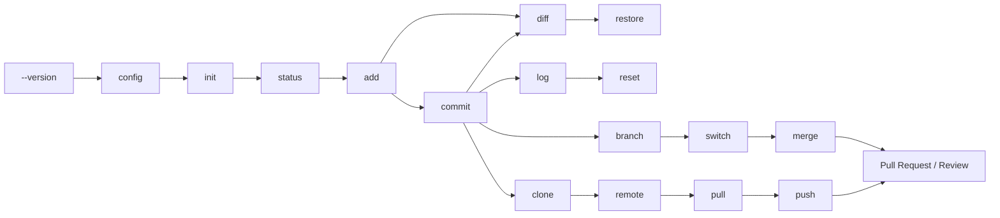

# Git-Diwaa — Game Design v2 (ฉบับปรับปรุงตามข้อเสนอแนะ)

> ยึดเนื้อเรื่องเดิม "บททดสอบแห่งหอคอยเวทมนตร์" (เวล, มิวรา, ผู้พิทักษ์คลังเวทกลาง, ปรมาจารย์, เศษคัมภีร์ 16 ชิ้น)
> แต่เปลี่ยนวิธีเล่นจาก **"อ่านชีท → ดูรูปคุยกัน → พิมพ์ตาม"** เป็น **"เจอปัญหาในโลกเวท → ร่ายคาถา (Git จริง) → เห็นโลกเปลี่ยน"**

---

## 0. ปัญหาของเวอร์ชันเดิม (จากข้อเสนอแนะ)

| อาการที่ผู้ทดสอบเจอ | สาเหตุเชิงออกแบบ | แนวทางแก้ในเวอร์ชันนี้ |
|---|---|---|
| "เหมือนเอาชีทมาแปะ" | แต่ละด่านแยก 3 ขั้น *สอน → เล่น → สรุป* ชัดเจน ผู้เล่นรู้ตัวว่ากำลังถูกสอน | รวมเป็นวงจรเดียว **ปัญหา → ลงมือ → ผลลัพธ์ในโลก** ความรู้แทรกอยู่ในปัญหา (stealth learning) |
| "รูปมาพูด ๆ" | บทสนทนายาว + ปุ่มคำถาม (Choice) ที่ไม่มีผลต่อการเล่น | บทพูดต่อจังหวะไม่เกิน 3 บรรทัด, คำถามย้ายไปเป็นคำสั่ง `ask` (เลือกอ่านเมื่ออยากรู้) |
| คำสั่งไม่สัมพันธ์กับสิ่งที่เกิดในฉาก | คำสั่งเป็นแค่ "กุญแจเปิดประตู" | ทุกคาถาเปลี่ยนโลก **ตรงตามหน้าที่จริงของคำสั่ง** (เช่น `reset` = ย้อนเวลา, `branch` = แยกมิติ) |
| หน้าจอรก | แสดง Terminal + File + Graph ทุกด่าน | **Contextual UI** แผงข้อมูลปลดล็อกตามความรู้ที่ผู้เล่นมี |
| การวัดผลเป็นการเลือกตอบ | ตัวเลือก / เฟรมภาพนิ่ง | ตรวจจาก **สถานะ Repository จริง** และการกระทำของผู้เล่น |

---

## 1. กรอบแนวคิด LM-GM (Learning Mechanics – Game Mechanics)

อ้างอิง Arnab et al. (2015) *Mapping learning and game mechanics for serious games analysis*, British Journal of Educational Technology 46(2).
หลักคือ **ทุกกลไกเกมต้องจับคู่กับกลไกการเรียนรู้** ถ้ากลไกใดไม่มีคู่ ให้ตัดหรือลดบทบาท

### 1.1 ตารางจับคู่หลัก (Core LM-GM Map)

| Learning Mechanic | Game Mechanic ใน Git-Diwaa | ตัวอย่างในเกม | คำสั่ง Git |
|---|---|---|---|
| Discover / Explore | **ร่ายคาถาสำรวจ** แล้วโลกเผยข้อมูลที่ซ่อนอยู่ | ร่าย `status` แล้วเศษคัมภีร์ที่ยังไม่ถูกติดตามเรืองแสง | status, log, diff |
| Instructional (just-in-time) | **คำแนะนำของมิวราเมื่อจำเป็น** (Hint 3 ระดับ, ค่อย ๆ จางหายใน Act หลัง) | `hint` ครั้งที่ 1 บอกเป้าหมาย / ครั้งที่ 3 บอกคาถา | ทุกคำสั่ง |
| Action / Task | **วงร่ายเวท** — พิมพ์คาถา Git จริง | ผู้เล่นพิมพ์ `git add scroll.txt` | ทุกคำสั่ง |
| Demonstration → Imitation | ด่านต้นมีตัวอย่างคาถาในเป้าหมาย, ด่านหลังไม่มี | Floor 1–5 เป้าหมายบอกคาถา, Floor 6+ บอกแค่สิ่งที่ต้องการ | — |
| Feedback | **เอฟเฟกต์เวทในฉาก** สร้างจากการเปรียบเทียบสถานะก่อน/หลัง | เศษคัมภีร์ลอยขึ้นแท่นเตรียม, หนังสือเรืองแสงเมื่อจารึก | add, commit |
| Experimentation | **มิติคู่ขนาน** ลองผิดได้โดยไม่กระทบเส้นทางหลัก | สลับไปมิติ `experiment` แล้วเห็นเศษคัมภีร์หายเมื่อกลับ `main` | branch, switch |
| Analyse / Identify | **ปริศนารหัสผ่าน** ต้องอ่านผลลัพธ์จริงเพื่อหาคำตอบ | หารหัสผนึกจากประวัติจารึกแล้ว `say <รหัส>` | log, diff |
| Repetition | **โกลาหลแทรกแซง** (World Event) ทำให้ต้องใช้คาถาเดิมในบริบทใหม่ | พลังโกลาหลแก้ข้อความคัมภีร์ → ต้อง diff/restore | diff, restore |
| Plan / Strategize | **เลือกระดับการย้อนเวลา** ที่มีผลจริง | `reset --hard` ทำเศษคัมภีร์ชิ้นที่ 6 หาย, `--soft` รักษาไว้ | reset |
| Collaboration | **คลังเวทกลางและจอมเวทคนอื่น (NPC)** ส่งงานเข้าคลังพร้อมกัน | จอมเวทอื่นอัปเดตคลัง → ต้อง `pull` ก่อน `push` | clone, pull, push, fetch |
| Assessment | **สถานะ Repository สุดท้าย** ไม่ใช่ข้อความคำสั่ง | ผ่านด่านเมื่อ HEAD, Stage, Branch ตรงเป้าหมาย | — |
| Reflect | **บันทึกสั้นท้ายด่าน** ("สิ่งที่นายเพิ่งทำคือ…") 1–2 บรรทัด | สรุปผลพร้อมชื่อคาถาจริง | — |
| Motivation (รอง) | ดาว / Coin / Leaderboard | แสดงตอนจบด่านเท่านั้น | — |

### 1.2 กลไกที่ถูกตัดหรือลดบทบาท (ไม่มีคู่ LM)

* **ปุ่มคำถาม 3–4 ตัวเลือกก่อนเล่น** → ย้ายเป็นคำสั่ง `ask` (ผู้เล่นเลือกเปิดเอง ไม่ขวางการเล่น)
* **ตัวเลือก "ใช่/ไม่" ที่จบเกมทันที** → ตัด (ไม่มีผลต่อการเรียนรู้)
* **ฉากสรุปผลที่เป็นบทสนทนายาว** → เหลือ 1–2 บรรทัด + ชื่อคาถาที่ใช้
* **คำสั่งที่ใช้เพียงเพื่อ "ขยับสิ่งกีดขวาง"** → ไม่มีอีกต่อไป ทุกคำสั่งต้องเปลี่ยนสถานะ Git จริง

---

## 2. ขอบเขตเนื้อหาและทฤษฎีรองรับการคัดเลือกคำสั่ง

### 2.1 เกณฑ์คัดเลือก "คำสั่ง Git ขั้นพื้นฐาน"

คำสั่งที่อยู่ในเกมต้องผ่านเกณฑ์อย่างน้อย 2 ใน 3 ข้อ:

1. **ความถี่ในการใช้งานจริง (Frequency of Use)** — อยู่ในกลุ่มคำสั่งที่นักพัฒนาใช้บ่อยที่สุด ตามผลศึกษาการใช้ Git CLI ของนักพัฒนา และหัวข้อพื้นฐานใน *Pro Git* (Chacon & Straub, 2014) บทที่ 2–3 (Git Basics, Branching)
2. **ความจำเป็นต่อเวิร์กโฟลว์มาตรฐาน (Workflow Necessity)** — จำเป็นต่อ *GitHub Flow* (branch → commit → push → Pull Request → review → merge) ซึ่งเป็นเวิร์กโฟลว์ที่ใช้สอนในหลักสูตรวิศวกรรมซอฟต์แวร์
3. **การกู้คืนจากความผิดพลาด (Recovery Value)** — ช่วยแก้ปัญหาที่ผู้เริ่มต้นพบบ่อย (แก้ไฟล์ผิด, stage ผิด, commit ผิด branch, conflict)

**มาตรฐานคำสั่ง:** ใช้รูปแบบปัจจุบันของ Git ≥ 2.23 เป็นหลัก — `git switch` / `git restore` แทน `git checkout`
เกมจะปฏิเสธ `git checkout` อย่างสุภาพ พร้อมบอกคาถาสมัยใหม่ที่ใช้แทน (ไม่รองรับรูปแบบเก่าทุกเวอร์ชัน)

### 2.2 การจัดหมวดหมู่: 5 สำนักเวท (Schools of Magic)

| สำนักเวท | แนวคิด Git | คำสั่ง | Act |
|---|---|---|---|
| 🔮 **เวทปลุกพลัง** (Awakening) | ตั้งค่าและสร้าง Repository | `--version`, `config`, `init` | 1 |
| 👁 **เวทหยั่งรู้** (Divination) | สังเกตสถานะ / ประวัติ / ความต่าง | `status`, `log`, `diff`, `show` | 1, 3 |
| ✒️ **เวทจารึก** (Inscription) | Working Tree → Stage → Commit | `add`, `commit`, `commit --amend` | 1, 3 |
| ⏳ **เวทกาลเวลา** (Chronomancy) | ย้อน / กู้คืน | `restore`, `restore --staged`, `reset --soft/--mixed/--hard` | 1, 3 |
| 🌌 **เวทมิติ** (Dimension) | Branch และการรวม | `branch`, `switch`, `switch -c`, `merge`, `merge --abort` | 1, 3 |
| 🏛 **เวทเชื่อมคลัง** (Conjuration) | Remote และการทำงานเป็นทีม | `clone`, `remote`, `fetch`, `pull`, `push`, `push -u` | 1, 2, 3 |

### 2.3 ลำดับการเรียนรู้ (Prerequisite Graph)

อ้างอิง **Gagné's Learning Hierarchy** (ทักษะระดับสูงต้องสร้างบนทักษะย่อยที่เป็นพื้นฐาน)
และ **Revised Bloom's Taxonomy** (Anderson & Krathwohl, 2001) สำหรับระดับความลึกของแต่ละ Act

| Act | ระดับ Bloom | ลักษณะการเล่น | ระดับการช่วยเหลือ (Scaffolding) |
|---|---|---|---|
| Act 1 หอคอย 15 ชั้น | Remember → Understand → Apply | ปริศนาเดี่ยว 1 แนวคิดต่อชั้น | สูง: เป้าหมายบอกคาถา (ชั้น 1–5) → บอกแค่ผลที่ต้องการ (ชั้น 6+) |
| Act 2 คลังเวทกลาง | Apply → Analyse | ทำงานร่วมกับจอมเวท NPC ใน GitHub Flow | กลาง: Hint ระดับ 1–3 |
| Act 3 วิกฤตหอคอย | Analyse → Evaluate | สถานการณ์ปัญหาผสม เลือกคาถาเอง | ต่ำ: Hint แค่ระดับ 1–2 (Fading ตาม Vygotsky ZPD) |

### 2.4 การผสานความสนุกกับการเรียนรู้ (Stealth Learning)

* **ไม่มีขั้น "สอน" แยก** — ทุกชั้นเริ่มจาก *ปัญหาในโลก* (คัมภีร์ถูกสาป, ประตูผนึก, มิติแตก) แล้วผู้เล่นค้นพบว่าคาถาไหนแก้ได้
* **ล้มเหลวได้อย่างปลอดภัย** — Sandbox ทำให้ลองคำสั่งผิดได้ เกมตอบด้วยข้อความ Git จริง + การแปลความของมิวราสั้น ๆ
* **ผลลัพธ์เห็นเป็นรูปธรรม** — สถานะ Git ถูกแปลงเป็นภาพ (โต๊ะเขียน / แท่นเตรียม / คัมภีร์ / มิติ / คลังเวท)
* **ความอยากรู้นำทาง** — รหัสผนึก, เศษคัมภีร์ที่หายไป, เบาะแสของปรมาจารย์ ซ่อนอยู่ในประวัติ Git จริง

---

## 3. การเปรียบเปรยและคำศัพท์ในโลกเวท (Metaphor & In-Game Terminology)

หลักการ: **อุปมาต้องทำงานเหมือนของจริง** — ถ้าผู้เล่นเข้าใจอุปมา ก็ต้องทำนายพฤติกรรมของ Git ได้ถูก

### 3.1 แผนที่อุปมา (Metaphor Map)

| แนวคิด Git | ในโลกเวท | ทำไมอุปมานี้ "ถูกต้อง" |
|---|---|---|
| Repository | **คัมภีร์เวทส่วนตัว** | เก็บทุกการจารึกและประวัติทั้งหมด |
| Working Tree | **โต๊ะเขียน (Desk)** | ที่วางเศษคัมภีร์ที่กำลังแก้ ยังไม่ถาวร |
| Untracked file | **เศษคัมภีร์ไร้ตรา** | คัมภีร์ยังไม่รู้จักมัน |
| Staging Area | **แท่นเตรียม (Altar)** | คัดเลือกว่าจะจารึกชิ้นไหน ก่อนจารึกจริง |
| Commit | **การจารึก (Inscription)** | ถาวร มีชื่อผู้จารึก ข้อความ และเวลา |
| Commit message | **คำจารึก** | บอกว่าจารึกครั้งนี้คืออะไร |
| HEAD | **ที่คั่นหน้า (Bookmark)** | บอกว่าตอนนี้เรายืนอยู่ ณ หน้าไหนของประวัติ |
| `log` | **ม้วนประวัติ** | อ่านย้อนการจารึกทั้งหมด |
| `diff` | **คาถาเทียบรอย** | เทียบรอยอักขระสองช่วงเวลา |
| `restore` | **คาถาฟื้นคืน** | คืนเศษคัมภีร์บนโต๊ะ/แท่น ให้เหมือนที่จารึกไว้ล่าสุด |
| `reset` | **เวทย้อนกาล** | เลื่อนที่คั่นหน้ากลับไปในอดีต — ระดับ soft/mixed/hard = เก็บไว้บนแท่น / เก็บไว้บนโต๊ะ / ลบทิ้งหมด |
| Branch | **มิติคู่ขนาน** | เส้นเวลาแยกที่ทดลองได้โดยไม่กระทบมิติหลัก |
| `switch` | **ประตูมิติ** | ย้ายตัวเองไปยืนในมิติอื่น โลกรอบตัว (ไฟล์) เปลี่ยนตาม |
| `merge` | **พิธีหลอมมิติ** | รวมสองเส้นเวลา |
| Merge conflict | **การปะทะของมิติ** | สองมิติเขียนอักขระต่างกัน ณ จุดเดียวกัน ต้องตัดสินใจเอง |
| Remote | **คลังเวทกลาง** | ที่เก็บความรู้ร่วมของจอมเวททุกคน |
| `clone` | **คาถาคัดลอกคัมภีร์** | ได้ทั้งเนื้อหาและประวัติ |
| `pull` / `fetch` | **คาถาเรียกความรู้** / **คาถาส่องคลัง** | fetch = ดูว่าคลังมีอะไรใหม่, pull = ดึงลงมารวมกับคัมภีร์เรา |
| `push` | **คาถาส่งผ่านประตูเวท** | ส่งการจารึกของเราเข้าคลัง |
| Pull Request | **คำร้องต่อสภาจอมเวท** | ขอให้ผู้อาวุโสตรวจก่อนหลอมเข้ามิติหลัก |

### 3.2 วิธีใช้คำศัพท์ในบทสนทนา

* ตัวละครพูดด้วย **คำในโลกเวทเสมอ** เช่น "วางเศษคัมภีร์ขึ้นแท่นเตรียม" ไม่ใช่ "add ไฟล์เข้า Staging Area"
* **ชื่อคาถาจริงปรากฏเฉพาะใน** (1) วงร่ายเวท (Terminal) (2) สมุดคาถา (`spells`) (3) บันทึกท้ายด่าน — เพื่อให้ผู้เล่นเชื่อมโยงอุปมา ↔ คำสั่งจริงได้เอง
* ข้อความ error ของ Git แสดงตามจริง (เรียนรู้ข้อความจริง) แล้วมิวราแปลเป็นภาษาโลกเวท 1 บรรทัด
