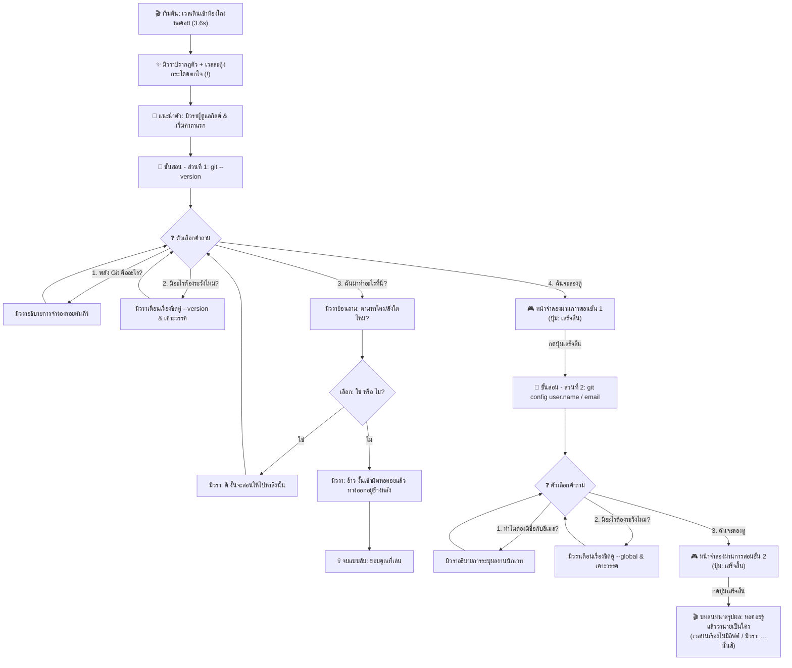

# ด่านที่ 1: ตรวจสอบพลังและประกาศนาม (git --version + git config)

เป้าหมาย: ฉากคัตซีนเปิดตัวบทที่ 1 แนะนำตัวละคร **มิวรา (Mewla)** ผู้ดูแลกิลด์แห่งหอคอยเวท และฝึกฝนคาถาแรกของผู้เล่น (เวล) ในการตรวจสอบพลังเวท (`git --version`) และการประกาศตัวตนจารึกคัมภีร์เวท (`git config`) พร้อมระบบถาม-ตอบแบบมีตัวเลือก (Dialogue Choice System) ภายในกล่องข้อความ และฉากสรุปผลเดินขึ้นบันไดผ่านด่าน

---

## 1. ภาพรวมและโฟลว์การทำงาน (Flow)

---

## 2. ทรัพยากรและ Assets ที่ใช้งาน

| หมวดหมู่ | ไฟล์ Asset | รายละเอียด |
|---|---|---|
| **ฉากหลังหลัก** | `res://assets/cutscene/backgrounds/inside-tower-Sheet.png` | ห้องโถงชั้น 1 หอคอยเวท (1920×1080) |
| **ฉากหลังบันได** | `res://assets/cutscene/backgrounds/central-tower-Sheet.png` | โถงบันไดหินกลางหอคอย สำหรับคัตซีนเดินขึ้นบันได |
| **ตัวละครฝั่งซ้าย (เวล)** | `res://assets/cutscene/characters/vel/` | • `vel_walk_right-Sheet.png` (เดินเข้า/เดินผ่านมิวรา) • `vel_breathe_blink-Sheet.png` (ท่ายืนฟัง) • `vel_shockpng.png` (ท่าตกใจ) • `vel_back.png` (ท่ายืนหันหลังเดินขึ้นบันได) |
| **ตัวละครฝั่งขวา (มิวรา)** | `res://assets/cutscene/characters/mewla/` | • `mewla_idle-Sheet.png` (ยืนฟัง/กระดิกหู) • `mewla_talk-Sheet.png` (ท่าพูด) • `mewla_success-Sheet.png` (ท่าพร้อมลุย) |
| **กรอบข้อความ** | `res://assets/cutscene/frame dialog text/text dialog.png` | กรอบข้อความ 9-slice StyleBoxTexture ขอบมนโทนม่วงเข้มตัดลาเวนเดอร์ (ใช้แสดงทั้งบทพูดและตัวเลือก) |
| **ลูกศรไปต่อ** | `res://assets/cutscene/frame dialog text/arrow.png` | ไอคอนลูกศรพิกเซล ลอยเด้งดึ๋งเมื่อพิมพ์ข้อความเสร็จ |
| **ฟอนต์ข้อความ** | `res://assets/fonts/TA-8-bit.ttf` | ฟอนต์พิกเซล 8-bit (บทพูด 26 px สีขาว, ชื่อผู้พูด 30 px สีทอง/ฟ้า, ช้อยส์ 22 px) |
| **เสียงประกอบ** | `res://assets/audio/` | • `sfx_cat_meow.wav` (เสียงแมวมิวรา) • `sfx_dialogue_next.wav` (เสียงเปลี่ยนข้อความ) • `bgm_tower_loop.wav` (ดนตรีบรรยากาศหอคอย) |

---

## 3. มาตรฐานระบบตัวเลือกและการย้อนกลับข้อความ (Inline Choice & Back Navigation System)

### 3.1 ระบบตัวเลือกคำถามภายในกล่องข้อความเดิม (Inline Choice System)
เพื่อรักษาความสะอาดของหน้าจอ ไม่ให้มีหน้าต่างลอยมาบดบังตัวละคร ระบบช้อยส์ถูกออกแบบให้แสดงผล **อยู่ภายในกล่องข้อความเดิม (`DialogueBox`)**:

1. **เมื่อเข้าสู่โหมดเลือกช้อยส์:**
   * ซ่อนลูกศรไปต่อ (`ContinueArrow`) และล็อกการกด Space/Enter ข้ามบท
   * ป้ายชื่อผู้พูด (`SpeakerLabel`) เปลี่ยนเป็นสีทอง `#F0D273` ข้อความ: **`"ตัวเลือกคำถาม"`**
   * ซ่อนข้อความบทพูด (`DialogueLabel`) และแสดงรายการตัวเลือก (`ChoiceContainer`) เรียงลงมาในแนวตั้ง
2. **การควบคุมและ Interaction:**
   * **คลิกด้วยเมาส์:** แต่ละตัวเลือกเป็นปุ่มโปร่งใส เมื่อเอาเมาส์ไปชี้ (Hover) จะมีไฮไลต์สีทอง/ม่วงสว่างพร้อมสัญลักษณ์ `>` นำหน้า
   * **กดปุ่มตัวเลขบนคีย์บอร์ด:** สามารถกดเลข `1`, `2`, `3`, `4` เพื่อเลือกช้อยส์ข้อนั้นได้ทันที
3. **การวนลูป (Looping):**
   * เมื่อคลิกเลือกคำถาม ตัวละครจะคุยอธิบายตอบข้อนั้น
   * เมื่ออธิบายจบประโยค ระบบจะวนกลับมาเปิดกล่องตัวเลือกเดิมใหม่อัตโนมัติ จนกว่าผู้เล่นจะเลือกข้อ "ฉันจะลองดู"

### 3.2 ระบบปุ่มลูกศรควบคุมบทสนทนา ◀ ▶ (Navigation Arrows)
* ใช้ไอคอนลูกศรพิกเซลจาก `arrow.png` หมุน 90 องศาซ้าย-ขวา วางเรียงคู่กันอยู่มุมขวาล่างของกล่องบทสนทนา (`DialogueBox`):
  * **ลูกศรซ้าย `◀` (ย้อนกลับ):** ย้อนกลับไปยังข้อความก่อนหน้า
  * **ลูกศรขวา `▶` (ไปต่อ):** เร่งตัวหนังสือให้เต็มทันที / ไปยังข้อความถัดไป
* **การเคลื่อนไหวและเอฟเฟกต์ (Hover & Static):**
  * **ไม่เด้ง (No Bouncing):** ยกเลิกแอนิเมชันเด้งขึ้น-ลง ลูกศรทั้งสองอยู่นิ่งคงที่สวยงาม
  * **โฮเวอร์เรืองแสง (Hover Brightness):** เมื่อนำเมาส์ไปชี้ (Hover) ลูกศรจะสว่างขึ้นอย่างนุ่มนวล (`modulate = Color(1.4, 1.4, 1.4, 1.0)`) และเมื่อเอาเมาส์ออกจะกลับเป็นสีเดิม
  * **สถานะปิดใช้งาน (Disabled/Dimmed):** หากอยู่ที่ข้อความแรกสุดที่ย้อนกลับไม่ได้ ลูกศร `◀` จะลดความโปร่งใสลงเป็น 25% (`modulate.a = 0.25`) และเมื่ออยู่ในหน้าเมนูช้อยส์ ลูกศร `▶` จะถูกปิดใช้งานเพื่อให้ผู้เล่นเลือกคำตอบ
* **การแสดงผลข้อความเต็มทันทีเมื่อย้อนกลับ (Immediate Full Text):**
  * เมื่อผู้เล่นกดย้อนกลับ ข้อความในอดีตจะแสดงผลเต็มประโยคทันที (`visible_ratio = 1.0`) **โดยไม่เล่นเอฟเฟกต์พิมพ์ดีด (Typewriter)**
* **การควบคุมด้วยคีย์บอร์ด:**
  * กดย้อนกลับด้วยปุ่มลูกศรซ้าย `Left Arrow` หรือ `Backspace`
  * กดไปข้างหน้าด้วยปุ่ม `Space`, `Enter` หรือคลิกที่ใดก็ได้บนกล่องข้อความ

---

## 4. บทสนทนาฉบับเต็มของด่านที่ 1 (Complete Dialogue Script)

### บทนำ (คัตซีนเปิดตัว - inside_tower_cutscene.tscn)
1. **มิวรา:** "ยินดีต้อนรับสู่กิลด์แห่งหอคอยเวท"
2. **เวล:** "เธอคือ..." *(ไอคอน ?)*
3. **มิวรา:** "“แมวไง เห็นก็รู้ปะ” ฉันมิวรา ผู้ดูแลกิลด์ และเป็นคนที่จะสอนนายตั้งแต่พื้นฐาน" *(เสียงแมวเหมียว)*
4. **มิวรา:** "ก่อนเข้าสู่บททดสอบของหอคอย นายต้องตรวจสอบว่าพลังเวทของตัวเองพร้อมใช้งานหรือยัง"
5. **มิวรา:** "มาเริ่มคาถาแรกกัน"

> [!NOTE]
> **การเล่นต่อเนื่องในซีนเดียว (Single Scene Pipeline):**
> ทั้งคัตซีนเปิดตัวและการสอนด่านที่ 1 ทำงานอยู่บนซีนเดียวกัน 100% โดย**ไม่มีการสลับฉากข้าม Scene (Zero Scene Change)**
> - ไม่หลุดความเร็ว Fast-Forward (`x2` / `2.5x`): ปุ่มเร่งความเร็วจะทำงานต่อเนื่องตลอดทั้งฉาก
> - ฉากหลัง (`inside-tower-Sheet.png`) ไม่ถูกรีเซ็ต: ลูปไฟคบเพลิงเล่นต่อเนื่องไร้รอยต่อ
> - ตัวละครเวลและมิวราคงอยู่บนเวทีต่อเนื่อง ไม่ถูกทำลายและเกิดใหม่
> - เมื่อจบบทสนทนาข้อ 5 ตัวเกมจะไหลเข้าสู่บทสอนด่าน 1 (ข้อ 1 "ร่ายคาถานี้ดู") ในกล่องข้อความเดิมทันที

---

### ด่านที่ 1 (ตัวเกมบทสนทนา - level_dialogue_view.tscn)

#### ขั้นสอน - ส่วนที่ 1: ตรวจสอบพลังเวท (`git --version`)
1. **มิวรา:** "ร่ายคาถานี้ดู"
2. **มิวรา:** "`git --version`"
3. **เวล:** "แค่นี้เอง?" *(ไอคอน ?)*
4. **มิวรา:** "ถ้าพลัง Git ถูกปลุกไว้แล้ว คาถานี้จะแสดงระดับพลังตอบกลับมาเอง ใช้สำหรับเช็กว่าพลัง Git พร้อมไหม"
5. **เวล:** "เข้าใจแล้ว"

#### ตัวเลือกคำถาม:
* **ข้อ 1: พลัง Git คืออะไร?**
  * เวล: "พลัง Git คืออะไรกันแน่?" *(ไอคอน ?)*
  * มิวรา: "Git คือพลังที่ใช้บันทึกการเปลี่ยนแปลงของคัมภีร์เวทส่วนตัว"
  * มิวรา: "ทุกครั้งที่นายแก้ไขหรือจารึกอะไรลงไป Git จะจดจำร่องรอยเหล่านั้นเอาไว้"
  * มิวรา: "ต่อให้เวลาผ่านไป นายก็ยังย้อนกลับไปดูอดีตของคัมภีร์เวทส่วนตัวได้"
  * *(วนกลับไปหน้าคำถามใหม่)*
* **ข้อ 2: มีอะไรต้องระวังเป็นพิเศษไหมตอนร่ายคาถา?**
  * เวล: "มีอะไรต้องระวังเป็นพิเศษไหม?" *(ไอคอน ?)*
  * มิวรา: "มี"
  * เวล: "หืม?" *(ไอคอน ?)*
  * มิวรา: "อักขระหน้าคำว่า version ต้องเป็นขีดคู่"
  * มิวรา: "`--version` ไม่ใช่ `-version` และ `git --version` ต้องเว้นวรรคระหว่าง `git` กับ `--version` ด้วย"
  * มิวรา: "ศิษย์ฝึกหัดหลายคนพลาดตรงนี้ อักขระเวทละเอียดกว่าที่คิด"
  * มิวรา: "ผิดเพียงตัวเดียว คาถาอาจไม่ตอบสนอง"
  * เวล: "เข้าใจแล้ว"
  * มิวรา: "ดี…ก่อนร่ายคาถา ตรวจสอบอักขระให้ครบทุกครั้ง"
  * *(วนกลับไปหน้าคำถามใหม่)*
* **ข้อ 3: ฉันมาทำอะไรที่นี่?**
  * เวล: "ฉันมาทำอะไรที่นี่กันแน่?" *(ไอคอน ?)*
  * มิวรา: "ฉันจะไปรู้เหรอ"
  * เวล: "..."
  * มิวรา: "นายเดินเข้ามาเองนะ ถ้างั้นฉันถามกลับ"
  * มิวรา: "นายมาที่นี่เพื่อตามหาใครหรือสิ่งใดหรือเปล่า?"
  * **[ตัวเลือกย่อย: ใช่ / ไม่]**
    * **ถ้าเลือก "ใช่":**
      * มิวรา: "ดี"
      * มิวรา: "งั้นฉันจะสอนนายให้ไปหาสิ่ง ๆ นั้นเอง"
      * มิวรา: "เริ่มจากคาถาบทแรกกัน"
      * *(วนกลับไปหน้าคำถามใหม่)*
    * **ถ้าเลือก "ไม่":**
      * มิวรา: "อ้าว…งั้นนายเข้าผิดหอคอยแล้ว"
      * มิวรา: "ทางออกอยู่ด้านหลัง ขอให้โชคดี"
      * *(จบด่านแบบลับ ขึ้นหน้าจอดำ "ขอบคุณที่เล่น (เข้าผิดหอคอย)" พร้อมปุ่มกลับหน้าหลัก)*
* **ข้อ 4: ฉันจะลองดู**
  * เวล: "ฉันจะลองดู"
  * *(สลับฉากเข้าสู่หน้าจำลอง: `gameplay_placeholder_view.tscn` แสดงข้อความ "ผ่านการสอนขั้น 1" และปุ่ม "เสร็จสิ้น" เมื่อกดแล้วจะกลับมาที่บทสอนส่วนที่ 2)*

---

### ขั้นสอน - ส่วนที่ 2: ประกาศตัวตนจารึกคัมภีร์ (`git config`)
11. **มิวรา:** "ดีมาก นายผ่านบททดสอบแรกแล้ว"
12. **เวล:** "ง่ายกว่าที่คิดนะ"
13. **มิวรา:** "เพราะนี่เป็นแค่จุดเริ่มต้น... ต่อไป นายต้องลงทะเบียนตัวตนของนักเวทกับสำนักเวทเสียก่อน"
14. **เวล:** "ทำไมต้องลงทะเบียนด้วย?" *(ไอคอน ?)*
15. **มิวรา:** "เพราะต่อจากนี้นายจะได้เริ่มรวบรวมและจารึก 'เศษคัมภีร์' ลงในคัมภีร์เวทส่วนตัวของนาย"
16. **เวล:** "เศษคัมภีร์?" *(ไอคอน ?)*
17. **มิวรา:** "เศษคัมภีร์คือชิ้นส่วนขององค์ความรู้ที่เคยอยู่ในคัมภีร์เวทต้นกำเนิด หลังจากคัมภีร์เวทต้นกำเนิดแตกสลาย เศษคัมภีร์เหล่านั้นก็กระจัดกระจายไปทั่วหอคอย"
18. **มิวรา:** "บางชิ้นอาจบันทึกความรู้พื้นฐาน บางชิ้นอาจบันทึกคาถาหรืออักขระสำคัญ และบางชิ้นอาจเป็นกุญแจสำคัญที่นำไปสู่ความจริงเกี่ยวกับการหายตัวไปของปรมาจารย์"
19. **มิวรา:** "แต่ทุกครั้งที่นายจารึกการเปลี่ยนแปลงลงในคัมภีร์เวทส่วนตัว สำนักเวทต้องรู้ก่อนว่าเจ้าของการจารึกคือใคร ไม่อย่างนั้นต่อให้จารึกเศษคัมภีร์ดีแค่ไหน ก็ไม่มีใครรู้ว่าใครเป็นคนจารึก"
20. **เวล:** "งั้นฉันต้องทำยังไง"
21. **มิวรา:** "ประกาศตัวตนของนายให้สำนักเวทรู้ซะ... มาเริ่มคาถาบทต่อไปกัน"
22. **มิวรา:** "ร่ายคาถานี้เพื่อประกาศนามของนาย:\n`git config --global user.name \"ชื่อของนาย\"`"
23. **มิวรา:** "แล้วตามด้วยการผูกตราประทับวิญญาณ:\n`git config --global user.email \"อีเมลของนาย\"`"
24. **เวล:** "คาถาสองบท?" *(ไอคอน ?)*
25. **มิวรา:** "ใช่ บทแรกใช้ตั้งชื่อ บทที่สองใช้ผูกอีเมล"
26. **มิวรา:** "แต่ถ้านายอยากตรวจสอบว่าหอคอยจดจำชื่อนายไว้หรือยัง ให้ลองร่ายคาถาเดิมแต่ **ไม่ต้องใส่ชื่อต่อท้าย** ดูสิ (`git config --global user.name`)"
27. **เวล:** "แล้วถ้ายังไม่เคยลงทะเบียนล่ะ" *(ไอคอน ?)*
28. **มิวรา:** "คาถาจะไม่ตอบกลับอะไรเลย... นั่นหมายความว่านายต้องรีบประกาศนามเดี๋ยวนี้!"

#### ตัวเลือกคำถาม:
* **ข้อ 1: ทำไมต้องมีชื่อกับอีเมล?**
  * เวล: "ทำไมต้องมีทั้งชื่อและอีเมลด้วย?" *(ไอคอน ?)*
  * มิวรา: "เพราะทุกการจารึกต้องระบุว่าเป็นผลงานของนักเวทคนไหน"
  * มิวรา: "ชื่อใช้แสดงตัวตน"
  * มิวรา: "ส่วนอีเมลใช้เชื่อมข้อมูลการจารึกเข้ากับตัวตนของนาย"
  * มิวรา: "เมื่อย้อนดูประวัติของคัมภีร์เวทส่วนตัว นายจะรู้ได้ว่าใครเป็นคนจารึกสิ่งนั้น"
  * *(วนกลับไปหน้าคำถามใหม่)*
* **ข้อ 2: มีอะไรต้องระวังตอนร่ายคาถา?**
  * เวล: "มีอะไรต้องระวังไหม?" *(ไอคอน ?)*
  * มิวรา: "มี"
  * มิวรา: "อักขระ `--global` ต้องเป็นขีดคู่"
  * มิวรา: "และต้องเว้นวรรคระหว่าง `git`, `config`, `--global` และคำสั่งที่ตามมา"
  * มิวรา: "ถ้าอักขระผิด คาถาอาจไม่ทำงานตามที่ตั้งใจ"
  * เวล: "เข้าใจแล้ว"
  * มิวรา: "ดี…นักเวทที่ร่ายคาถาแม่น มักเริ่มจากการพิมพ์ให้แม่นก่อน"
  * *(วนกลับไปหน้าคำถามใหม่)*
* **ข้อ 3: ฉันจะลองดู**
  * เวล: "ฉันจะลองดู"
  * *(สลับฉากเข้าสู่หน้าจำลอง: `gameplay_placeholder_view.tscn` แสดงข้อความ "ผ่านการสอนขั้น 2" และปุ่ม "เสร็จสิ้น" เมื่อกดแล้วจะกลับมาที่บทสนทนาสรุปผล Outro)*

---

### สรุปผลหลังผ่านด่าน 1 (Outro)
29. **มิวรา:** "ดีมาก ตอนนี้หอคอยรู้แล้วว่านายเป็นใคร"
30. **เวล:** "แปลว่าพร้อมสำหรับการจารึกแล้ว?" *(ไอคอน ?)*
31. **มิวรา:** "เกือบ... ตัวตนของนักเวทน่ะพร้อมแล้ว"
32. **มิวรา:** "ต่อไป เราจะไปสร้าง 'คัมภีร์เวทส่วนตัว' เล่มแรกของนายกัน... ไปชั้นถัดไปกันเถอะ"
33. **เวล:** "...ทำไมหอคอยถึงไม่มีลิฟต์บ้างเนอะ เหนื่อย"
34. **มิวรา:** "…นั้นสิ"

> [!NOTE]
> **การจบด่านที่ 1:**
> ตามข้อกำหนดของผู้ใช้ ฉากเดินขึ้นบันไดหินกลางหอคอยยังไม่ได้จัดทำ ในเวอร์ชันนี้ตัวเกมจะจบที่บทสนทนาสรุปผลระหว่างเวลกับมิวรา แล้วเฟดเข้าสู่ฉากถัดไปอย่างราบรื่น
