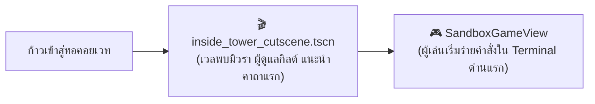

# คัตซีนภายในหอคอยเวท (Inside Tower Cutscene)

เป้าหมาย: ฉากคัตซีนเปิดตัวการเข้าสู่ภายในหอคอยเวทและพบกับ **มิวรา (Mewla)** ผู้ดูแลกิลด์แห่งหอคอยเวทเป็นครั้งแรก โดยแนะนำตัวละครและเตรียมความพร้อมของผู้เล่น (เวล) ก่อนเริ่มฝึกฝนคาถาแรกของหอคอย

---

## 1. ภาพรวมและโฟลว์การทำงาน (Flow)

ฉากนี้ทำหน้าที่เป็น **Intro Cutscene** เมื่อผู้เล่นก้าวเข้ามาสู่ภายในห้องโถงของหอคอยเวท:



* **เมื่อเข้าสู่ฉาก:** จอค่อยๆ สว่างขึ้นจากจอดำ (Fade in 0.8s) โดยเวลเดินเข้ามาจากทางซ้ายจอหยุดยืนประจันหน้ากับมิวราที่ยืนรออยู่ทางขวา
* **การพูดคุย:** กล่องข้อความสไตล์ Retro Fantasy ปรากฏขึ้น ตัวอักษรค่อยๆ พิมพ์ทีละตัว (Typewriter Effect) พร้อมเสียงแมวเหมียว (`sfx_cat_meow.wav`) เมื่อมิวราแนะนำว่าตนเองเป็นแมว
* **การควบคุม:** ผู้เล่นคลิกหน้าจอ หรือกด Space / Enter เพื่ออ่านบทสนทนาประโยคถัดไป (หากกำลังพิมพ์อยู่ การกดจะเร่งให้แสดงผลเต็มทันที)
* **การข้ามฉาก:** สามารถกดปุ่ม **"ข้าม ⏵⏵ (Esc)"** หรือกดปุ่ม `Esc` บนคีย์บอร์ดได้ตลอดเวลา เพื่อตัดเข้าสู่เกมเพลย์ทันที
* **เมื่อจบคัตซีน:** มิวราจะแสดงท่าดีใจ (`success`) ก่อนที่หน้าจอจะค่อยๆ เฟดมืดลง พร้อมปรับระดับเสียง BGM ลงอย่างนุ่มนวล แล้วเปลี่ยน Scene ไปยังด่านเกมเพลย์ที่ระบุใน `@export var next_scene_path`

---

## 2. ทรัพยากรและ Assets ที่ใช้งาน

| หมวดหมู่ | ไฟล์ Asset | รายละเอียด |
|---|---|---|
| **ฉากหลัง** | `res://assets/cutscene/backgrounds/inside-tower-Sheet.png` | ห้องโถงภายในหอคอยเวท (ขนาดเฟรมละ 480×270 พิกเซล, 11×12 เฟรม = รวม 132 เฟรมวนลูป 11 วินาที, ขยาย Scale 4 เท่าเต็มจอ 1920×1080) |
| **ตัวละครฝั่งซ้าย (เวล)** | `res://assets/cutscene/characters/vel/` | • `vel_Hblue_Sredyellow_idle.png` (ท่ายืน)<br>• `vel_walk_right-Sheet.png` (ท่าเดินเข้าห้อง)<br>• `vel_breathe_blink-Sheet.png` (ท่าหายใจและกระพริบตา)<br>• `vel_breathe-Sheet.png` (ท่าหายใจ) |
| **ตัวละครฝั่งขวา (มิวรา)** | `res://assets/cutscene/characters/mewla/` | • `mewla_black_idle.png` (ท่ายืนนิ่ง/รอฟัง)<br>• `mewla_talk-Sheet.png` (ท่าพูด 6 เฟรมวนลูป)<br>• `mewla_success-Sheet.png` (ท่าพร้อมลุย/ดีใจ 6 เฟรมวนลูป) |
| **เอฟเฟกต์ประกอบ** | `QuestionMark/Label` | ไอคอนสงสัย (?) ปรากฏขึ้นเหนือศีรษะเวลเมื่อถามว่า "เธอคือ..." |
| **กรอบข้อความ** | `res://assets/cutscene/frame dialog text/text dialog.png` | กรอบข้อความ 9-slice StyleBoxTexture ขอบมนโทนม่วงเข้มตัดลาเวนเดอร์ |
| **ลูกศรไปต่อ** | `res://assets/cutscene/frame dialog text/arrow.png` | ไอคอนลูกศรพิกเซลชี้ลงโทนลาเวนเดอร์ ลอยเด้งดึ๋งบอกให้คลิกไปต่อ |
| **ฟอนต์ข้อความ** | `res://assets/fonts/TA-8-bit.ttf` | ฟอนต์พิกเซล 8-bit มาตรฐานของโปรเจกต์ (บทพูด 26 px สีขาวจั๊ว `#FFFFFF`, ชื่อตัวละคร 28 px ตัวหนา) |
| **เสียงประกอบ** | `res://assets/audio/` | • `sfx_dialogue_next.wav` (เสียงเปลี่ยนข้อความ)<br>• `sfx_cat_meow.wav` (เสียงแมวเหมียวของมิวรา)<br>• `bgm_tower_loop.wav` (ดนตรีบรรยากาศหอคอย) |

---

## 3. โครงสร้าง Scene และ Node Hierarchy

ไฟล์ Scene อยู่ที่: [`Scenes/cutscene/inside_tower_cutscene.tscn`](file:///c:/Users/67030311/Documents/Game-Git-Diwaa/src/GitDiwaa.Godot/Scenes/cutscene/inside_tower_cutscene.tscn)  
สคริปต์อยู่ที่: [`Scripts/cutscene/inside_tower_cutscene.gd`](file:///c:/Users/67030311/Documents/Game-Git-Diwaa/src/GitDiwaa.Godot/Scripts/cutscene/inside_tower_cutscene.gd)

```text
InsideTowerCutscene (Node2D) [Script: inside_tower_cutscene.gd]
├── AnimationPlayer [Autoplay: background_loop วนลูป 132 เฟรมตลอดทั้งฉาก]
├── Camera2D (จัดกึ่งกลาง 960, 540)
├── Background (Sprite2D) (inside-tower-Sheet, hframes: 11, vframes: 12, Scale 4x4)
├── Atmosphere (ColorRect) (ฟิลเตอร์เงาบรรยากาศโปร่งแสง)
├── Stage (Node2D)
│   ├── Vel (AnimatedSprite2D) [Spawn: (-120, 750), Target: (700, 750), Scale 4x4]
│   │   ├── DropShadow (Sprite2D) [drop_shadow.png, Scale (0.65, 0.45), Position: (0, 38.5)]
│   │   ├── ExclamationMark (Sprite2D) [Position: (0, -60)]
│   │   └── QuestionMark (Node2D) [Position: (0, -36)]
│   │       └── Label [Font: TA-8-bit.ttf 20px, Color: #FFFFFF, Outline: 4px #000000]
│   └── Mewla (AnimatedSprite2D) [Position: (1220, 708), Scale (1.0, 1.0)]
│       └── DropShadow (Sprite2D) [drop_shadow.png, Scale (2.5, 1.5), Position: (0, 196.5)]
├── MagicStoryUI (CanvasLayer: Layer 10)
│   ├── SkipButton (Button) [มุมขวาบน สำหรับกดข้ามคัตซีน]
│   ├── DialogueBox (PanelContainer) [StyleBoxTexture: text dialog.png, Offset: L:-580, R:580, T:-216, B:-36]
│   │   ├── Margin (MarginContainer) [Margin: L:36, T:24, R:48, B:16]
│   │   │   └── VBox (VBoxContainer) [Separation: 12]
│   │   │       ├── SpeakerLabel (Label) [ชื่อผู้พูด ตัวหนา TA-8-bit ขนาด 28 px สีทองหม่น #F0D273 / สีฟ้าอ่อน #7AC7FF]
│   │   │       └── DialogueLabel (Label) [ข้อความคำพูด ฟอนต์ TA-8-bit ขนาด 26 px สีขาวจั๊ว #FFFFFF, Outline 2px, Line Spacing 8px]
│   │   └── ArrowOverlay (Control)
│   │       └── ArrowWrapper (Control) [Anchors: Bottom-Right (offset: -48, -34, -22, -16)]
│   │           └── ContinueArrow (TextureRect) [arrow.png ลอยเด้งดึ๋งเมื่อพิมพ์เสร็จ]
│   └── FadeOverlay (ColorRect) [ม่านจอดำสำหรับเฟดเข้า-ออก]
└── Audio (Node)
    ├── SfxDialogue (AudioStreamPlayer) [sfx_dialogue_next.wav]
    ├── SfxCat (AudioStreamPlayer) [sfx_cat_meow.wav]
    └── BgmMusic (AudioStreamPlayer) [bgm_tower_loop.wav]
```

---

## 3.1 มาตรฐานตำแหน่งการยืน สัดส่วน และการเดินเข้าฉากของตัวละคร (Positioning & Proportion Standard)

1. **การสมมาตรซ้าย-ขวาบนแกน X (Symmetrical Alignment):**
   - ระยะห่างจากกึ่งกลางจอ: กำหนด `d = 260px` จากจุดศูนย์กลางหน้าจอ `x = 960`
   - **เวล (ฝั่งซ้าย):** ยืนที่ `x = 700` (`960 - 260`)
   - **มิวรา (ฝั่งขวา):** ยืนที่ `x = 1220` (`960 + 260`)
   - ผลลัพธ์: ตัวละครทั้งสองยืนประจันหน้ากันอย่างสมดุล มองเห็นลวดลายเสาและสถาปัตยกรรมภายในหอคอยได้อย่างชัดเจน

2. **ระดับความสูงและการยึดพื้นบนแกน Y (Grounded Height & Drop Shadow):**
   - **แนวระนาบพื้น (Ground Line):** กำหนดไว้ที่ `y = 904`
   - **เวล:** สเกล 4×4 ขนาด 48×83 (สูง 332px) จุดศูนย์กลางอยู่ที่ `y = 750` ปลายเท้าอยู่ที่ `y = 904` พอดี
   - **มิวรา:** สเกล 4×4 ขนาด 47×83 (สูง 332px สอดคล้องกับพิกเซลอาร์ตของเวล 100%) จุดกึ่งกลางวางไว้ที่ `y = 750` ส่งผลให้ปลายเท้าแตะระนาบพื้น `y = 904` เท่ากันเป๊ะ
   - เพิ่มเงาใต้เท้า `DropShadow` (`res://assets/cutscene/props/khampri/drop_shadow.png`) วางไว้ใต้เท้าทั้งสองตัวละคร (Scale: `Vector2(0.65, 0.45)`, Position: `Vector2(0, 38.5)`) พร้อม `show_behind_parent = true` ช่วยให้ตัวละครดูมีน้ำหนักและติดพื้นอย่างเป็นธรรมชาติ ไม่รู้สึกลอยในอากาศ

3. **สัดส่วนและการเว้นระยะของกล่องข้อความ (Dialogue Box Clearance):**
   - ขนาดกล่องข้อความ `1160 × 180 px`, จัดวางกึ่งกลางแนวนอน (`offset_left = -580`, `offset_right = 580`), ห่างขอบล่าง 36 px
   - ระดับขอบบนของกล่องข้อความอยู่ที่ `y = 864` วางทับเฉพาะส่วนเท้า โดยมองเห็นลำตัวและใบหน้าของตัวละครครบถ้วนชัดเจนในระดับสายตา

4. **การเดินเข้าฉากจากนอกจอ (Walk-in Entrance):**
   - เวลจะเกิดที่พิกัดนอกจอซ้ายสุด: `Vector2(-120, 750)` พร้อมเล่นแอนิเมชัน `"walk"`
   - **อ้างอิงสเปก Open Game (`intro_cutscene`):** ในฉากเปิดเกม เวลเดินระยะ 210 units (840 screen px) ใช้เวลา **4.2 วินาที** (ความเร็ว ~195–200 px/s) ด้วยความเร็วคงที่สม่ำเสมอ (`Tween.TRANS_LINEAR`)
   - เล่น Tween เคลื่อนที่ตามแกน X จาก `-120.0` ไปยัง `700.0` (ระยะทาง 820 px) ในเวลา **4.2 วินาที** (`Tween.TRANS_LINEAR`) สอดคล้องกับจังหวะก้าวเท้า 5.0 FPS ของตัวละคร
   - เมื่อเดินถึงจุด `700` เวลจะเปลี่ยนเป็นท่า `"breathe"` หน่วง 0.35 วินาที แล้วกล่องข้อความจึงเริ่มแสดงบทสนทนาแรก

5. **การซิงค์จังหวะหายใจและผงกหัวของตัวละคร (Breathing Synchronization):**
   - ทั้งสองตัวละคร (เวล และมิวรา) ถูกกำหนดค่าความเร็วแอนิเมชันไว้ที่ **5.0 FPS** พร้อมทั้งจังหวะการค้างของแต่ละเฟรม (Frame Duration) เจาะจง: `[2, 1, 2, 1, 2, 1]` (รวม 9 ticks = 1.8 วินาทีต่อ 1 รอบลูป)
   - เมื่อเวลเดินเข้าฉากเสร็จสิ้น (t = 4.2s) ระบบจะสั่งรีเซ็ตทั้งเวลและมิวราให้เริ่มที่เฟรม 0 (`frame = 0, progress = 0.0`) พร้อมกันทันที
   - ระหว่างการเปลี่ยนสถานะ (พูด vs ฟัง) ตัวละครจะส่งต่อ `frame` และ `frame_progress` เข้าหากัน ทำให้จังหวะการขยับตัว ยกอกหายใจ และผงกหัวลงเป็นไปอย่างพร้อมเพรียง ไม่คลาดเคลื่อนหลุดเฟส

---

## 4. บทสนทนาในฉาก (Dialogue Script)

บทสนทนาถูกจัดเก็บในตัวแปร `DIALOGUES` ในสคริปต์ [`inside_tower_cutscene.gd`](file:///c:/Users/67030311/Documents/Game-Git-Diwaa/src/GitDiwaa.Godot/Scripts/cutscene/inside_tower_cutscene.gd):

| ลำดับ | ผู้พูด | ข้อความบทสนทนา | ท่าทางเวล | ไอคอน Emote | ท่าทางมิวรา | เสียง SFX |
|:---:|:---:|---|:---:|:---:|:---:|:---:|
| 1 | **มิวรา** | "ยินดีต้อนรับสู่กิลด์แห่งหอคอยเวท" | `breathe` | - | `talk` (วนลูป) | - |
| 2 | **เวล** | "เธอคือ..." | `breathe` | `?` (สงสัย) | `idle` | - |
| 3 | **มิวรา** | "“แมวไง เห็นก็รู้ปะ” ฉันมิวรา ผู้ดูแลกิลด์\nและเป็นคนที่จะสอนนายตั้งแต่พื้นฐาน" | `breathe` | - | `talk` (วนลูป) | `sfx_cat_meow.wav` (เหมียว) |
| 4 | **มิวรา** | "ก่อนเข้าสู่บททดสอบของหอคอย\nนายต้องตรวจสอบว่าพลังเวทของตัวเองพร้อมใช้งานหรือยัง" | `breathe` | - | `talk` (วนลูป) | - |
| 5 | **มิวรา** | "มาเริ่มคาถาแรกกัน" | `breathe` | - | `success` (พร้อมลุย) | - |

---

## 5. การนำไปใช้งาน (Integration Guide)

### การเชื่อมต่อเปลี่ยน Scene มายังฉากนี้:
```gdscript
get_tree().change_scene_to_file("res://Scenes/cutscene/inside_tower_cutscene.tscn")
```

### การตั้งค่าด่านถัดไปใน Godot Inspector:
ที่ Root Node `InsideTowerCutscene` จะมีตัวแปร Export:
* **`Next Scene Path`**: กำหนด Path ของด่านถัดไป (ค่าเริ่มต้นคือ `"res://Scenes/SandboxGameView.tscn"`)
* เมื่อจบคัตซีนหรือกดปุ่มข้าม ระบบจะพาผู้เล่นเข้าสู่ Scene นี้โดยอัตโนมัติ
