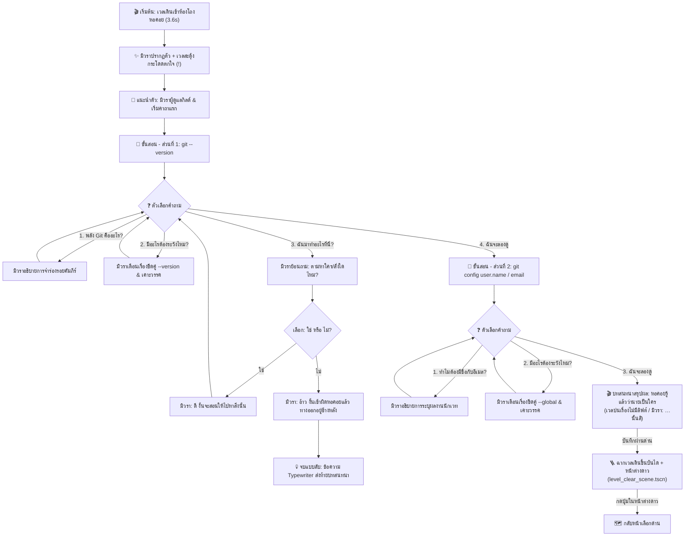
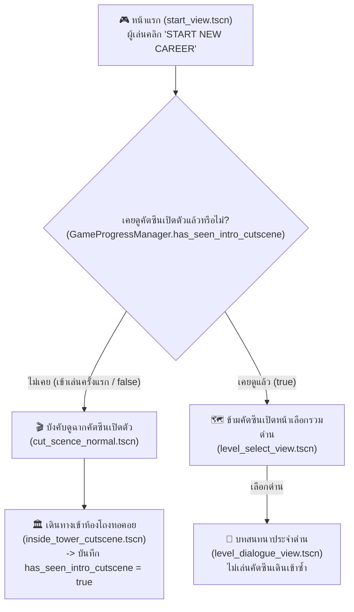

# ด่านที่ 1: ตรวจสอบพลังและประกาศนาม (git --version + git config)

เป้าหมาย: ฉากคัตซีนเปิดตัวบทที่ 1 แนะนำตัวละคร **มิวรา (Mewla)** ผู้ดูแลกิลด์แห่งหอคอยเวท และฝึกฝนคาถาแรกของผู้เล่น (เวล) ในการตรวจสอบพลังเวท (`git --version`) และการประกาศตัวตนจารึกคัมภีร์เวท (`git config`) พร้อมระบบถาม-ตอบแบบมีตัวเลือก (Dialogue Choice System) ภายในกล่องข้อความ และฉากสรุปผลเดินขึ้นบันไดผ่านด่าน

---

## 1. ภาพรวมและโฟลว์การทำงาน (Flow)

---

## 2. ทรัพยากรและ Assets ที่ใช้งาน

| หมวดหมู่ | ไฟล์ Asset | รายละเอียด |
|---|---|---|
| **ฉากหลังหลัก** | `res://assets/cutscene/backgrounds/inside-tower-Sheet.png` | ห้องโถงชั้น 1 หอคอยเวท (1920×1080) |
| **ฉากหลังบันได** | `res://assets/cutscene/backgrounds/central-tower-Sheet.png` | โถงบันไดหินกลางหอคอย สำหรับคัตซีนเดินขึ้นบันได |
| **ตัวละครฝั่งซ้าย (เวล)** | `res://assets/cutscene/characters/vel/` | • `vel_walk_right-Sheet.png` (เดินเข้า/เดินผ่านมิวรา) • `vel_breathe_blink-Sheet.png` (ท่ายืนฟัง) • `vel_shockpng.png` (ท่าตกใจ) • `vel_back.png` (ท่ายืนหันหลังเดินขึ้นบันได) |
| **ตัวละครฝั่งขวา (มิวรา)** | `res://assets/cutscene/characters/mewla/` | • `mewla_idle-Sheet.png` (ยืนฟัง/กระดิกหู) • `mewla_talk-Sheet.png` (ท่าพูด) • `mewla_success-Sheet.png` (ท่าพร้อมลุย) |
| **กรอบข้อความ** | `res://assets/cutscene/frame dialog text/text dialog.png` | กรอบข้อความ 9-slice StyleBoxTexture ขอบมนโทนม่วงเข้มตัดลาเวนเดอร์ (ใช้แสดงทั้งบทพูดและตัวเลือก) |
| **ลูกศรไปต่อ** | `res://assets/cutscene/frame dialog text/arrow.png` | ไอคอนลูกศรพิกเซล ลอยเด้งดึ๋งเมื่อพิมพ์ข้อความเสร็จ |
| **ฟอนต์ข้อความ** | `res://assets/fonts/TA-8-bit.ttf` | ฟอนต์พิกเซล 8-bit (บทพูด 26 px สีขาว, ชื่อผู้พูด 30 px สีทอง/ฟ้า, ช้อยส์ 22 px) |
| **เสียงประกอบ** | `res://assets/audio/` | • `sfx_cat_meow.wav` (เสียงแมวมิวรา) • `sfx_dialogue_next.wav` (เสียงเปลี่ยนข้อความ) • `bgm_tower_loop.wav` (ดนตรีบรรยากาศหอคอย) |

---

## 3. มาตรฐานระบบตัวเลือกและการย้อนกลับข้อความ (Inline Choice & Back Navigation System)

### 3.1 ระบบตัวเลือกคำถามภายในกล่องข้อความเดิม (Inline Choice System)
เพื่อรักษาความสะอาดของหน้าจอ ไม่ให้มีหน้าต่างลอยมาบดบังตัวละคร ระบบช้อยส์ถูกออกแบบให้แสดงผล **อยู่ภายในกล่องข้อความเดิม (`DialogueBox`)**:

1. **เมื่อเข้าสู่โหมดเลือกช้อยส์:**
   * ซ่อนลูกศรไปต่อ (`ContinueArrow`) และล็อกการกด Space/Enter ข้ามบท
   * ซ่อนป้ายชื่อผู้พูด (`SpeakerLabel`) และตัดคำว่า "ตัวเลือก" ออกทั้งหมด เพื่อให้พื้นที่กล่องข้อความสะอาดตา
   * ซ่อนข้อความบทพูด (`DialogueLabel`) และแสดงรายการตัวเลือก (`ChoiceContainer`) เรียงลงมาในแนวตั้ง
   * ตัดตัวเลขลำดับข้างหน้าช้อยส์ออก (`1. `, `2. `, `3. `) แสดงเฉพาะข้อความคำถาม/การกระทำล้วนๆ
2. **การควบคุมและ Interaction:**
   * **สีตัวหนังสือ:** สีขาวปกติ (`Color(0.92, 0.92, 0.94, 0.95)`) เมื่อยังไม่ได้เลือก และปรับเป็น**สีขาวสว่างสดใส (Bright White `Color(2.0, 2.0, 2.0, 1.0)`)** คล้ายลูกศรนำทางเมื่อนำเมาส์ไปชี้หรือเลือกด้วยคีย์บอร์ด (ไม่ใช้สีเหลือง)
   * **แถบสีไฮไลต์ (Hover Strip):** ปรับเป็นโทนสีม่วงนวลโปร่งใส (`Color(0.18, 0.14, 0.28, 0.45)`) นุ่มนวล กลมกลืนกับตัวกล่องข้อความ ไม่เด่นแย่งสายตา
   * **การควบคุม:** รองรับทั้งการคลิกเมาส์, การกดปุ่มลูกศรขึ้น-ลงเพื่อเลื่อนเลือก, และการกดปุ่มตัวเลข `1`, `2`, `3`, `4`
3. **การวนลูป (Looping):**
   * เมื่อคลิกเลือกคำถาม ตัวละครจะคุยอธิบายตอบข้อนั้น
   * เมื่ออธิบายจบประโยค ระบบจะวนกลับมาเปิดกล่องตัวเลือกเดิมใหม่อัตโนมัติ จนกว่าผู้เล่นจะเลือกข้อ "ฉันจะลองดู"

### 3.2 ระบบปุ่มลูกศรควบคุมบทสนทนา ◀ ▶ (Navigation Arrows)
* ใช้ไอคอนลูกศรพิกเซลจาก `arrow.png` หมุน 90 องศาซ้าย-ขวา วางเรียงคู่กันอยู่มุมขวาล่างของกล่องบทสนทนา (`DialogueBox`):
  * **ลูกศรซ้าย `◀` (ย้อนกลับ):** ย้อนกลับไปยังข้อความก่อนหน้า
  * **ลูกศรขวา `▶` (ไปต่อ):** เร่งตัวหนังสือให้เต็มทันที / ไปยังข้อความถัดไป
* **การเคลื่อนไหวและเอฟเฟกต์ (Hover & Press Action Feedback):**
  * **ไม่เด้ง (No Bouncing):** ยกเลิกแอนิเมชันเด้งขึ้น-ลง ลูกศรทั้งสองอยู่นิ่งคงที่สวยงาม
  * **โฮเวอร์เรืองแสง (Hover Brightness):** เมื่อนำเมาส์ไปชี้ (Hover) ลูกศรจะสว่างขึ้นอย่างนุ่มนวล (`modulate = Color(1.4, 1.4, 1.4, 1.0)`) และเมื่อเอาเมาส์ออกจะกลับเป็นสีเดิม
  * **เอฟเฟกต์กดปุ่มตอบสนอง (Action Feedback - Button Sink & White Flash):** เมื่อกดปุ่มไปต่อหรือย้อนกลับ (ไม่ว่าจะผ่านคลิกเมาส์หรือชอร์ตคัตคีย์บอร์ด) ตัวปุ่มจะสว่างวาบสีขาวสดใส (`modulate = Color(2.4, 2.4, 2.4, 1.0)`) และยุบตัวลงเล็กน้อย (`position.y = 2.0`, `scale = 0.90`) จากนั้นคืนตัวกลับอย่างนุ่มนวลภายใน 0.12 วินาที
  * **สถานะปิดใช้งาน (Disabled/Dimmed):** หากอยู่ที่ข้อความแรกสุดที่ย้อนกลับไม่ได้ ลูกศร `◀` จะลดความโปร่งใสลงเป็น 25% (`modulate.a = 0.25`) และเมื่ออยู่ในหน้าเมนูช้อยส์ ลูกศร `▶` จะถูกปิดใช้งานเพื่อให้ผู้เล่นเลือกคำตอบ
* **การแสดงผลข้อความเต็มทันทีเมื่อย้อนกลับ (Immediate Full Text):**
  * เมื่อผู้เล่นกดย้อนกลับ ข้อความในอดีตจะแสดงผลเต็มประโยคทันที (`visible_ratio = 1.0`) **โดยไม่เล่นเอฟเฟกต์พิมพ์ดีด (Typewriter)**
* **การควบคุมและซิงค์ปุ่มคีย์บอร์ด (Keyboard Synchronization):**
  * **กดย้อนกลับ (◀):** รองรับปุ่มลูกศรซ้าย `Left Arrow` และปุ่ม `Backspace`
  * **กดไปข้างหน้า (▶):** รองรับปุ่ม `Spacebar`, `Enter`, `Numpad Enter`, ลูกศรขวา `Right Arrow`, แอ็กชัน `ui_accept` หรือคลิกเมาส์ซ้ายบนกล่องข้อความ
* **พฤติกรรมการกดปุ่มข้าม (Skip Button Pipeline):**
  * ช่วงคัตซีนเดินเข้าห้องโถง (ก่อนบทนำ 5 ประโยคจบ): ข้ามแอนิเมชันทั้งหมด แล้วเริ่มบทเรียนส่วนที่ 1 ทันที
  * ช่วงบทเรียนส่วนที่ 1: ข้ามไปบทเรียนส่วนที่ 2 ทันที (ปลายทางเดียวกับการเลือก "ฉันจะลองดู")
  * ช่วงบทเรียนส่วนที่ 2: ข้ามไปบทสนทนาสรุปผลทันที
  * ช่วงบทสนทนาสรุปผล (Outro): จบด่าน บันทึกว่าผ่านด่าน แล้วเฟดดำไปฉากเวลเดินขึ้นบันได (`level_clear_scene.tscn`) ซึ่งเปิดหน้าต่างดาวต่อ และปุ่มในหน้าต่างดาวพากลับหน้าเลือกด่าน
  * ด่านที่ยังไม่มีไฟล์ข้อมูล (fallback): กลับหน้าเลือกด่านโดยไม่บันทึกว่าผ่านด่าน
* **การย้อนกลับข้ามช่วงบทนำ:** เมื่อบทนำ 5 ประโยคจบ ระบบบันทึก history ขณะยังอยู่ในโหมดคัตซีน กดย้อนกลับจากบทเรียนประโยคแรกไปยัง "มาเริ่มคาถาแรกกัน" แล้วกดไปต่อ จะกลับเข้าบทเรียนตามปกติ

---

## 4. บทสนทนาฉบับเต็มของด่านที่ 1 (Complete Dialogue Script)

### บทนำ (คัตซีนเปิดตัว - inside_tower_cutscene.tscn)
1. **มิวรา:** "ยินดีต้อนรับสู่กิลด์แห่งหอคอยเวท"
2. **เวล:** "เธอคือ..." *(ไอคอน ?)*
3. **มิวรา:** "“แมวไง เห็นก็รู้ปะ” ฉันมิวรา ผู้ดูแลกิลด์ และเป็นคนที่จะสอนนายตั้งแต่พื้นฐาน" *(เสียงแมวเหมียว)*
4. **มิวรา:** "ก่อนเข้าสู่บททดสอบของหอคอย นายต้องตรวจสอบว่าพลังเวทของตัวเองพร้อมใช้งานหรือยัง"
5. **มิวรา:** "มาเริ่มคาถาแรกกัน"

> [!NOTE]
> **การเล่นต่อเนื่องในซีนเดียว (Single Scene Pipeline):**
> ทั้งคัตซีนเปิดตัวและการสอนด่านที่ 1 ทำงานอยู่บนซีนเดียวกัน 100% โดย**ไม่มีการสลับฉากข้าม Scene (Zero Scene Change)**
> - ไม่หลุดความเร็ว Fast-Forward (`x2` / `2.5x`): ปุ่มเร่งความเร็วจะทำงานต่อเนื่องตลอดทั้งฉาก
> - ฉากหลัง (`inside-tower-Sheet.png`) ไม่ถูกรีเซ็ต: ลูปไฟคบเพลิงเล่นต่อเนื่องไร้รอยต่อ
> - ตัวละครเวลและมิวราคงอยู่บนเวทีต่อเนื่อง ไม่ถูกทำลายและเกิดใหม่
> - เมื่อจบบทสนทนาข้อ 5 ตัวเกมจะไหลเข้าสู่บทสอนด่าน 1 (ข้อ 1 "ร่ายคาถานี้ดู") ในกล่องข้อความเดิมทันที

---

### ด่านที่ 1 (ตัวเกมบทสนทนา - level_dialogue_view.tscn)

#### ขั้นสอน - ส่วนที่ 1: ตรวจสอบพลังเวท (`git --version`)
1. **มิวรา:** "ร่ายคาถานี้ดู"
2. **มิวรา:** "`git --version`"
3. **เวล:** "แค่นี้เอง?" *(ไอคอน ?)*
4. **มิวรา:** "ถ้าพลัง Git ถูกปลุกไว้แล้ว คาถานี้จะแสดงระดับพลังตอบกลับมาเอง ใช้สำหรับเช็กว่าพลัง Git พร้อมไหม"
5. **เวล:** "เข้าใจแล้ว"

#### ตัวเลือกคำถาม:
* **ข้อ 1: พลัง Git คืออะไร?**
  * เวล: "พลัง Git คืออะไรกันแน่?" *(ไอคอน ?)*
  * มิวรา: "Git คือพลังที่ใช้บันทึกการเปลี่ยนแปลงของคัมภีร์เวทส่วนตัว"
  * มิวรา: "ทุกครั้งที่นายแก้ไขหรือจารึกอะไรลงไป Git จะจดจำร่องรอยเหล่านั้นเอาไว้"
  * มิวรา: "ต่อให้เวลาผ่านไป นายก็ยังย้อนกลับไปดูอดีตของคัมภีร์เวทส่วนตัวได้"
  * *(วนกลับไปหน้าคำถามใหม่)*
* **ข้อ 2: มีอะไรต้องระวังเป็นพิเศษไหมตอนร่ายคาถา?**
  * เวล: "มีอะไรต้องระวังเป็นพิเศษไหม?" *(ไอคอน ?)*
  * มิวรา: "มี"
  * เวล: "หืม?" *(ไอคอน ?)*
  * มิวรา: "อักขระหน้าคำว่า version ต้องเป็นขีดคู่"
  * มิวรา: "`--version` ไม่ใช่ `-version` และ `git --version` ต้องเว้นวรรคระหว่าง `git` กับ `--version` ด้วย"
  * มิวรา: "ศิษย์ฝึกหัดหลายคนพลาดตรงนี้ อักขระเวทละเอียดกว่าที่คิด"
  * มิวรา: "ผิดเพียงตัวเดียว คาถาอาจไม่ตอบสนอง"
  * เวล: "เข้าใจแล้ว"
  * มิวรา: "ดี…ก่อนร่ายคาถา ตรวจสอบอักขระให้ครบทุกครั้ง"
  * *(วนกลับไปหน้าคำถามใหม่)*
* **ข้อ 3: ฉันมาทำอะไรที่นี่?**
  * เวล: "ฉันมาทำอะไรที่นี่กันแน่?" *(ไอคอน ?)*
  * มิวรา: "ฉันจะไปรู้เหรอ"
  * เวล: "..."
  * มิวรา: "นายเดินเข้ามาเองนะ ถ้างั้นฉันถามกลับ"
  * มิวรา: "นายมาที่นี่เพื่อตามหาใครหรือสิ่งใดหรือเปล่า?"
  * **[ตัวเลือกย่อย: ใช่ / ไม่]**
    * **ถ้าเลือก "ใช่":**
      * มิวรา: "ดี"
      * มิวรา: "งั้นฉันจะสอนนายให้ไปหาสิ่ง ๆ นั้นเอง"
      * มิวรา: "เริ่มจากคาถาบทแรกกัน"
      * *(วนกลับไปหน้าคำถามใหม่)*
    * **ถ้าเลือก "ไม่":**
      * มิวรา: "อ้าว…งั้นนายเข้าผิดหอคอยแล้ว"
      * มิวรา: "ทางออกอยู่ด้านหลัง ขอให้โชคดี"
      * *(จบด่านแบบลับ ขึ้นหน้าจอดำ "ขอบคุณที่เล่น (เข้าผิดหอคอย)" พร้อมปุ่มกลับหน้าหลัก)*
* **ข้อ 4: ฉันจะลองดู**
  * *(ด่าน 1 ยังไม่มีหน้าเล่นจริง จึงเล่นบทเรียนส่วนที่ 2 ต่อทันที)*

---

### ขั้นสอน - ส่วนที่ 2: ประกาศตัวตนจารึกคัมภีร์ (`git config`)
11. **มิวรา:** "ดีมาก นายผ่านบททดสอบแรกแล้ว"
12. **เวล:** "ง่ายกว่าที่คิดนะ"
13. **มิวรา:** "เพราะนี่เป็นแค่จุดเริ่มต้น... ต่อไป นายต้องลงทะเบียนตัวตนของนักเวทกับสำนักเวทเสียก่อน"
14. **เวล:** "ทำไมต้องลงทะเบียนด้วย?" *(ไอคอน ?)*
15. **มิวรา:** "เพราะต่อจากนี้นายจะได้เริ่มรวบรวมและจารึก 'เศษคัมภีร์' ลงในคัมภีร์เวทส่วนตัวของนาย"
16. **เวล:** "เศษคัมภีร์?" *(ไอคอน ?)*
17. **มิวรา:** "เศษคัมภีร์คือชิ้นส่วนขององค์ความรู้ที่เคยอยู่ในคัมภีร์เวทต้นกำเนิด หลังจากคัมภีร์เวทต้นกำเนิดแตกสลาย เศษคัมภีร์เหล่านั้นก็กระจัดกระจายไปทั่วหอคอย"
18. **มิวรา:** "บางชิ้นอาจบันทึกความรู้พื้นฐาน บางชิ้นอาจบันทึกคาถาหรืออักขระสำคัญ และบางชิ้นอาจเป็นกุญแจสำคัญที่นำไปสู่ความจริงเกี่ยวกับการหายตัวไปของปรมาจารย์"
19. **มิวรา:** "แต่ทุกครั้งที่นายจารึกการเปลี่ยนแปลงลงในคัมภีร์เวทส่วนตัว สำนักเวทต้องรู้ก่อนว่าเจ้าของการจารึกคือใคร ไม่อย่างนั้นต่อให้จารึกเศษคัมภีร์ดีแค่ไหน ก็ไม่มีใครรู้ว่าใครเป็นคนจารึก"
20. **เวล:** "งั้นฉันต้องทำยังไง"
21. **มิวรา:** "ประกาศตัวตนของนายให้สำนักเวทรู้ซะ... มาเริ่มคาถาบทต่อไปกัน"
22. **มิวรา:** "ร่ายคาถานี้เพื่อประกาศนามของนาย:\n`git config --global user.name \"ชื่อของนาย\"`"
23. **มิวรา:** "แล้วตามด้วยการผูกตราประทับวิญญาณ:\n`git config --global user.email \"อีเมลของนาย\"`"
24. **เวล:** "คาถาสองบท?" *(ไอคอน ?)*
25. **มิวรา:** "ใช่ บทแรกใช้ตั้งชื่อ บทที่สองใช้ผูกอีเมล"
26. **มิวรา:** "แต่ถ้านายอยากตรวจสอบว่าหอคอยจดจำชื่อนายไว้หรือยัง ให้ลองร่ายคาถาเดิมแต่ **ไม่ต้องใส่ชื่อต่อท้าย** ดูสิ (`git config --global user.name`)"
27. **เวล:** "แล้วถ้ายังไม่เคยลงทะเบียนล่ะ" *(ไอคอน ?)*
28. **มิวรา:** "คาถาจะไม่ตอบกลับอะไรเลย... นั่นหมายความว่านายต้องรีบประกาศนามเดี๋ยวนี้!"

#### ตัวเลือกคำถาม:
* **ข้อ 1: ทำไมต้องมีชื่อกับอีเมล?**
  * เวล: "ทำไมต้องมีทั้งชื่อและอีเมลด้วย?" *(ไอคอน ?)*
  * มิวรา: "เพราะทุกการจารึกต้องระบุว่าเป็นผลงานของนักเวทคนไหน"
  * มิวรา: "ชื่อใช้แสดงตัวตน"
  * มิวรา: "ส่วนอีเมลใช้เชื่อมข้อมูลการจารึกเข้ากับตัวตนของนาย"
  * มิวรา: "เมื่อย้อนดูประวัติของคัมภีร์เวทส่วนตัว นายจะรู้ได้ว่าใครเป็นคนจารึกสิ่งนั้น"
  * *(วนกลับไปหน้าคำถามใหม่)*
* **ข้อ 2: มีอะไรต้องระวังตอนร่ายคาถา?**
  * เวล: "มีอะไรต้องระวังไหม?" *(ไอคอน ?)*
  * มิวรา: "มี"
  * มิวรา: "อักขระ `--global` ต้องเป็นขีดคู่"
  * มิวรา: "และต้องเว้นวรรคระหว่าง `git`, `config`, `--global` และคำสั่งที่ตามมา"
  * มิวรา: "ถ้าอักขระผิด คาถาอาจไม่ทำงานตามที่ตั้งใจ"
  * เวล: "เข้าใจแล้ว"
  * มิวรา: "ดี…นักเวทที่ร่ายคาถาแม่น มักเริ่มจากการพิมพ์ให้แม่นก่อน"
  * *(วนกลับไปหน้าคำถามใหม่)*
* **ข้อ 3: ฉันจะลองดู**
  * *(ด่าน 1 ยังไม่มีหน้าเล่นจริง จึงเล่นบทสนทนาสรุปผลต่อทันที แล้วไปฉากเดินขึ้นบันไดและหน้าต่างดาว)*

---

### สรุปผลหลังผ่านด่าน 1 (Outro)
29. **มิวรา:** "ดีมาก ตอนนี้หอคอยรู้แล้วว่านายเป็นใคร"
30. **เวล:** "แปลว่าพร้อมสำหรับการจารึกแล้ว?" *(ไอคอน ?)*
31. **มิวรา:** "เกือบ... ตัวตนของนักเวทน่ะพร้อมแล้ว"
32. **มิวรา:** "ต่อไป เราจะไปสร้าง 'คัมภีร์เวทส่วนตัว' เล่มแรกของนายกัน... ไปชั้นถัดไปกันเถอะ"
33. **เวล:** "...ทำไมหอคอยถึงไม่มีลิฟต์บ้างเนอะ เหนื่อย"
34. **มิวรา:** "…นั้นสิ"

> [!NOTE]
> **การจบด่านที่ 1:**
> หลังบทสนทนาสรุปผลระหว่างเวลกับมิวรา เกมจะเฟดดำไปฉากเวลเดินขึ้นบันได (`res://features/cutscene/level_clear_scene.tscn`) เมื่อเดินพ้นจอจะเปิดหน้าต่างสรุปดาว (`level_clear_modal.tscn`) ขึ้นมาเอง ปุ่มในหน้าต่างพาเล่นซ้ำหรือกลับหน้าเลือกด่าน (กด Esc ก็กลับหน้าเลือกด่าน)

---

## 5. หน้าต่างสรุปผลผ่านด่านและหน้ารวมด่าน (Level Clear & Level Select)

> [!IMPORTANT]
> **สถานะการพัฒนาของหน้าเลือกด่านและหน้าสรุปดาว (Mockup & Flow Integration Only):**
> * **หน้าเลือกรวมด่าน (`level_select_view.tscn`) และหน้าแสดงดาวสรุปผล (`level_clear_modal.tscn`) ในปัจจุบันจัดทำขึ้นเป็น "โครงสร้างจำลอง (Mockup UI)" เท่านั้น** เพื่อให้ตัวเกมดูครบถ้วนและเห็นภาพรวมโฟลว์การทำงาน แต่ยังไม่ได้เปิดใช้งานระบบคำนวณคะแนน/ดาวจริง โดยทำขึ้นและเชื่อมต่อไว้ก่อนเฉยๆ เพื่อจุดประสงค์ดังนี้:
>   1. **หน้าเลือกรวมด่าน:** ทำไว้เพื่อให้สามารถคลิกสลับหน้าจอไป-มาระหว่างด่านและเมนูหลักได้ง่าย ไม่ต้องเปิดปิดเกมใหม่
>   2. **หน้าแสดงดาวสรุปผล:** ทำขึ้นมาเพื่อตรวจสอบการทำงานและโฟลว์หลังจบด่านของเกมเฉยๆ เผื่อมีเพื่อนหรือทีมงานมาตรวจงานแล้วจะได้ทราบว่าระบบคิดคะแนน/บันทึกดาวยังไม่ได้เปิดใช้งานจริง

### 5.1 หน้าต่างสรุปผลผ่านด่าน (Success Modal - `level_clear_modal.tscn`)
* แสดงเมื่อจบบทสนทนาด่านที่ 1 (ประโยค "มิวรา: …นั้นสิ") หรือเมื่อกดข้ามในช่วง Outro
* **โครงสร้าง UI:**
  * หัวข้อ: `"ด่านที่ N : <คำสั่ง>"` ตามด่านที่เพิ่งเล่น (ดึงจาก `commands[0]` ในไฟล์ข้อมูลด่านผ่าน `LevelDataLoader`) พร้อมผลดาว ⭐ ⭐ ★
  * ตารางคะแนนจำลอง (คะแนนรอบนี้, สถิติสูงสุดเดิม, คะแนนสะสม, รางวัลที่ได้รับ) — ยังเป็นค่าตายตัว
  * กล่องบันทึกคัมภีร์เวท: `บันทึกคัมภีร์เวทประจำด่านที่ N` พร้อมไอคอนคัมภีร์เวท SVG และข้อความสรุปจากฟิลด์ `clear_keyword` ในไฟล์ข้อมูลด่าน (ด่าน 1: `git --version เพื่อเช็กความพร้อมของ Git และ git config เพื่อตั้งชื่อกับอีเมลผู้สร้างงาน`)
* **ปุ่มควบคุม 3 ปุ่ม (บังคับคลิกเมาส์เท่านั้น ไม่ใช้ Space/Enter):**
  * ปิดการใช้งานปุ่ม Spacebar และ Enter บนหน้านี้ทั้งหมด เพื่อป้องกันการกดพลาด และให้ผู้เล่นใช้การคลิกเมาส์เพื่อเลือกการกระทำ
  1. **เล่นอีกครั้ง (Replay):** เริ่มเล่นด่านเดิมใหม่อีกครั้งที่ `level_dialogue_view.tscn` (ไม่เล่นคัตซีนเดินเข้าห้องโถงซ้ำ)
  2. **กลับไปหน้าเลือกด่าน (Level Select):** เปิดหน้าเลือกรวมด่าน (`level_select_view.tscn`)
  3. **ด่านต่อไป (Next Level):** สลับไปยังหน้าเลือกรวมด่าน

### 5.2 หน้าต่างเลือกรวมด่าน (Level Select Screen - `level_select_view.tscn`)
* หน้าต่าง `Level` สไตล์หน้าต่างระบบ มีปุ่มย่อ ขยาย และปุ่มปิด `✕` (กดปิดจะกลับสู่หน้าหลัก `start_view.tscn`)
* หัวข้อภายใน: `"Select Level"` พร้อมเส้นคั่นแนวนอน
* แสดงการ์ดด่าน 15 ด่านในรูปแบบ Grid (3 แถว × 5 คอลัมน์) ตามสถานะความสำเร็จของผู้เล่น:
  * **การ์ดสีเขียว (เฉพาะด่านที่เล่นสำเร็จแล้วเท่านั้น):** เมื่อผู้เล่นเล่นผ่านด่านนั้นสำเร็จ ระบบจะบันทึกสถานะลงใน `user://game_progress.cfg` และการ์ดจะเปลี่ยนเป็นสีเขียวสดใส แสดงชื่อด่าน คีย์เวิร์ดคำสั่ง และดาวทอง ⭐⭐⭐ สามารถคลิกเพื่อเล่นซ้ำได้
  * **การ์ดสีเทา (ด่านที่ยังเล่นไม่ผ่าน):**
    * *ด่านที่พร้อมให้เข้าเล่น (เช่น ด่านที่ 1 ในปัจจุบันที่ยังเล่นไม่ผ่าน):* แสดงเป็นการ์ดสีเทาพร้อมชื่อด่านและคำสั่ง สามารถคลิกเพื่อเข้าเล่นด่านได้ตามปกติ
    * *ด่านที่ยังไม่เปิด / ยังไม่มีไฟล์ (ด่านที่ 2–15):* แสดงเป็นการ์ดสีเทาเปล่า ปิดการคลิก เพื่อคงโครงสร้างหน้าต่าง 15 ด่านตาม Mockup
  * **Dynamic Level Detection:** ตรวจจับไฟล์ `level_%02d.gd` อัตโนมัติผ่าน `LevelDataLoader.has_level()` เมื่อมีการสร้างด่านใหม่ในอนาคต จะสามารถเข้าเล่นได้ทันที และจะเปลี่ยนเป็นสีเขียวเมื่อเล่นผ่านสำเร็จ
  * **การปลดล็อกตามลำดับ:** ด่านที่ N เล่นได้เมื่อมีไฟล์ข้อมูล และผ่านด่านที่ N−1 แล้ว (หรือเคยผ่านด่านนั้นเอง) ด่านที่ไม่มีไฟล์ข้อมูลกดเล่นไม่ได้แม้จะเคยบันทึกว่าผ่านแล้ว
  * **ปลายทางเมื่อกดการ์ด:** เปิด `level_dialogue_view.tscn` โดยตรง (ไม่ผ่าน `inside_tower_cutscene.tscn`) คัตซีนเดินเข้าห้องโถงและบทนำพบมิวราจึงเล่นเฉพาะครั้งแรกในโฟลว์เปิดตัวเกมเท่านั้น

---

## 6. ระบบบันทึกสถานะผู้เล่นและการเริ่มเกม (Game Progress & Start Flow)

### 6.1 แผนภาพการตัดสินใจเมื่อกดปุ่มเริ่มเกม (Start Game Flow)

### 6.2 ตัวจัดการสถานะ (`game/common/game_progress_manager.gd`)
* ใช้คลาส `GameProgressManager` บันทึกสถานะผู้เล่นลงในไฟล์คอนฟิก `user://game_progress.cfg`
* ค่าที่บันทึก: `[progress] has_seen_intro_cutscene = bool` และ `[levels_cleared] level_N = bool`
* **ฟังก์ชันการทำงาน:**
  * `has_seen_intro_cutscene() -> bool`: ตรวจสอบว่าผู้เล่นเคยดูคัตซีนเปิดตัวแล้วหรือไม่ (คืนค่า `true` หากเคยดูแล้ว, `false` หากยังไม่เคย)
  * `set_intro_cutscene_seen(seen: bool = true) -> void`: บันทึกว่าผู้เล่นได้ดูคัตซีนเปิดตัวแล้ว (เรียกใช้อัตโนมัติเมื่อเดินทางเข้าห้องโถงหอคอยใน `inside_tower_cutscene.gd`)
  * `reset_progress() -> void`: ล้างสถานะเพื่อทดสอบใหม่
* **ป้องกันไฟล์เซฟเสีย:** ถ้าโหลด `game_progress.cfg` ไม่สำเร็จ (เช่น ไฟล์เสียหรือ parse ไม่ผ่าน) ระบบจะคัดลอกไฟล์เดิมไว้เป็น `game_progress.cfg.corrupt.bak` และแจ้งเตือนก่อนเริ่มด้วยค่าว่าง เพื่อไม่ให้การบันทึกครั้งถัดไปเขียนทับความคืบหน้าจนหาย

### 6.3 เงื่อนไขการกด START NEW CAREER ในหน้าเมนูหลัก (`start_view_controller.gd`)
* **ผู้เล่นใหม่ (ยังไม่เคยดูคัตซีน):**
  * เมื่อกด `START NEW CAREER` ระบบจะเริ่มเล่นฉากคัตซีนเปิดตัว (`cut_scence_normal.tscn`) บังคับให้ผู้เล่นรับชมเนื้อเรื่องเปิดตัวเกม
* **ผู้เล่นเดิม (เคยดูคัตซีนแล้ว):**
  * เมื่อกด `START NEW CAREER` ระบบจะข้ามฉากคัตซีนเปิดตัวทั้งหมด และนำทางผู้เล่นไปยังหน้าต่างเลือกรวมด่าน (`level_select_view.tscn`) ทันที เพื่อความรวดเร็วและต่อเนื่องในการเล่น
* **คำสั่งช่วยเหลือผ่าน Terminal ในหน้าเริ่มเกม (สำหรับ Dev & QA):**
  * พิมพ์ `reset` หรือ `reset progress`: รีเซ็ตสถานะกลับเป็นผู้เล่นใหม่ สำหรับทดสอบฉากคัตซีนเปิดตัวซ้ำ
  * พิมพ์ `level`: สลับไปหน้าต่างเลือกรวมด่านโดยตรง

### 6.4 การยกเลิกตัวแปร static ข้าม Scene และปรับใช้ In-Scene Modal Presentation
* **ยกเลิกการใช้ `static var` ข้ามซีนทั้งหมด:**
  * นำ `static var start_phase` ออกจาก `level_dialogue_view.gd`
  * นำ `static var current_step` และ `static var return_scene_path` ออกจาก `gameplay_placeholder_view.gd`
  * ตัดการ `load()` ข้ามสคริปต์เพื่อเซ็ตค่า static ซึ่งทำให้เกิด Circular Coupling
* **ช่วงเล่นของด่าน (`open_gameplay`) เล่นต่อในฉากเดิม:**
  * ด่าน 1 ยังไม่มีหน้าเล่นจริง เมื่อถึงขั้นตอน `open_gameplay` (ขั้นที่ 1 หรือ 2) หรือกดปุ่มข้าม บทสนทนาจะเล่นช่วงถัดไปต่อในซีนเดิมทันที ไม่สลับฉาก
  * ล้างประวัติย้อนกลับเมื่อขึ้นช่วงใหม่ ปุ่มย้อนกลับจึงไม่พากลับไปที่รายการ `open_gameplay` แล้ววนกลับมาที่เดิม
  * ลบ `gameplay_placeholder_view` และ API ส่งผ่านขั้นตอน (`gameplay_step` / `pending_dialogue_phase`) ใน `GameProgressManager` ที่ไม่มีใครใช้แล้ว

### 6.5 การโหลดฉากล่วงหน้าแบบ Background Threaded Loading
* **ปัญหาเดิม:** ซีนขนาดใหญ่ (เช่น `sandbox_game_view.tscn` ใช้เวลาโหลด ~586 ms) ทำให้การสลับฉากหยุดชะงัก เกิดอาการค้างหน้าเดิมหรือค้างที่จอดำ
* **โซลูชัน Background Threaded Loading (`game/common/scene_loader.gd`):**
  1. ฉากต้นทางเรียก `SceneLoader.request_preload(path)` ใน `_ready()` เพื่อโหลดฉากปลายทางในแรมเงียบ ๆ ผ่าน Background Thread
     * ถ้าไฟล์นั้นกำลังโหลดอยู่หรือโหลดเสร็จรอใช้งานอยู่แล้ว จะไม่ส่ง request ซ้ำ ป้องกัน request ค้างสะสมในหน่วยความจำเมื่อเข้าฉากเดิมหลายรอบ
  2. ตอนเปลี่ยนฉากเรียก `SceneLoader.change_scene(get_tree(), path)` ซึ่งดึงผลจาก `load_threaded_get` (ใช้เวลา ~0 ms) ถ้าไม่มีผลที่โหลดไว้จะ `load()` แบบปกติแทน
  3. สลับฉากด้วย `change_scene_to_packed()` ได้ทันทีแบบไร้รอยต่อ
  * จุดที่ใช้: `level_dialogue_view.gd` (โหลดหน้าเลือกด่านรอไว้), `central_tower_cutscene.gd`, `start_view_controller.gd` (ปุ่ม GIT SANDBOX) และ `sandbox_game_view.gd` (โหลดฉากที่ปุ่มออกจะพากลับไป)
  4. **ผลลัพธ์:** สลับฉากทันทีโดยไม่ต้องรอดิสก์ I/O และไม่มีอาการจอดำค้าง

### 6.6 Sandbox แบบเล่นอิสระ (ไม่มีภารกิจ)
* Sandbox เป็นห้องทดลองคำสั่ง git เปล่า ๆ ไม่มีเป้าหมาย ไม่มี checklist และไม่มีการตรวจผ่าน/ไม่ผ่าน และบทสนทนาด่าน 1 ไม่พาเข้า Sandbox แล้ว
* เข้าได้จากปุ่ม **GIT SANDBOX 🧪** หน้าแรก (หรือพิมพ์ `sandbox` ใน terminal หน้าแรก) ปุ่มขวาบนจะเป็น **กลับหน้าแรก** ส่วนด่านที่ยังไม่มีข้อมูลบทสนทนาซึ่งหน้าเลือกด่านเปิด Sandbox ให้ ปุ่มจะเป็น **กลับหน้าเลือกด่าน** (ตั้งผ่าน `GameProgressManager.set_sandbox_return_scene()`)
* ออกจาก Sandbox ทางใดก็ตาม ระบบจะรีเซ็ตฉากปลายทางกลับเป็นค่าเริ่มต้น (หน้าเลือกด่าน) ใน `_exit_tree`
